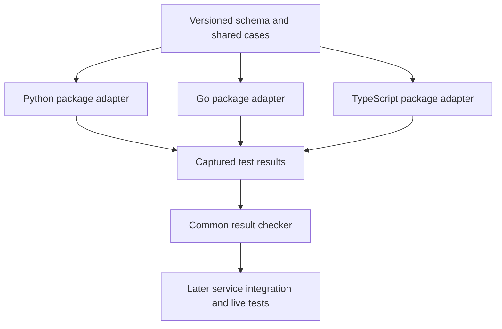
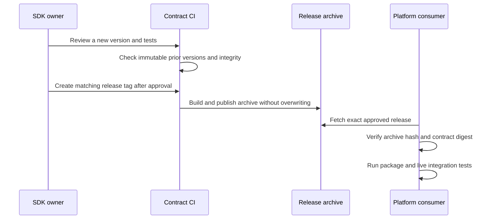

# Shared log-correlation contract

One versioned schema and one set of examples for every language package.



| Delivered here | Separate follow-up |
|---|---|
| Unchanged `1.0.0-rc.1` schema, 29 record cases, 10 context cases | Shared logging packages and automatic enrichment |
| Common adapter-result protocol and checker | Production service integration and deployed package inventory |
| Digest checks, immutable-version CI and reproducible release archive | Package publication and platform consumption cutover |

- `versions/<version>/` is append-only after merge, including release candidates. Never edit or delete an existing version; create a successor.
- This candidate preserves the exact schema/vector bytes accepted in platform issue #795. Moving ownership does not change the contract or promote it to stable `1.0.0`.
- The SHA-256 is `e514c4411aaf93e1a83c662c8e6b4dfdd99772b6d1c89ed7b586d475993a2274`.
- Compute it by hashing each filename, a NUL byte, and the original bytes, in manifest order. Per-file hashes also appear in the manifest.
- A matching hash proves content identity, not author approval. Consumers pin the reviewed repository/tag or commit **and** digest in their own trusted policy.

## Fields and profiles

| Profile | Required fields | Use |
|---|---|---|
| `common` | timestamp, level, service, region, message | Independent system logs |
| `correlated` | Common fields + trace_id | Request/job-associated logs |
| `lifecycle` | Correlated fields + event, outcome | Start/completion/failure events |

- Custom fields are allowed. They cannot override the common fields or exceed the record budget.
- Profile is chosen by the test scenario, never by the producer being tested.
- Timestamps are signed-64-bit-range, nonnegative integer nanoseconds. JavaScript adapters need lossless JSON handling; `JSON.parse` can round these integers. Do not silently convert timestamps to floats or strings.
- Message limit: 1,024 UTF-8 bytes. Compact record limit: 4,096 UTF-8 bytes. Reject non-finite numbers. Follow the schema's `x-semantic-checks` as well as JSON Schema rules.
- Schema-valid records do not prove that requests propagate context or that a service has installed a shared package.

## Run the checks

Python 3.11+ standard library only. No package installation, cluster access or credentials.

```bash
python3 -m unittest discover -s contracts/log-correlation/tests -v

python3 contracts/log-correlation/check_contract.py verify \
  --version 1.0.0-rc.1 \
  --expected-digest e514c4411aaf93e1a83c662c8e6b4dfdd99772b6d1c89ed7b586d475993a2274

python3 contracts/log-correlation/check_contract.py immutable --base origin/main
```

`verify` checks integrity and case structure. It does **not** claim that a language implementation passed those cases.

## Language adapter protocol — version 1

Each language's package tests consume the same immutable vector file and execute its **actual installed package**. Capture observed results, then run the shared checker. An adapter that copies expected results is not valid implementation evidence.

| Case kind | Adapter must execute | Result fields |
|---|---|---|
| `record` | Validate the provided record with the scenario-selected profile, including semantic checks | kind, id, errors |
| `context` | Start with no active context; extract/reset according to the trusted boundary; enter scope; inject outgoing context; leave scope | kind, id, trace_id, outgoing_traceparent, after_trace_id |

- `errors` is the sorted list of stable error codes, exactly matching the case expectation. Never include raw log messages or secrets in the result.
- Each case appears exactly once. Missing, duplicate, unknown or skipped cases fail.
- Context tests use the conservative, unsampled #795 test profile: outgoing flags `00`; no baggage. This does not require disabling existing production tracing or sampling.
- Trusted valid input preserves its trace ID. Other cases create fresh, nonzero, unique trace IDs. Outgoing traceparent must be valid and agree with the active trace ID. After leaving scope, `after_trace_id` is null.
- These cases check basic propagation and cleanup. Concurrent isolation, exceptions, async jobs/retries and live collection still require package/service-specific tests.

Example result envelope (the real file must contain **all 39 results**):

```json
{
  "adapter_protocol": 1,
  "contract_version": "1.0.0-rc.1",
  "contract_sha256": "e514c4411aaf93e1a83c662c8e6b4dfdd99772b6d1c89ed7b586d475993a2274",
  "results": [
    {"kind": "record", "id": "system_without_context", "errors": []},
    {
      "kind": "context", "id": "public_missing",
      "trace_id": "aaaaaaaaaaaaaaaaaaaaaaaaaaaaaaaa",
      "outgoing_traceparent": "00-aaaaaaaaaaaaaaaaaaaaaaaaaaaaaaaa-bbbbbbbbbbbbbbbb-00",
      "after_trace_id": null
    }
  ]
}
```

```bash
python3 contracts/log-correlation/check_contract.py check-results \
  --version 1.0.0-rc.1 \
  --expected-digest e514c4411aaf93e1a83c662c8e6b4dfdd99772b6d1c89ed7b586d475993a2274 \
  --results /path/to/package-test-results.json
```

- Exit 0: every reported result agrees with the contract. Exit 1: integrity, coverage or result mismatch. CLI usage errors exit 2.
- Input is bounded to 1 MiB/file and 500 cases/kind. Duplicate JSON keys and non-finite JSON numbers fail.
- Reports expose fixed failure codes only. No remote calls, subprocess adapter execution or runtime logging hooks.
- Review package tests to verify results come from actual APIs. This checker cannot authenticate the producer or prove package installation.

## Release and consumption



- Tag format: `log-correlation-v<version>`. Tag publication is an explicit owner action; this PR does not publish a release.
- The dedicated workflow verifies the tagged commit belongs to main, tests the tools, builds the archive and refuses to overwrite an existing release.
- Archive: schema, vectors, manifest, this guide, the design/validation report and the standalone checker. `SHA256SUMS` pins the complete archive, including checker code. Contract digest pins schema/vector bytes independently.
- Build locally into a new output path; an existing file is never overwritten:

```bash
python3 contracts/log-correlation/check_contract.py build \
  --version 1.0.0-rc.1 \
  --expected-digest e514c4411aaf93e1a83c662c8e6b4dfdd99772b6d1c89ed7b586d475993a2274 \
  --output /tmp/log-correlation-1.0.0-rc.1.tar.gz
```

| Migration stage | Authority and validation |
|---|---|
| This PR | SDK becomes the canonical authoring location after merge; original platform bytes remain a frozen compatibility snapshot |
| Owner release | Publish reviewed archive; record exact tag/commit, archive checksum and contract digest |
| Platform follow-up PR | Consume that pinned artifact in CI/build; verify byte parity, then remove editable schema/vector ownership from platform |
| Language packages | Pin contract identity, execute shared cases, expose package version separately |
| Service adoption | Pin installed packages and image digests; prove actual context propagation and Loki lookup |

- Do not delete the platform snapshot before a published artifact and a validated consumer path exist.
- Do not add a mutable `latest` download or require a runtime network fetch.
- Retain old releases for rollback; never republish different bytes under an old tag. Administrative tag/release protection and mandatory CI are repository-owner settings, not established by source code alone.
- Review details: [design and validation](design-and-validation.md).

## Live validation handoff

- Existing platform procedure: [raw log-correlation tests](https://github.com/onenexus-team/one-nexus-ai-platform/blob/main/platforms/mlops/backend/tests/raw_tests/observability/RUNNING.md).
- Run that lane after a follow-up changes an actual logging package, service or collection path. Keep isolated test workloads and their cleanup in the platform repository.
- This contract-only PR does not change the deployed path, so it does not rerun or claim new live-cluster evidence.
