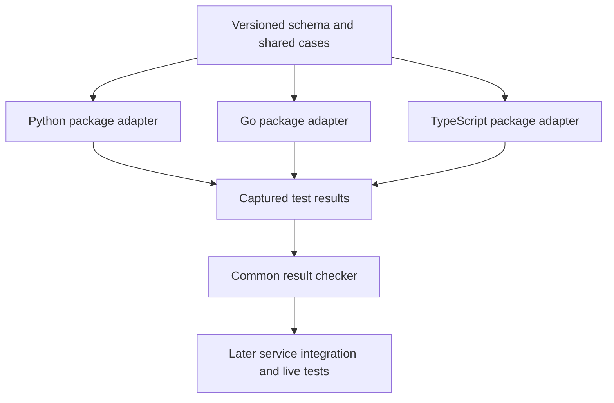
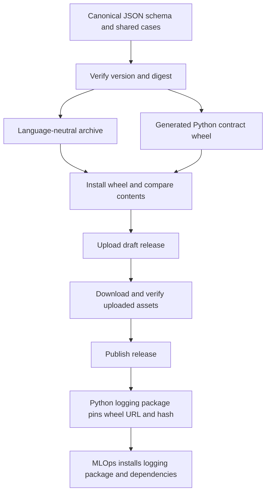

# Shared log-correlation contract

One versioned schema and one set of examples for every language package.



| Delivered here | Separate follow-up |
|---|---|
| Current `0.3.2` schema, 56 record cases, 10 context cases | Shared logging packages and automatic enrichment |
| Common adapter-result protocol and checker | Production service integration and deployed package inventory |
| Digest checks, release archive and generated Python wheel | Platform consumption cutover |

- Source contains one current bundle: `schema.json`, `vectors.json` and `manifest.json`.
- Current contract: `0.3.2`, requiring `environment` in every profile.
- Historical versions live in Git tags and release assets, not copied source folders. The two unpublished candidates were removed from the working tree; Git history retains them.
- For a new release, update version identities and hashes in the current bundle. Never move a published tag or replace its assets. Consumers pin an exact release and checksum.
- The SHA-256 is `4d34a46189a6383afb87b5d70f771a364db8a11e29c1aab1a1b9420b0cfea923`.
- Compute it by hashing each filename, a NUL byte, and the original bytes, in manifest order. Per-file hashes also appear in the manifest.
- A matching hash proves content identity, not author approval. Consumers pin the reviewed repository/tag or commit **and** digest in their own trusted policy.

## Fields and profiles

| Profile | Required fields | Use |
|---|---|---|
| `common` | timestamp, level, service, environment, region, message | Independent system logs |
| `correlated` | Common fields + trace_id | Request/job-associated logs |
| `lifecycle` | Correlated fields + event, outcome | Start/completion/failure events |

- `environment` is required and must be exactly `development`, `staging`, or `prod`. Missing, null, empty, numeric, alias (`dev`) and unknown values fail with `schema_invalid`.
- Future logging packages must read environment from deployment configuration, add it automatically, and prevent request/custom fields from overriding it. This PR defines and tests the contract; it does not install that runtime behavior.
- Custom fields are allowed. They cannot override the common fields or exceed the record budget.
- Profile is chosen by the test scenario, never by the producer being tested.
- Timestamps are signed-64-bit-range, nonnegative integer nanoseconds. JavaScript adapters need lossless JSON handling; `JSON.parse` can round these integers. Do not silently convert timestamps to floats or strings.
- Message limit: 1,024 UTF-8 bytes. Compact record limit: 4,096 UTF-8 bytes. Reject non-finite numbers. Follow the schema's `x-semantic-checks` as well as JSON Schema rules.
- Schema-valid records do not prove that requests propagate context or that a service has installed a shared package.

Example lifecycle record:

```json
{
  "timestamp": 1792573200000000000,
  "level": "INFO",
  "service": "mlops-api",
  "environment": "prod",
  "region": "ric1",
  "message": "Request completed",
  "trace_id": "4bf92f3577b34da6a3ce929d0e0e4736",
  "event": "request.completed",
  "outcome": "success"
}
```

## Run the checks

Python 3.11+ standard library only. No package installation, cluster access or credentials.

```bash
python3 -m unittest discover -s contracts/log-correlation/tests -v

python3 contracts/log-correlation/check_contract.py verify \
  --version 0.3.2 \
  --expected-digest 4d34a46189a6383afb87b5d70f771a364db8a11e29c1aab1a1b9420b0cfea923
```

`verify` checks integrity and case structure. It does **not** claim that a language implementation passed those cases.

## Language adapter protocol — version 1

Each language's package tests consume the same immutable vector file and execute its **actual installed package**. Capture observed results, then run the shared checker. An adapter that copies expected results is not valid implementation evidence.

| Case kind | Adapter must execute | Result fields |
|---|---|---|
| `record` | Validate the provided record with the scenario-selected profile, including semantic checks | kind, id, errors |
| `context` | Start with no active context; extract/reset according to the trusted boundary; enter scope; inject outgoing context; leave scope | kind, id, trace_id, outgoing_traceparent, after_trace_id |

- `errors` is the sorted list of stable error codes, exactly matching the case expectation. Never include raw log messages or secrets in the result.
- Each case appears exactly once. Missing, duplicate, unknown or skipped cases fail.
- Context tests use the conservative, unsampled #795 test profile: outgoing flags `00`; no baggage. This does not require disabling existing production tracing or sampling.
- Trusted valid input preserves its trace ID. Other cases create fresh, nonzero, unique trace IDs. Outgoing traceparent must be valid and agree with the active trace ID. After leaving scope, `after_trace_id` is null.
- These cases check basic propagation and cleanup. Concurrent isolation, exceptions, async jobs/retries and live collection still require package/service-specific tests.

Example result envelope (the real file must contain **all 66 results**):

```json
{
  "adapter_protocol": 1,
  "contract_version": "0.3.2",
  "contract_sha256": "4d34a46189a6383afb87b5d70f771a364db8a11e29c1aab1a1b9420b0cfea923",
  "results": [
    {"kind": "record", "id": "system_without_context", "errors": []},
    {
      "kind": "context", "id": "public_missing",
      "trace_id": "aaaaaaaaaaaaaaaaaaaaaaaaaaaaaaaa",
      "outgoing_traceparent": "00-aaaaaaaaaaaaaaaaaaaaaaaaaaaaaaaa-bbbbbbbbbbbbbbbb-00",
      "after_trace_id": null
    }
  ]
}
```

```bash
python3 contracts/log-correlation/check_contract.py check-results \
  --version 0.3.2 \
  --expected-digest 4d34a46189a6383afb87b5d70f771a364db8a11e29c1aab1a1b9420b0cfea923 \
  --results /path/to/package-test-results.json
```

- Exit 0: every reported result agrees with the contract. Exit 1: integrity, coverage or result mismatch. CLI usage errors exit 2.
- Input is bounded to 1 MiB/file and 500 cases/kind. Duplicate JSON keys and non-finite JSON numbers fail.
- Reports expose fixed failure codes only. No remote calls, subprocess adapter execution or runtime logging hooks.
- Review package tests to verify results come from actual APIs. This checker cannot authenticate the producer or prove package installation.

## Release and consumption



| Artifact | Purpose | Version source |
|---|---|---|
| `log-correlation-0.3.2.tar.gz` | Go, TypeScript and standalone tools | Contract manifest |
| `onenexus_log_contract-0.3.2-py3-none-any.whl` | Installable Python contract dependency | Same manifest; independent of SDK `VERSION` |
| `SHA256SUMS` | Hashes both complete artifacts | Release build |

- `0.3.2` adds Python packaging. Field rules and shared cases are unchanged from `0.3.1`.
- Author schema/cases only in this directory. CI generates the wheel resources in a temporary directory; never edit a generated copy.
- The wheel has no third-party runtime dependencies. It exposes verified data, not logging behavior.
- The repository and release assets are public. GitHub Releases hosts the wheel; this is not a PyPI registry publication.
- Python 3.11+; packaging uses `uv`. The standalone checker remains standard-library-only.

```python
from onenexus_log_contract import CONTRACT_VERSION, CONTRACT_DIGEST, load

manifest, schema, cases = load()
```

**Consumer dependency** (replace the hash with the published wheel's SHA-256):

```toml
dependencies = [
  "onenexus-log-contract @ https://github.com/onenexus-team/onenexus-sdks/releases/download/log-correlation-v0.3.2/onenexus_log_contract-0.3.2-py3-none-any.whl#sha256=<wheel-sha256>",
]
```

- Run `uv lock`, review the dependency change, and commit the lockfile. CI uses `uv sync --frozen`.
- A later upgrade changes the URL/version/hash and lockfile. Installation downloads the dependency automatically; no manual archive download or vendoring step.
- Runtime reads installed local data. It never fetches a mutable `latest` schema.
- Each logging package must still execute all 66 shared cases through its actual APIs. Installing the contract alone does not enforce logger behavior.

| Release step | Gate | Failure / recovery |
|---|---|---|
| Update source and PR | Version identities, digest, shared tests, clean wheel installation on Python 3.11/3.14 | Fix before merging |
| Tag merged commit | `log-correlation-v0.3.2`; version matches manifest and commit belongs to main | Wrong version/off-main tag fails |
| Build archive and wheel | Verified snapshot; archive/wheel parity; installed identity; corruption rejection | Failed output is never uploaded; retry with fresh local output |
| Upload draft | Existing releases refused; one job per tag | Interrupted upload remains draft; inspect before recovery |
| Verify remote assets | Download, compare against local checksums, install downloaded wheel | Leave draft unpublished; never silently overwrite |
| Publish | All gates passed | Retain assets/tag for pinned consumers and rollback |

```bash
bash scripts/check-log-contracts.sh
bash scripts/check-log-contract-package.sh
```

- Merge alone does not publish. The owner creates the matching release tag after CI passes.
- Never move a published tag or replace its assets. Preserve `0.3.1` and earlier published releases.
- If a draft upload or publication has an unknown outcome, inspect the release first. Resume publication only after verifying every expected asset against the original build; otherwise use a new version. Automatic reruns refuse existing drafts/releases.
- Repository protection and administrator permissions are external controls, not enforced by this workflow. Main was unprotected when inspected; no repository settings are changed here.
- [Design and validation](design-and-validation.md) records the lifecycle and remaining service-adoption gates.

## Live validation handoff

### Future MLOps integration

The contract is a specification, not a logging library. The Python logging package
and MLOps adoption are separate follow-up changes.

| Step | Implementation | Validation before proceeding |
|---|---|---|
| 1. Build shared Python package | Depend on the approved contract wheel; implement record formatting and context helpers | Execute all 66 shared cases through actual package APIs; test concurrency and cleanup |
| 2. Connect MLOps logging | Pin the package in MLOps dependencies; initialize it in `src/core/observability/logging.py` | Capture real logger output and check required fields, custom fields and size limits |
| 3. Supply field values | Read service, environment and region from trusted deployment configuration; supply timestamp, level and message from each log call | Reject invalid configuration; prevent custom fields overriding common fields |
| 4. Connect request/job context | Create or restore trace context at trusted boundaries, propagate it, and clear it when work ends | Test HTTP calls, concurrent requests, exceptions, jobs and retries |
| 5. Verify collection | Preserve the supported stdout/OTLP paths and validate their field mapping | Run development-cluster raw tests; query related MLOps logs by trace ID and environment |

- Existing Python logger calls can use the shared handler/formatter. Lifecycle events still need explicit event and outcome values.
- Package version and contract version are separate pins. Install the pinned contract dependency at build time; do not download it per request.
- Existing OTel resource attributes do not by themselves prove that exported records satisfy the contract. Verify the final collected records.

- Existing platform procedure: [raw log-correlation tests](https://github.com/onenexus-team/one-nexus-ai-platform/blob/main/platforms/mlops/backend/tests/raw_tests/observability/RUNNING.md).
- Run that lane after a follow-up changes an actual logging package, service or collection path. Keep isolated test workloads and their cleanup in the platform repository.
- This contract-only PR does not change the deployed path, so it does not rerun or claim new live-cluster evidence.
