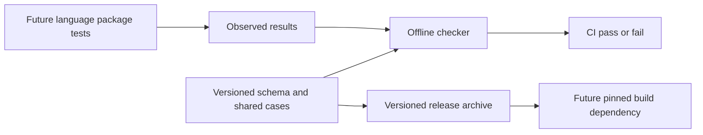
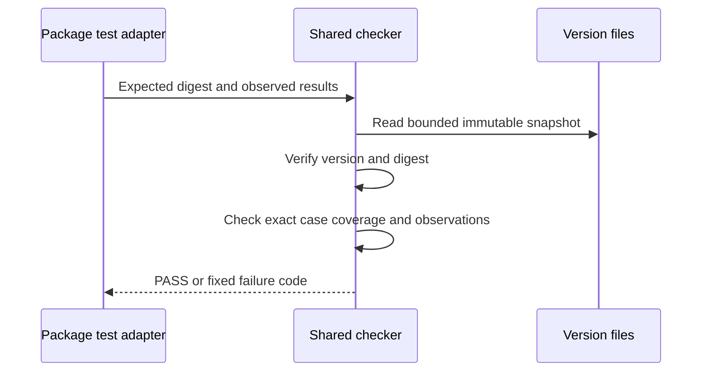
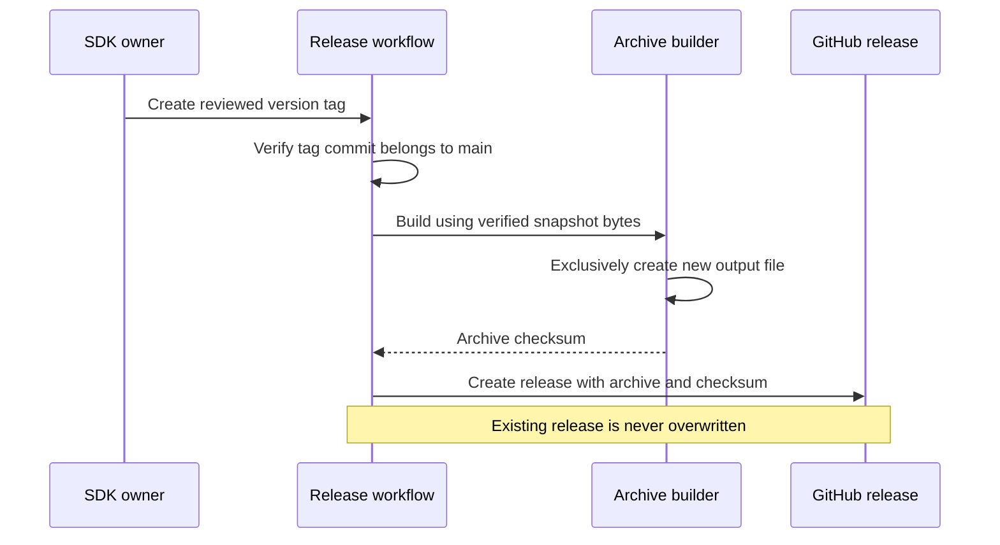
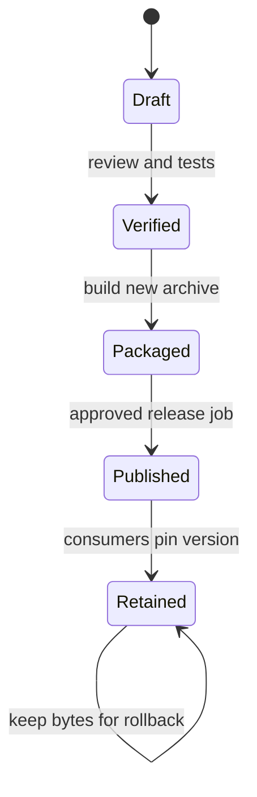

# Log contract — design and validation

## 1. Verdict

**Source implementation is ready for review after the checks below pass. Publishing and service adoption remain separate gates.**

- Mode: **Implement**, scoped to immutable contract files, adapter results and release archives.
- A source test pass is not evidence that any deployed service uses this contract.
- Evidence uses function/test names in `check_contract.py` and `tests/test_contract.py`; paths are relative to this directory.

### Seven-discipline readiness scorecard

| Discipline | Status | Reason |
|---|---|---|
| 1 · Technical design | ✅ | Trusted digest, immutable versions and exact case coverage are enforced. |
| 2 · Distributed systems | ✅ | Offline checker has no durable jobs, leases or business writes; release publication is gated separately. |
| 3 · Test coverage | ⚠️ | QA1: shared checker tests do not prove future package or service behavior. |
| 4 · Monitoring and alerts | ✅ | CLI emits fixed PASS/FAIL codes; CI failure is the operational signal. No runtime service is introduced. |
| 5 · CI/CD | ⚠️ | CD1: actual release publication remains unexecuted. |
| 6 · Security | ⚠️ | OPS1: remote branch/tag protection has not been verified. |
| 7 · Operations | ⚠️ | OPS1: SDK owner must establish release ownership and retention controls. |

| What holds | Why it is sound |
|---|---|
| Existing contract behavior | Schema/vector bytes retain the #795 digest; no stable-version claim. |
| No production side effects | Checker is offline; no Kubernetes, database or logging configuration changes. |
| Safe handoff boundary | README separates contract checks, package checks and live service validation. |

| Priority | Gap | Consequence | Finding |
|---|---|---|---|
| Before release | Publication and recovery have not run on GitHub | Local archive success is insufficient release evidence | CD1 |
| Before release | Repository protections and release owner need confirmation | Source code cannot stop an administrator rewriting a tag | OPS1 |
| Before adoption | Language packages and services are not integrated | Common fields are not automatically added yet | QA1 |

## 2. System context



| Component | Execution | Authority |
|---|---|---|
| Version directory | Git files, one immutable version | SDK maintainers review changes |
| Checker | Local process or CI job | Caller supplies trusted digest |
| Adapter results | Bounded local JSON | Actual package tests must produce observations |
| Release workflow | One job per tag; 10-minute timeout | Repository write token, owner-created tag |
| Runtime service | None in this change | Existing logging/collection remains in the platform repo |

| System profile | Decision |
|---|---|
| Datastore / isolation | Git snapshots and local files; no relational database |
| Work execution | Synchronous offline checks; GitHub schedules release jobs |
| Deployment / regions | No deployed component or regional state |
| Integrity | SHA-256 for exact bytes; append-only version history |
| Tenancy | No customer data; trace IDs never grant access |
| Retention | Retain prior versions and published archives for pinned consumers |

## 3. Core flows

### Flow 1 · Verify contract and package observations



- Already right: missing, duplicated, skipped, unknown and incorrect observations fail.
- Fix/handoff: QA1 owns actual package execution and service adoption.

| Principle | Status | Evidence / limit |
|---|---|---|
| Extendability | ✅ | Add a version and adapter using the documented result protocol. |
| Availability | ✅ | No network dependency; missing local inputs fail closed. |
| Scalability | ✅ | One MiB per input; 500 cases per kind; independent CI jobs. |
| Reliability | ✅ | `load_bundle` hashes the same bytes later parsed; test rejects tampering. |
| Performance | ✅ | Linear checks over bounded files; no request hot-path code. |
| Maintainability | ✅ | One shared result checker and explicit profile rules. |
| Security | ✅ | Reject symlinks, traversal versions, duplicate keys and non-finite numbers; redact input contents. |
| Concurrency | ✅ | Read-only result checking; no shared mutable request context. |
| Failure tolerance | ✅ | Nonzero exit on failure; rerun after fixing input. No partial state to repair. |

### Flow 2 · Build and publish a versioned archive



- Already right: real filesystem exclusive creation allows only one local writer to win.
- Fix/handoff: CD1 and OPS1 are required before first publication.

| Principle | Status | Evidence / limit |
|---|---|---|
| Extendability | ✅ | Tag version selects a directory; no per-version workflow edits. |
| Availability | ⚠️ | CD1: GitHub outage blocks publication; deployed services do not depend on this workflow. |
| Scalability | ✅ | Tag-scoped concurrency; small bounded archive; no application traffic. |
| Reliability | ✅ | Reproducible bytes and no overwrite; source-mutation test retains verified bytes. |
| Performance | ✅ | In-memory bounded artifact assembly; Git subprocesses have 10-second timeouts. |
| Maintainability | ✅ | One release workflow and one build function. |
| Security | ⚠️ | OPS1: read-only checks, write token only in release job; remote protections need confirmation. |
| Concurrency | ✅ | Barrier-controlled two-writer test proves one exclusive-create winner. |
| Failure tolerance | ⚠️ | CD1: interrupted remote publication needs the owner recovery procedure below. |

## 3.7 Dependencies

| Dependency | Direction | HA / availability | When unavailable | Auth | Findings |
|---|---|---|---|---|---|
| Python 3.11–3.14 and Git | Local | Installed tools; no service replicas | Fail with nonzero exit | Local process identity | None |
| GitHub Actions and Releases | Outbound, publication only | Managed provider; no application runtime dependency | Keep previous artifacts; retry after diagnosing failure | Scoped repository token | CD1 |
| Language package tests | Inbound, future | Separate build jobs | No adoption approval without their results | Repository CI controls | QA1 |
| Original platform snapshot | Migration reference | Retained Git commit | Stop migration if exact bytes cannot be verified | Repository read access | QA1 |

## 3.8 Data layer

| Area | State / verification | Findings |
|---|---|---|
| Indexes, foreign keys, queries, connections | Not applicable: no database access or migration | None |
| Locking / concurrent writes | `output.open("xb")`; actual two-writer test checks one winner | None |
| Data identity | Manifest plus external trusted digest; existing-version edit/delete/add tests | None |
| N−1 compatibility | Original platform schema/vector bytes retained; old consumers remain pinned | QA1 |
| Caching | No mutable latest lookup or runtime fetch; consumers pin archive checksum | None |
| Retention | Keep old versions; no deletion workflow | OPS1 |

## 4. What is already right

| Control | Evidence |
|---|---|
| No silent version drift | `test_existing_versions_cannot_be_changed_or_deleted` uses real Git history |
| No fabricated completeness | `test_missing_duplicate_unknown_or_skipped_cases_fail` |
| No artifact overwrite | `test_concurrent_archive_creation_has_one_winner` |
| No mixed source generation | `test_r28_build_uses_verified_bytes_when_source_changes` |

### Checked and not found

| Suspected failure | Why it is rejected | Evidence |
|---|---|---|
| Result names another contract | Version and trusted digest must match | `test_result_identity_must_match` |
| Context leaks after scope exit | Non-null post-scope ID fails | `test_context_errors_are_detected` |
| Public incoming ID is trusted | Fresh-ID cases reject preserving supplied ID | `test_context_errors_are_detected` |
| Error report prints sensitive input | Only fixed error codes are emitted | `test_cli_requires_pin_and_redacts_bad_results` |
| Archive lacks its checker or guide | Extracted checker runs; linked guide is present | `test_archive_reproducible_and_not_overwritten` |

## 5. Findings catalog

| ID | Priority / problem | Recommended solution | Status |
|---|---|---|---|
| CD1 | P2 release gate: remote publication and interrupted-upload recovery are unverified | SDK owner publishes the candidate only after approval; verify downloaded archive and complete assets | Not started; blocks publication, not source merge |
| OPS1 | P2 release gate: branch/tag protection and accountable release owner are unverified | SDK owner enables mandatory checks, protects version tags, records ownership, and retains released assets | Not started; blocks publication |
| QA1 | P2 adoption gate: no language logging package or service has adopted this artifact | Follow-up tasks implement actual package adapters, pin released artifacts, then run platform integration/raw tests | Not started; blocks service-compliance claims |

## 6. Test coverage

| Check | What it proves | What it does not prove |
|---|---|---|
| Shared checker unit tests | Bad results, tampering and invalid inputs fail | A producer actually called its SDK APIs |
| Real Git immutability test | Accepted version edits/deletes/additions fail | Remote branch protection is configured |
| Real filesystem concurrency test | One writer wins; output matches winning checksum | GitHub release API race behavior |
| Source mutation test | Archive retains the already-verified schema/vector snapshot | An untrusted workspace is a secure publisher |
| Existing #795 reference implementation | All 39 observed results match the moved cases | Production MLOps or other services comply |
| Python-version CI matrix | Same offline suite passes on supported endpoints | All downstream language packages work |

### 6.1 Concrete validation

| Local evidence, 22 October 2026 | Result |
|---|---|
| Python 3.11.16 and Python 3.14.5 checker suite | 14 tests passed on each |
| Original #795 implementation observations | 29 record + 10 context cases passed |
| Archive built with both Python versions | Identical SHA-256; extracted checker passed |
| Ruff, ShellCheck, workflow YAML/shell syntax | Passed |
| Mermaid diagrams | All six rendered |
| Lifecycle/readiness report checks | Complete and consistent; structure only |


```bash
bash scripts/check-log-contracts.sh origin/main
python3 contracts/log-correlation/check_contract.py check-results \
  --version 1.0.0-rc.1 \
  --expected-digest e514c4411aaf93e1a83c662c8e6b4dfdd99772b6d1c89ed7b586d475993a2274 \
  --results /path/to/actual-package-results.json
```

- Run checks with Python 3.11 and 3.14; build twice from identical inputs and compare archive hashes.
- Unit tests use synthetic observations deliberately; actual reference observations are separate migration evidence.
- No new live raw test is needed for this offline-only change. Existing platform raw tests remain the future integration gate after a package/service change; QA1 owns that lane.
- The readiness report checker validates structure, not correctness.

### 6.2 Distributed-systems protocol

Distributed-systems protocol — not applicable: this change has no application jobs, database leases, business resource writes or distributed runtime coordinator.

### 6.3 Publication boundary and recovery

| Interruption | Durable evidence | Recovery / bound |
|---|---|---|
| During local verification | No output published | Fix input and rerun; CI timeout is 5 minutes |
| During local archive write | Partial file may exist | Do not consume failed output; choose a fresh output path or delete only the failed local output |
| After archive build, before publication | CI artifact and checksum | Rerun in a fresh workspace; release job timeout is 10 minutes |
| GitHub accepts publication but response is lost | Release/tag may exist | Owner inspects assets and verifies checksums; retry refuses overwrite |
| Partial remote release assets | Incomplete asset set | Stop consumption; retain evidence and publish a new version/tag after review; CD1 |

## 7. Recommended sequence

### Phase 1 — release readiness

- [ ] OPS1 — SDK owner confirms protection, ownership and retention settings.
- [ ] CD1 — Publish only after explicit approval; download, verify and test the published candidate.

### Phase 2 — package and service adoption

- [ ] QA1 — Implement language packages and adapters; then pin the archive in platform CI and validate services with existing live raw tests.

Every catalog item is scheduled exactly once. Publishing or service adoption is not included in this source-only PR.

## 8. Decision and approval gates

| Gate | Demonstration | Findings |
|---|---|---|
| Source merge | Unit checks, exact source parity, cross-version build checks and hosted CI pass | None |
| First release | Owner approval, protected tag, complete downloaded archive with matching checksums | OPS1, CD1 |
| Package acceptance | Real package API observations pass every shared case | QA1 |
| Service acceptance | Pinned package/image inventory plus context and Loki raw-test evidence | QA1 |

## Appendix — lifecycle contract



| Resource | Tenant key | Natural key | Parent / dependents | Write authority |
|---|---|---|---|---|
| Version bundle | None | Contract + version | Schema/vector files; future packages | Reviewed Git commit |
| Archive | None | Version + archive checksum | Snapshot of bundle/checker/docs | Build process, exclusive create |
| Published release | None | Version tag | Pinned downstream builds | SDK release owner / workflow |

| Dependency edge | Authority / policy | Created / removed | Blocks / failure |
|---|---|---|---|
| Archive → bundle | Verified snapshot; retain source | Build / never automatically removed | Bad digest blocks build |
| Consumer → archive | Explicit approved pin; retain old release | Consumer PR / later reviewed upgrade | Missing artifact blocks build, not running services |

| From | Operation / guard | Atomic write | To | Side effect / recovery |
|---|---|---|---|---|
| Draft | Verify digest and cases | None | Verified | Failure exits; correct input |
| Verified | Build verified bytes | Exclusive file creation, not crash-atomic content | Packaged on success | Partial failed file is not consumable |
| Packaged | Owner tag on main | Provider release creation | Published | Inspect unknown outcomes; never overwrite |
| Published | Consumer pins artifact | Consumer repository commit | Retained | Upgrade via new pin; rollback to prior retained version |

| Contention | Serialization point | Winner / loser | Test |
|---|---|---|---|
| Two local archive writers | Filesystem exclusive create | One success / FileExistsError | Barrier-controlled two-writer test |
| Edit accepted version | Git-base byte comparison | New version allowed / edit rejected | Real Git history test |
| Mutation during snapshot build | Hash verified byte snapshots | Verified bytes retained / pre-read tampering fails | R28 source-mutation test |
| Same tag publication | Workflow concurrency; existing-release guard | Owner must inspect remote outcome | CD1 remains unverified |

| Busy state | Retry driver / budget | Deadline | Terminal outcome |
|---|---|---|---|
| Checking | One CI attempt | 5 minutes; local Git calls 10 seconds | PASS or failed job |
| Packaging / publication | One release job; no automatic overwrite retry | 10 minutes | Completed or failed job; owner follows recovery table |

| Rollout phase | Old behavior | New behavior | Validation / rollback |
|---|---|---|---|
| Merge SDK files | Platform snapshot unchanged | Canonical authoring location added | Exact byte parity; no runtime change |
| Publish candidate | Existing consumers unchanged | New immutable artifact available | CD1, OPS1; retain prior artifacts |
| Adopt package/service | Old pins still work | Explicitly upgraded consumers | QA1; revert consumer pin if needed |

| Contract area | Assessment |
|---|---|
| C1 dependencies | ✓ Explicit retain/snapshot edges above |
| C2 lifecycle | ✓ Draft, verification, packaging, publication, retention defined |
| C3 usage ownership | N/A: no runtime claims; retained artifacts cannot be deleted automatically |
| C4 concurrency | ✓ Real exclusive-create test; remote publication remains CD1 |
| C5 durable async transitions | N/A: no application job queue; CI job termination is explicit |
| C6 external effects | CD1: GitHub release is the only external mutation |
| C7 repair | ✓ Local failure recovery documented; CD1 owns remote validation |
| C8 retries | ✓ No overwriting files/releases; explicit retry procedure |
| C9 API / tenancy / client parity | N/A: offline CLI, no tenant API or UI |
| C10 observability | ✓ Fixed CLI failure codes and CI run history |
| C11 evolution | ✓ Immutable versions, pinned candidates and phased migration |

| Race row | Assessment / reason |
|---|---|
| R1 | N/A: no delete jobs or usage claims |
| R2 | N/A: no delete fence |
| R3 | N/A: no deletion requests; archive-create contention tested separately |
| R4 | N/A: no application job delivery |
| R5 | N/A: no database/broker boundary |
| R6 | N/A: no external teardown |
| R7 | N/A: no teardown finalization |
| R8 | N/A: no claim release/delete race |
| R9 | N/A: no shared claims |
| R10 | N/A: no worker leases |
| R11 | N/A: no asynchronous resource deletion |
| R12 | N/A: no reconciler |
| R13 | N/A: no cascades |
| R14 | N/A: no runtime state observer |
| R15 | N/A: no partial teardown |
| R16 | N/A: no lease heartbeat |
| R17 | N/A: no natural-key delete/recreate; version reuse rejected |
| R18 | N/A: no parent/child deletes |
| R19 | N/A: no artifact deletion workflow |
| R20 | N/A: no archive/restore/purge resource API |
| R21 | N/A: no stale deletion worker |
| R22 | N/A: no destructive dependency query |
| R23 | N/A: no runtime mixed-version worker rollout; consumers remain pinned |
| R24 | N/A: no paginated cascade |
| R25 | N/A: no cancellation/deletion boundary |
| R26 | N/A: no tenant offboarding resource |
| R27 | N/A: no leased credentials issued to consumers |
| R28 | ✓ Verified snapshot bytes survive mutation after read; deterministic test |
