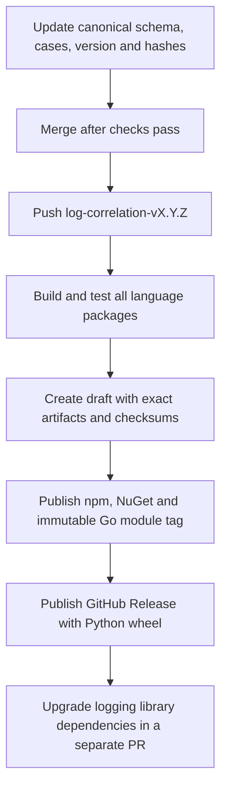
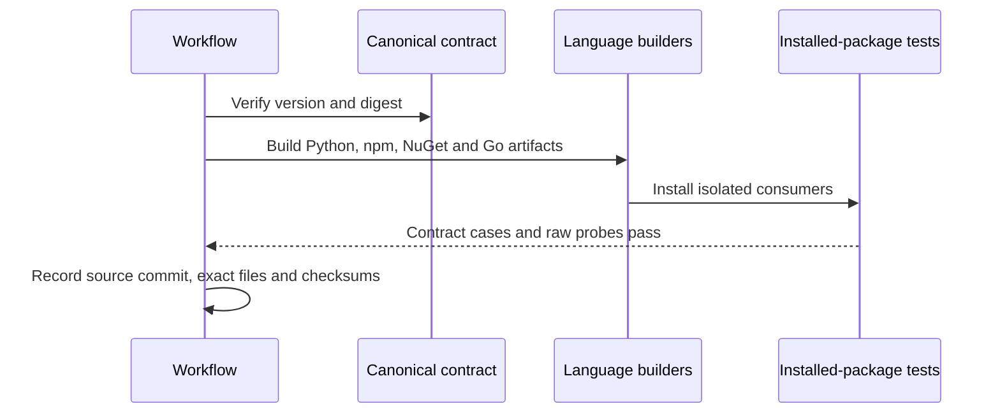
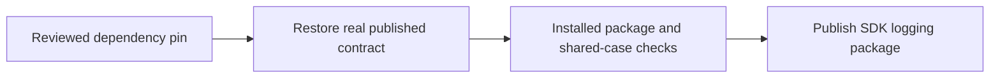

# Release the contract for every language



| Contract-tag output | Destination |
|---|---|
| `onenexus-log-contract` Python wheel | GitHub Release asset |
| `@onenexus-team/log-contract` npm package | GitHub Packages npm registry + release asset |
| `OneNexus.LogContract` NuGet package | GitHub Packages NuGet registry + release asset |
| Go contract module + source ZIP | Private Git tag `contracts/log-correlation/vX.Y.Z` + release asset |
| Language-neutral archive, release manifest and checksums | GitHub Release assets |

- One canonical source: `schema.json`, `vectors.json`, `manifest.json`.
- Package versions come from the contract tag. SDK `VERSION` is independent.
- Stable tags only: `log-correlation-vMAJOR.MINOR.PATCH`.
- Go embeds the canonical JSON directly. The workflow creates its module tag at the same reviewed source commit; an archive alone does not enable `go get`.
- Logging libraries, CAS clients and other SDKs are not published by contract tags.

## Publish a new contract

| Step | Action |
|---|---|
| 1 | Update schema definitions, `$id`, `x-contract-version`, vector `contract_version`, manifest `version`, file hashes and aggregate digest. |
| 2 | Run the checks below. Merge the reviewed change. |
| 3 | Push the matching contract tag on that merged commit. |
| 4 | Wait for **Log contract release** to pass. Check all four language destinations. |
| 5 | Upgrade logging-library pins in a separate PR, test, then publish an SDK release. Applications upgrade afterward. |

```bash
pnpm --dir ts install --frozen-lockfile
python3 scripts/test-log-contract-release.py
bash scripts/check-log-contracts.sh
python3 scripts/log-contract-release.py build \
  --version 0.3.2 --directory .artifacts/contract-release-local
```

- Use the version in `manifest.json`; use a fresh output directory for each build.
- The build creates real wheels, npm tarballs, NuGet packages and Go module ZIPs. It runs source tests, fresh installed-package tests, shared contract cases and existing raw log probes.
- The command above does **not** publish anything.
- Dependencies: the repository's Python/uv, Node/pnpm, .NET and Go 1.27.3 toolchains.

After the next contract version has been reviewed and merged, for example:

```bash
git tag log-correlation-v0.3.4 <merged-contract-commit>
git push origin log-correlation-v0.3.4
```

**Cutover:** npm/NuGet contract package `0.3.3` already exists and contains schema `0.3.2`. Preserve it. The first independent contract release must use an unused version greater than existing stable package versions; currently `0.3.4`. Do not recreate old tags or rename existing packages.

## Let a logging library consume the new contract

| Language | Reviewed dependency update |
|---|---|
| Python | Update the contract wheel URL/version/hash in `python/packages/observability/pyproject.toml`; refresh `python/uv.lock`. |
| TypeScript | Update `ts/packages/log-contract/package.json` version and the exact `workspace:X.Y.Z` dependency in `ts/packages/observability/package.json`; refresh `ts/pnpm-lock.yaml`. |
| Go | Update the contract requirement in `go/observability/go.mod`; refresh `go.sum` after publication. The first Go pin is v0.3.4 and release stays blocked until it exists. |
| .NET | Update `LogContractPackageVersion` in `dotnet/Directory.Build.props`. Applications retain their dependency lockfiles. |

- The TypeScript package version in source is the reviewed consumer pin. The contract-tag build temporarily sets the release version and its one workspace lockfile link, runs a frozen install, builds, then restores package metadata and the lockfile. External dependency resolutions stay unchanged.
- SDK releases preserve the reviewed pins and publish only logging/client packages. They do not publish another copy of the contract packages.
- SDK release validation restores the real pinned contract from the registry. It fails if the installed contract's digest/cases disagree with the reviewed canonical source.
- A required new field still needs logger code that supplies its value; schema generation cannot invent that value.

## Manual validation after a contract release

Use a disposable checkout of the released tag and a fresh destination directory:

```bash
gh release download log-correlation-v0.3.4 --dir .artifacts/downloaded-contract
python3 scripts/log-contract-release.py verify \
  --version 0.3.4 --directory .artifacts/downloaded-contract
npm view @onenexus-team/log-contract@0.3.4 version \
  --registry=https://npm.pkg.github.com
```

Then run the installed-package/raw-log checks against the actual registries:

```bash
export REQUIRE_PUBLISHED_LOG_CONTRACT=1
export LOG_CONTRACT_PACKAGE_VERSION=0.3.4
bash scripts/check-typescript-observability.sh
bash scripts/check-dotnet-observability.sh
bash scripts/check-go-observability.sh
```

- Go restores the private module through authenticated Git (`GOPRIVATE=github.com/onenexus-team/onenexus-sdks`). The Go checker must restore the published pin; it never substitutes local contract source in release mode.
- Set authenticated npm configuration before running. .NET checks require `GITHUB_ACTOR` and `NUGET_AUTH_TOKEN` from a protected credential source. Never commit tokens.
- These checks install the actual contract packages without local contract overrides, run the shared cases, and verify emitted raw log records plus deliberate failures.
- Run on a disposable checkout: the TypeScript version override updates package metadata for the test build.
- This validates artifact delivery and logging-package compatibility. It does not claim service adoption, cluster rollout or Loki ingestion.

## Lifecycle and readiness review

| Item | Scope |
|---|---|
| Mode | Implement: contract artifacts, package dependencies and release publication |
| Date | 2026-10-27 |
| Authority | Git tag/commit + verified manifest; registries enforce unique package versions |
| Out of scope | Service behavior, spans, production deployments and service adoption |
| Verdict | Local package validation passes; first independent live contract publication remains a post-merge gate (REL1). |

### Seven-discipline scorecard

| Discipline | Status | Evidence |
|---|---|---|
| 1 · Technical design + security | Sound | Canonical identity, hash checks and exact artifact inventory |
| 2 · Distributed-systems principles | Sound within scope | Serialized workflow; registry uniqueness; no overwrite; explicit partial state |
| 3 · Test coverage | Sound locally; REL1 open | Guard tests, source + installed package tests and raw probes |
| 4 · Monitoring + alerts | Sound within scope | GitHub run/job status, draft release and manifest; no serving path |
| 5 · CI/CD | Sound locally; REL1 open | PR builds every language without write permission; tag job publishes |
| 6 · Security | Sound within scope | Scoped GitHub token; npm credentials use environment substitution; no schema runtime downloads |
| 7 · Operations | Sound within scope | Bounded jobs; inspect partial state and roll forward with a new version |

### Flow 1 — build every language



**Already right:** no package writes happen until all language checks pass.

| Dimension | Verdict | Evidence |
|---|---|---|
| Extendability | Sound | Add a language builder and mandatory artifact entry together |
| Availability | Sound | Build outage prevents a new release; existing consumers continue |
| Scalability | Sound | One bounded build per tag; five artifacts |
| Reliability | Sound | Installed-package tests and digest verification |
| Performance | Sound | Offline runtime; build dependencies restored once |
| Maintainability | Sound | Reuses existing language suites; one release entry point |
| Security | Sound | Source commit and artifact identities checked |
| Concurrency | Sound | Independent output directory; refuse existing destination |
| Failure tolerance | Sound | Restore source metadata in finally; failure stops publication |

### Flow 2 — publish across destinations

```mermaid
sequenceDiagram
    participant W as Workflow
    participant G as GitHub Release
    participant N as npm
    participant D as NuGet
    participant T as Git module tag
    W->>N: Check existing versions
    W->>D: Check existing versions
    W->>T: Check existing tags and source
    W->>G: Create draft with all verified artifacts
    W->>G: Download and verify exact bytes
    W->>N: Publish contract tarball
    W->>D: Publish contract package
    W->>T: Atomically create tag at verified commit
    W->>G: Publish release only after all destinations succeed
    Note over W,G: Failure keeps draft; never overwrite an existing version
```

**Already right:** preflight is advisory; registry uniqueness and atomic Git ref creation are the final collision guards. Publication across registries, module tags and Releases is not atomic.

| Dimension | Verdict | Evidence |
|---|---|---|
| Extendability | Sound | Mandatory inventory prevents silently missing a language |
| Availability | Sound | Failed release leaves installed versions available |
| Scalability | Sound | Registry history scan capped at 1,000 NuGet versions; fails closed beyond cap |
| Reliability | Sound | Same downloaded bytes published; no duplicate/overwrite flags |
| Performance | Sound | Preflight network calls bounded; one global publication workflow |
| Maintainability | Sound | Stable error codes; draft captures all artifacts |
| Security | Sound | Registry auth errors fail closed; no credential values in Python exceptions |
| Concurrency | Sound | Global contract publication group + immutable registry version keys |
| Failure tolerance | Pending live proof, REL1 | Partial publication remains visible and stops finalization; unit failure tests pass |

### Flow 3 — SDK consumes a released contract



**Already right:** new SDK versions cannot silently create new contract versions.

| Dimension | Verdict | Evidence |
|---|---|---|
| Extendability | Sound | Each language uses its native dependency metadata |
| Availability | Sound | Registry outage blocks release, not running services |
| Scalability | Sound | Versioned dependencies; no request-time schema retrieval |
| Reliability | Sound | Real registry consumer tests reject mismatched contract identity |
| Performance | Sound | Compile/build-time dependencies; no new runtime network calls |
| Maintainability | Sound | Explicit SDK/contract version separation |
| Security | Sound | Credentials confined to restore/publish jobs |
| Concurrency | Sound | SDK workflows no longer publish contract packages |
| Failure tolerance | Sound | Dependency mismatch fails before SDK publication |

### Resource and dependency inventory

| Resource | Key / owner | Dependency policy |
|---|---|---|
| Canonical contract | Version + digest; source maintainers | Retain historical tags |
| Built artifact | Source commit + package name/version + SHA-256 | Immutable once published |
| Draft release | Contract tag; release workflow | Retain after failure for inspection |
| Registry package / Go module tag | Package name/version or Git ref; registry/GitHub | Never overwrite/delete to retry |
| Logging-library dependency | Reviewed package pin; SDK maintainer | Explicit upgrade only |

### Transitions, concurrency and recovery

| From → operation → to | Guard / side effect | Failure or retry |
|---|---|---|
| Tagged → build → verified | Main ancestor, matching version/digest, all language tests | Failed job; no publication |
| Verified → create draft → prepared | No existing release; all artifacts present | Existing draft blocks blind rerun |
| Prepared → npm/NuGet/Go publish → packages published | Versions unused and newer; registry uniqueness | Stop on first failure; retain draft and any accepted packages |
| Packages published → finalize → released | All publication writes succeeded; exact artifacts verified | Inspect registry packages and draft; finish only after confirming every artifact |

| Contending operations | Serialization / outcome | Evidence |
|---|---|---|
| Same/different contract tags | Global workflow concurrency; no FIFO assumption | Older version rejects if newer already published |
| Competing package publisher | Registry package/version uniqueness | Duplicate preflight and write-failure tests |
| SDK versus contract release | Only contract workflow publishes contract packages | SDK publish lists exclude contracts |
| Source changes during build | Checked-out commit, verified input bytes, artifact checksums | Stale-commit and changed-byte tests |

| Interrupted boundary | Durable evidence | Safe action |
|---|---|---|
| Before draft | Failed run/artifact logs | Retry after resolving cause; no registry writes yet |
| Draft created, no package published | Draft + checksums | Inspect exact assets; do not replace them blindly |
| One registry accepted, next failed/unknown | Draft, registry versions, job logs | Inspect all registries and the Go tag. Prefer a corrected new version; never delete/reuse the accepted version |
| Registries and Go tag accepted, finalization failed | Immutable versions/tag + verified draft assets | Operator may finish the existing draft after verifying every file and registry result |

- Jobs time out after 25 minutes; individual child commands after 10 minutes; registry queries after 60 seconds.
- No automatic publish retry after an unknown result. A failed job is terminal and inspectable.
- GitHub may replace a queued concurrency-group run; rerun an unstarted tag if still eligible. Do not assume FIFO.
- Front-end action parity: N/A; no product UI is changed. GitHub's release UI is not an application lifecycle API we own.

### Contract and race coverage

| Contract | Result |
|---|---|
| C1 | Proven: explicit source → artifact → registry → consumer graph |
| C2 | Proven: tagged / verified / draft / partial / published states |
| C3 | N/A: no deletion or usage leases; published versions retained |
| C4 | Proven in code: workflow serialization + immutable version key; live new flow REL1 |
| C5 | N/A: no application database/outbox; GitHub owns job execution and status |
| C6 | Proven in code: append-only publish, no delete/overwrite; live new flow REL1 |
| C7 | Proven: bounded failed job + explicit inspection/roll-forward procedure |
| C8 | Proven: duplicate attempts reject; partial results never silently skipped |
| C9 | Proven: repository/registry permissions; no tenant data or product API change |
| C10 | Proven: job status, source commit, checksums, stable failure codes |
| C11 | Proven locally: old packages retained, separate dependency pins, real installed-consumer checks |

| Races | Result / reason |
|---|---|
| R3, R4 | Adapted: duplicate publication fails; no second overwrite |
| R6, R7, R13, R15, R24 | Adapted: partial external writes remain in a draft/failed run; recovery table above |
| R10, R12, R17, R18, R20, R21 | Adapted: no replacement of package versions; no delete path or mutable worker lease |
| R22 | Adapted: registry/auth failures block writes or finalization |
| R23 | Adapted: drain old SDK publication runs before enabling independent contract releases; v0.3.3 run completed |
| R28 | Adapted: immutable checkout + version/digest/checksum checks |
| R1, R2, R5, R8, R9, R11, R14, R16, R19, R25, R26, R27 | N/A: no business resource deletion, usage claims, broker, tenant cascade or external write credentials |

## Dependencies and data layer

| Dependency | HA / outage behavior | Authentication | Evidence |
|---|---|---|---|
| GitHub Actions and Releases | Provider-managed; failed job/draft persists; existing releases remain usable | Repository-scoped `GITHUB_TOKEN` | Workflow permissions and draft/finalize ordering |
| GitHub npm and NuGet | Provider-managed; outage blocks publication/restore; installed apps continue | Package write token in release; read token for consumer validation | Registry preflight and installed-package checks |
| Public build dependency registries | Provider-managed; restore failure stops build before publication | Public read over TLS | pnpm frozen install and NuGet locked restore |

Data layer — not applicable: no application SQL tables, indexes, queries, connection pools, migrations or caches introduced. Durable state belongs to GitHub Releases and package registries.

## Distributed-systems protocol

| # | Invariant | Assessment and evidence |
|---|---|---|
| 1 | Single current authority | GitHub workflow concurrency serializes contract runs; package registry unique name/version is the final write authority. Preflight is advisory. |
| 2 | One durable intent | Tag and draft identify one release; an existing draft/release rejects a blind rerun. |
| 3 | Lease ownership | No custom lease; GitHub owns job execution. Registry uniqueness prevents a stale/manual writer overwriting a version. |
| 4 | State is monotonic | Tagged → verified → draft → packages accepted → published. No automatic deletion or overwrite. |
| 5 | Recovery converges | Failed run is terminal within the timeout. Operator inspects retained partial state and rolls forward; no automatic retry loop. |
| 6 | External resources are owned | Exact artifact names, hashes, source commit and package identities checked by `log-contract-release.py`; no ambient package deletion. |

### Checked and not found

| Suspected problem | Why it does not happen | Evidence |
|---|---|---|
| New SDK version silently replaces contract | Contract pin excluded from SDK version synchronization and publication | Version-separation test; installed-package checks |
| Missing language appears successful | Exact five-artifact inventory required | Missing/extra artifact tests |
| Wrong package uploaded under contract release | npm/NuGet identity, Go archive/source parity and hashes verified | Wrong-identity/tamper tests |
| Auth error treated as version absence | Only npm E404 means absent; NuGet/API errors stop | Auth-failure test |

## 4. Findings catalog

| ID | Problem | Recommended solution | Status |
|---|---|---|---|
| REL1 | New contract-tag publication has not yet run on merged code | After merge, release an unused contract version and run the manual registry checks above | Pending live validation; local builds/guards pass |

## 5. Test coverage

- Release guard tests exercise duplicate/newer versions, bounded lookup, auth failure, missing/extra artifacts, tampering, wrong identities, stale commit, interrupted publication and source restoration.
- Existing TypeScript and .NET tests run against both local packed artifacts and independently restored registry contracts.
- Python wheel is installed and checked for archive parity, immutable identity and corruption rejection.
- Go module guard tests cover source overrides, dirty source, archive parity, existing/newer tags, authentication failure and atomic-create races. Go source and isolated ZIP consumers run `go test -race`; SDK publication requires a real private Git restore.
- Raw tests: `go/observability/raw_tests/log-probe`, `ts/packages/observability/raw_tests/log-probe.mjs` and `dotnet/raw_tests/LogProbe`; wrong trace/missing service must fail.
- No cluster changes: package publication is not cluster-dependent. Service raw tests remain a downstream adoption gate.

## 6. Recommended sequence

### Phase 1 — merge and publish

- Merge after CI passes.
- Complete **REL1** with the first new contract tag; no existing release is overwritten.

### Phase 2 — adopt the published contract

- Upgrade logging-library pins, release SDK packages, then validate each adopting service separately.

## 8. Decision and approval gates

| Gate | Required evidence |
|---|---|
| Merge | Guard tests, all-language build, installed consumers, syntax/lint and existing package CI pass |
| First independent release | REL1: four language destinations verified; GitHub Release published only after registry and Go tag success |
| Application adoption | Separate dependency PR, service tests and deployed raw-test evidence |
