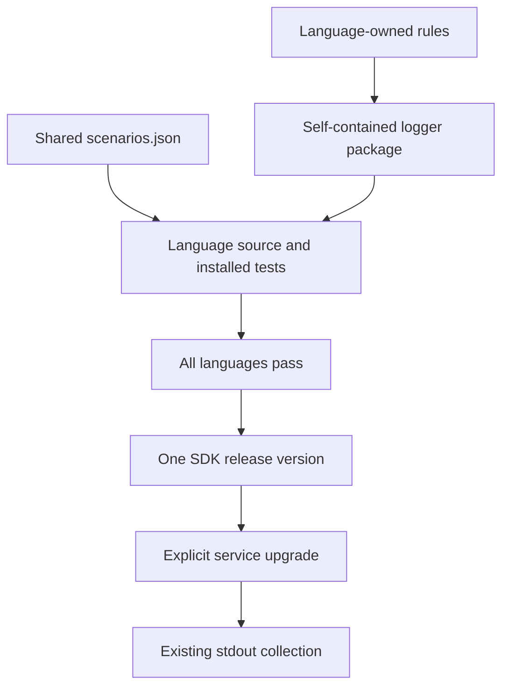
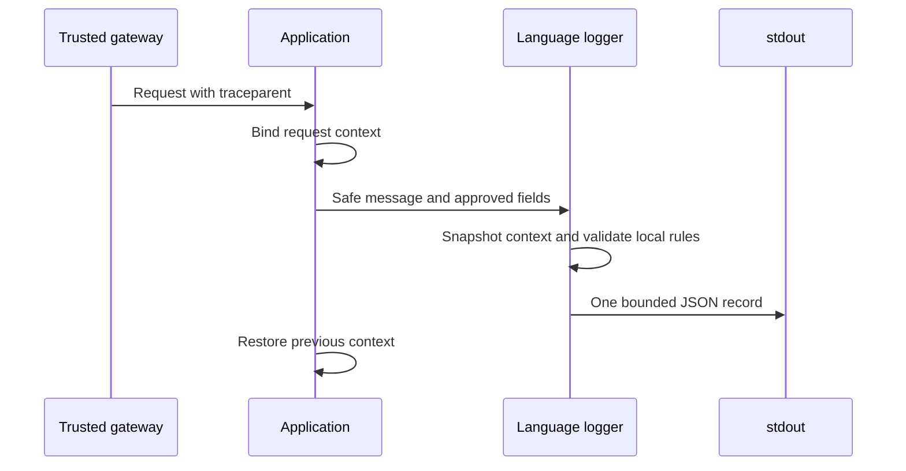
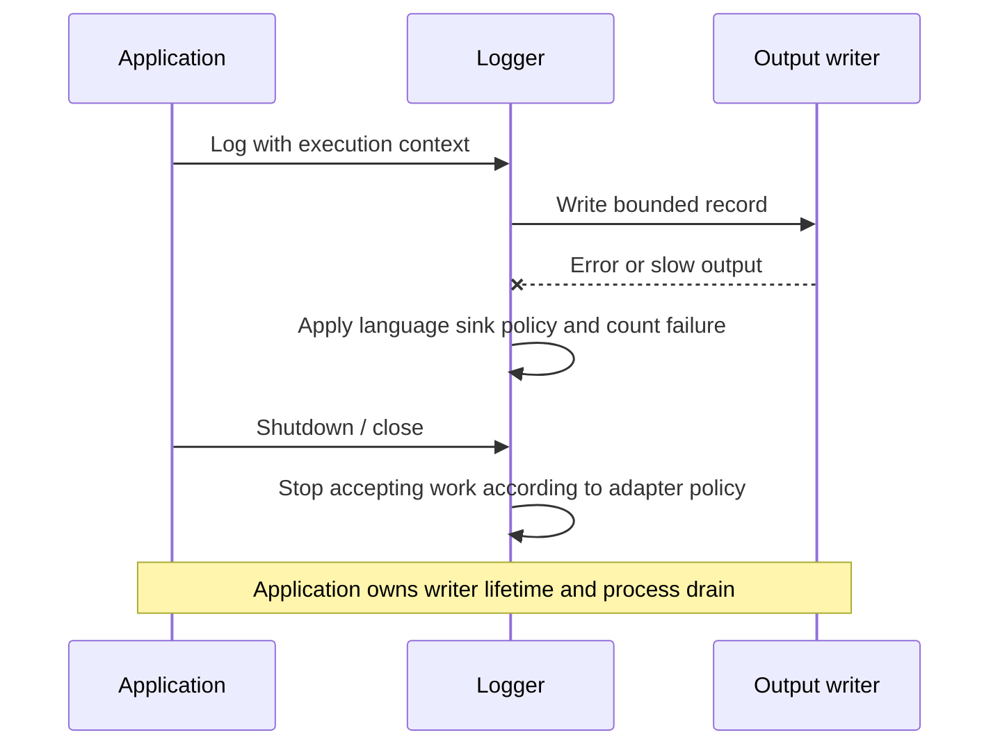
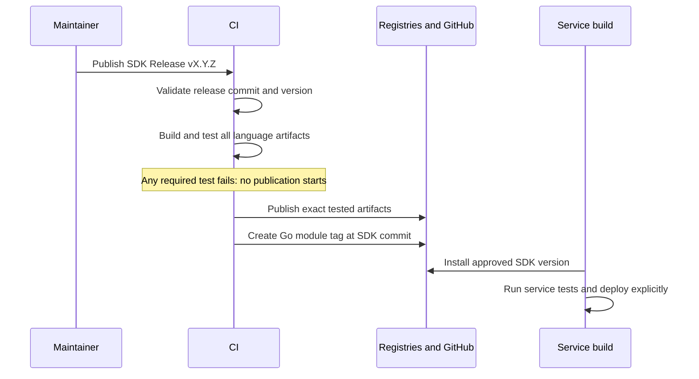

# Shared logging — lifecycle and readiness

## 1. Verdict

**Ready for PR review; publication and service rollout are separate gates.**
Source and installed-package validation do not prove deployment or monitoring ingestion.

- Implement mode: self-contained language packages, shared tests and one SDK release.
- Existing Python, TypeScript and .NET logger behavior is retained. Go adds an opt-in `slog` handler.
- No database migration, service configuration, cluster mutation or package publication.

### Seven-discipline readiness scorecard

| Discipline | Status | Evidence / limit |
|---|---|---|
| 1 · Technical design | ✅ | One package per language; bounded fields; runtime-local rules |
| 2 · Distributed-systems principles | ✅ | No business-state writes; immutable package identities; release recovery below |
| 3 · Test coverage | ⚠️ | OPS1: source/installed/shared/raw package checks; service adoption is separate |
| 4 · Monitoring + alerts | ⚠️ | OPS1: packages expose drop counters; services must export and alert |
| 5 · CI/CD | ⚠️ | REL1: all-language build gate; real publication not exercised |
| 6 · Security | ✅ | Private release credentials only in publisher; no runtime schema download |
| 7 · Operations | ⚠️ | PERF1: service stdout latency/loss budgets require measurement |

| What is sound | Why |
|---|---|
| Common behavior | All four adapters use the same input/expected JSON scenarios |
| Runtime installation | Separate consumers install only the logger and public dependencies |
| Version alignment | One SDK release input; artifact metadata checked before publication |
| Historical consumers | Published old versions and tags are retained |

## 2. System context



| Component | Ownership / lifetime |
|---|---|
| Shared scenarios and checker | SDK repository; test-only; no package version |
| Language rules | Included with each logger; equivalent definitions checked in CI |
| Context | Per execution; restored at a trusted boundary; application owns durable metadata |
| Logger / sink | Application owns startup, shutdown and stdout; no SDK exporter |
| SDK artifact | Language/name/version + source commit; immutable after publication |
| Release workflow | Builds on isolated runners; publishes after the entire matrix passes |

| Architecture | Actual mechanism |
|---|---|
| Datastore / isolation | No business datastore; process-local logging/context state |
| Work execution | Local validation and output; no SDK background job |
| Multi-region / replicas | No shared runtime state across services or replicas |
| Integrity | Lockfiles, installed-package tests, artifact identity and source checks |
| Tenant authority | Service authentication; trace identity grants no authorization |
| Retention | Service owns logs; existing packages/tags retained |

## 3. Flows

### Flow 1 — generate a correlated log



**Already right:** the logger uses actual execution context; applications explicitly adopt it.
Python's existing edge-style `incoming_context` API is retained; MLOps keeps its own ingress checks. This packaging change does not rewrite service boundary policy.

| Dimension | Verdict | Evidence |
|---|---|---|
| Extendability | ✅ | Add shared scenarios, then implement each language's behavior |
| Availability | ✅ | Rules are local; registry downtime cannot affect running requests |
| Scalability | ✅ | No cross-replica logger state or coordination |
| Reliability | ✅ | Actual emitted-log scenarios plus independent record/context checks |
| Performance | ⚠️ | PERF1: synchronous stdout can block; service budget needed |
| Maintainability | ✅ | Logger and validator have one package owner per language |
| Security | ✅ | Common fields protected; scalar allowlists; no automatic body/header serialization |
| Concurrency | ✅ | Python thread/async, TS async-local, .NET AsyncLocal and Go explicit-context tests |
| Failure tolerance | ⚠️ | OPS1: counted invalid/output drops; monitoring delivery remains external |

### Flow 2 — close, cancel or fail output



**Already right:** supplied writers are not closed by Go/TS loggers; context cleanup is tested through cancellation and exceptions.

| Dimension | Verdict | Evidence |
|---|---|---|
| Extendability | ✅ | Injected streams/writers permit failure tests |
| Availability | ⚠️ | PERF1: entered synchronous writes depend on application sink |
| Scalability | ✅ | No durable SDK queue; TS/Go cap pending writes at 128 |
| Reliability | ✅ | Go partial-write failure disables the sink; TS close/flush tests |
| Performance | ⚠️ | PERF1: Go waits at most 1s before entry; entered writer can still block |
| Maintainability | ✅ | Counters and shutdown APIs documented in package READMEs |
| Security | ✅ | Invalid/rejected content is not echoed by logger error paths |
| Concurrency | ✅ | Deterministic barriers test isolation, writer serialization and close races |
| Failure tolerance | ⚠️ | OPS1: best-effort logs can be lost at crash; no durability promise |

### Flow 3 — build, publish and consume



**Already right:** PR checks reuse the release build; public dependency resolution and private publication are separate.

| Dimension | Verdict | Evidence |
|---|---|---|
| Extendability | ✅ | One language matrix; no separate contract release sequence |
| Availability | ✅ | Failed restore/build stops release; running services keep pinned versions |
| Scalability | ✅ | Independent build runners; standard language package caches |
| Reliability | ⚠️ | REL1: no cross-registry atomic transaction; partial release is explicit |
| Performance | ✅ | Build-time validation; no request-time downloads |
| Maintainability | ✅ | One SDK version; source and installed artifacts share test cases |
| Security | ✅ | Build jobs read-only; publisher has scoped package/content writes |
| Concurrency | ✅ | Serialized release workflow; immutable registry versions and atomic Go ref create |
| Failure tolerance | ⚠️ | REL1: inspect remote state after partial failure; never overwrite/reuse versions |

## 4. Dependencies and data layer

| Dependency | Availability / failure behavior | Authentication |
|---|---|---|
| Language validator libraries | Local runtime; locked restore failures stop builds | Public registry TLS at build time |
| OpenTelemetry context API | Local state; no new provider/exporter | None |
| stdout / injected writer | Bounded records; sink can block or fail; PERF1 | Application-owned |
| GitHub Release/npm/NuGet | Existing services unaffected by outage; release/install can fail | Existing protected token / package permissions |
| Git tags / Go modules | Module tag must target SDK commit; wrong/existing ref fails | Authenticated Git for private consumers |

Data layer: no tables, indexes, foreign keys, caches, queries or migrations. Durable job persistence belongs to consumer services, not this SDK.
Cost: no new cluster workload, collector, database or background process. Runtime cost remains validation and writing logs.

### Checked and not found

| Suspected regression | Check / result |
|---|---|
| Hidden contract dependency | Artifact metadata rejects it; isolated package installs |
| SDK versions drift across languages | Alternate-version builds and metadata tests |
| Shared cases test only a validator | Added shared emitted-log cases through real loggers |
| Package tests import local source | Separate installed environments/module proxy; no Go Replace |
| Public trace input becomes authorization | No authorization implementation in these packages |
| Removed releases break old consumers | No published artifact/tag deletion in this change |
| Automatic service activation | No service/deployment files changed |

## 5. Findings catalog

| ID | Severity | Problem / consequence | Solution | Status |
|---|---|---|---|---|
| REL1 | P2 | Publication spans independent registries; local tests cannot prove permissions or remote installability | Approved SDK release; inspect every destination; clean install by version; immutable failure recovery | Pending publication |
| OPS1 | P2 | Package success does not prove consumer adoption, Loki ingestion or alert coverage | Adopt version in service; real request/job raw tests; query trace and export drop counters | Separate service gate |
| PERF1 | P2 | Caller-owned stdout can block or lose data during process/collector failure | Measure sink latency and peak load; set service loss/latency budget and drain policy | Separate production gate |

## 6. Validation and lifecycle

| Check | Evidence |
|---|---|
| Shared behavior | 56 record + 10 edge-context scenarios; 3 shared emitted-log scenarios per language |
| Python | Source/installed wheel, thread/async cleanup, raw-probe negative controls |
| TypeScript | Source/installed npm, ESM/CommonJS shared context, exact int64, backpressure/close |
| .NET | Source/installed NuGet, Activity/AsyncLocal, cancellation, raw-probe negatives |
| Go | Source/installed module, race detector, barriers, partial writes, recorded child, raw probe |
| Release | Version/name/inventory guards; no separate dependency; Go SDK-tag/source identity |
| Remaining live proof | REL1 package publication; OPS1/PERF1 consumer cluster checks |

### Resource transitions and ownership

| From | Operation / guard | Authority / atomic boundary | To / recovery |
|---|---|---|---|
| Source | Build reviewed commit and SDK version | Isolated build job | Tested artifacts or failed run |
| Tested artifacts | All language jobs successful | Workflow `needs` gate | Publication allowed |
| Publishing | Create version/tag | Registry immutable version / Git ref create | Published or partial failure |
| Partial failure | Inspect destinations | Maintainer; exact version + commit | Finish verified artifact attachment or release new version |
| Uninitialized logger | Explicit configuration | Application startup | Active; invalid config fails |
| Active logger | Log / validation / writer policy | Adapter lock/channel/stream | Written or counted drop |
| Active logger | Close/cancel scope | Adapter shutdown/context restore | No inherited context; sink remains caller-owned |

| Dependency edge | Policy | Failure / lifecycle |
|---|---|---|
| Service → installed logger | Version pin; retain old releases | Existing service continues until explicit upgrade |
| Logger → runtime rules | Included in same artifact | No external package lifecycle |
| Tests → shared JSON | Test input only | Mismatch blocks CI/build |
| Logger → output | Caller-owned | Adapter counts failure; service handles recovery |

| Busy state | Bound / owner | Termination |
|---|---|---|
| CI build | 25-minute job timeout | Success or failed run |
| Publication | 15-minute job timeout | Success or visible partial failure, REL1 |
| Go writer wait | 128 slots; configured wait ≤1s | Write entry, Busy drop or Close |
| TS pending output | 128 callbacks; bounded flush deadline | Written/error or timed-out close |
| Entered synchronous write | Application sink | PERF1: SDK cannot cancel arbitrary writer |

### Crash and race coverage

```mermaid
sequenceDiagram
    participant C as Release job
    participant N as Registry
    participant G as GitHub
    participant O as Maintainer
    C->>N: Publish version X.Y.Z
    N-->>C: Accepted
    C->>G: Attach tested artifact
    G--xC: Failure
    O->>N: Inspect exact published version
    O->>G: Verify SDK commit and artifact bytes
    Note over O,G: Retain accepted versions; never overwrite or delete
```

| Boundary / race | Expected recovery / evidence |
|---|---|
| Build fails before gate | No publisher starts; workflow gate test |
| Registry accepted before job fails | REL1: retain immutable version; inspect before repair/new release |
| Concurrent Go publishers | Atomic create rejects loser; no force update; unit failure injection |
| SDK tag differs from Go source | Publisher rejects mismatch; test proves no API write |
| Duplicate or missing test results | Shared checker rejects; negative controls |
| Two requests / logger close race | Language barrier and cleanup tests; Go race detector |

Distributed-systems protocol — not applicable: these packages do not coordinate distributed business-state transitions, outboxes, SQL leases or deletion cascades. Release identity and local context/sink invariants are covered above.

| Lifecycle area | Result |
|---|---|
| C1 | ✓ Package/rules/context/sink dependencies explicit |
| C2 | ✓ Build/release/logger transitions listed |
| C3 | N/A: no deletable usage claims; writer owned by caller |
| C4 | ✓ Local context and sink tests; immutable release identities |
| C5 | N/A: SDK owns no durable business work |
| C6 | ✓ Append-only publication; no old package deletion |
| C7 | ✓ Bounded CI jobs and waiters; PERF1 limits entered I/O |
| C8 | ✓ No logger retry loop; explicit partial-publication recovery |
| C9 | ✓ No authorization changes; frontend action parity N/A, no UI |
| C10 | ✓ Drop counters/raw probes; OPS1 service monitoring gate |
| C11 | ✓ Unchanged log format; old pins retained; service rollback by pin |

| Race rows | Result / reason |
|---|---|
| R3, R4 | ✓ Adapted: immutable Go tag create rejects competing publisher |
| R6, R7, R13, R15, R24 | UNVERIFIED live publication: REL1; local failure paths retain partial artifacts |
| R10, R12, R17, R18, R20, R21 | ✓ No version replacement/deletion; publishers cannot rewrite an accepted version |
| R22 | ✓ Errors block publication; no failed lookup treated as absence |
| R23 | ✓ No wire-format change; existing pins retained; OPS1 service validation |
| R28 | ✓ Checked-out release commit; staged artifacts; Go archive/source comparison |
| R1, R2, R5, R8, R9, R11, R14, R16, R19, R25, R26, R27 | N/A: no resource teardown, producer leases, broker or tenant cascade |

## 7. Sequence

### Phase 1 — release

- [ ] REL1 — After merge, publish an approved SDK version and verify all registry installs.

### Phase 2 — service adoption

- [ ] OPS1 — Upgrade service pins, verify real ingress/dependency/job logs and alerts.

### Phase 3 — production acceptance

- [ ] PERF1 — Measure stdout latency, peak load and loss; validate drain/rollback.

## 8. Decision and approval gates

| Gate | Required evidence |
|---|---|
| Merge | Shared/source/installed/raw package tests and release guards pass; PR CI green |
| Publish | REL1: explicit release approval; unused stable version; all languages pass |
| Test-cluster adoption | OPS1: real service version and trace queries; no stand-in service |
| Production | PERF1: latency/loss budget, drop alerts, drain and rollback verified |

| Rollout phase | Old behavior | New behavior | Rollback |
|---|---|---|---|
| Merge | Existing services pinned | No runtime change | Revert source if needed |
| Publish SDK | Old packages remain available | One logger package per language at SDK version | New version for fixes; retain published versions |
| Upgrade service | Old logger version | Same logging APIs; bundled local validation | Restore old service pin/image |

Consumer version-deadline audits are not enabled by this package refactor. They require a later policy with owners, a supported minimum version and a grace period.
