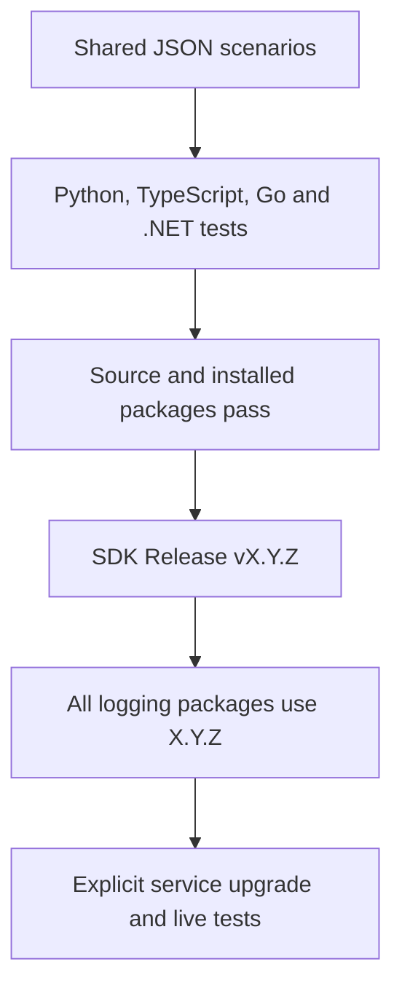

# Shared logging: one SDK release

| Language | Package / usage | Distribution |
|---|---|---|
| Python | [onenexus-observability-python](../python/packages/observability/README.md) | SDK Release wheel |
| TypeScript | [@onenexus-team/observability](../ts/packages/observability/README.md) | GitHub npm registry |
| Go | [go/observability](../go/observability/README.md) | Go module tag |
| .NET | [OneNexus.Observability](../dotnet/packages/observability/README.md) | GitHub NuGet registry |

- Each logger includes its runtime rules and context helpers; no separate OneNexus contract package.
- To change a rule, update the affected language implementations and `tests/logging/scenarios.json`. CI checks equivalent schemas and behavior through the actual APIs.

## Release

| Step | Required result |
|---|---|
| Merge the SDK change | PR checks pass |
| Publish a GitHub Release with an unused stable `vX.Y.Z` tag on main | Starts `sdk-release.yml`; pushing a tag alone does not |
| Build all languages | Source tests, shared scenarios, installed-package tests and artifact checks pass before any publisher starts |
| Publish tested artifacts | Wheels attached, npm/NuGet uploaded, Go tag created |
| Verify remote installs | Clean consumers can install each adopted package by version |

- Go requires `go/observability/vX.Y.Z` for its subdirectory. The workflow creates it at the same SDK commit and version.
- Publication across registries is not atomic. After failure, inspect accepted versions before retrying; keep service upgrades blocked until all destinations are verified.
- Never overwrite/delete published versions. Use a new SDK version if safe completion is impossible. If only a Release attachment failed, attach the exact tested artifact after verifying its tag and source commit.

## Validation

| Scope | Command from repository root |
|---|---|
| Shared rules and checker | `python3 -m unittest discover -s tests/logging -p 'test_*.py'` |
| Release guards | `python3 scripts/test-sdk-release.py` and `python3 scripts/test-go-module-release.py` |
| Python source + installed wheel | `bash scripts/check-python-observability.sh` |
| TypeScript source + installed npm | `bash scripts/check-typescript-observability.sh` |
| Go source + installed module + race detector | `bash scripts/check-go-observability.sh` |
| .NET source + installed NuGet | `bash scripts/check-dotnet-observability.sh` |
| Full SDK build | `bash scripts/build-sdk-artifacts.sh <language> [version]` |

- Full builds use `python`, `typescript`, `go` or `dotnet` and require a fresh `.artifacts/sdk/<language>` directory. Local version defaults to root `VERSION`; specifying another version does not publish it.
- Integration probes live under each package's `tests/integration/` (`test/integration/` for TypeScript). The check scripts run them automatically against installed artifacts and verify emitted JSON plus deliberate failures.
- SDK checks use synthetic data without cluster credentials. Real gateway → service → worker → monitoring `raw_tests` belong to consuming repositories; package success does not prove service adoption or log delivery.

## Service upgrade

- Publish and verify the SDK release, update the service pin/lockfile, then run service tests and live raw tests before promotion. Validate log completeness, drop counters, latency and rollback.
- Existing logger APIs and log format remain. Keep old packages/tags available for pinned consumers; roll back a service through its previous pin/image.
- Direct users of standalone contract packages must move validation calls to their logger. .NET validation is under `OneNexus.Observability.Rules`.
- Legacy exported format constants remain for compatibility; they are not package versions or release controls.
- Shared edge-policy cases generate IDs explicitly. Business services retain their trusted-ingress policy; Envoy owns new business-request IDs. Python's existing `incoming_context` API is edge-style and must not replace service ingress checks.
- Consumer upgrade deadlines, collectors and service deployments remain separate work.
