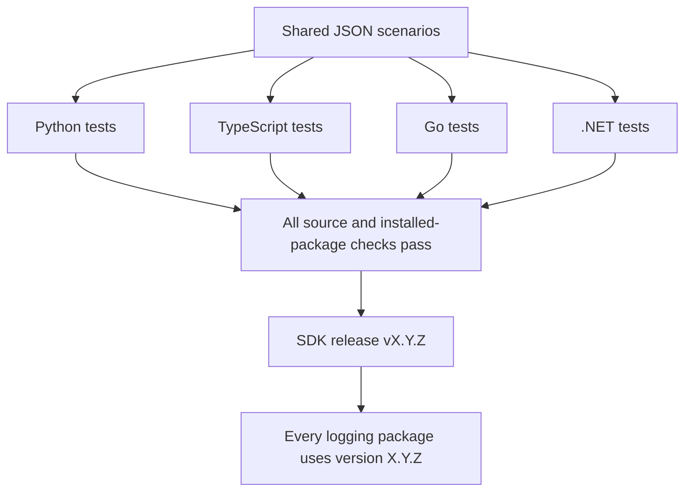

# Shared logging: one SDK release



| Language | Service installs | Distribution |
|---|---|---|
| Python | `onenexus-observability-python` | Wheel attached to SDK Release |
| TypeScript | `@onenexus-team/observability` | GitHub npm registry |
| Go | `github.com/onenexus-team/onenexus-sdks/go/observability` | Go module tag created by SDK release |
| .NET | `OneNexus.Observability` | GitHub NuGet registry |

- Each package contains its logger, runtime rules and context helpers.
- Shared inputs and expected results are in `tests/logging/scenarios.json`.
- Language tests call the actual package APIs and compare observations with those expectations.
- CI also checks that the language-owned schemas remain equivalent. Update all affected implementations when a rule changes.
- There is no contract-package build/download dependency and no independent contract-release workflow.
- Standard third-party dependencies remain; “self-contained” means no separate OneNexus schema package.

## Publish a release

| Step | Action | Required result |
|---|---|---|
| 1 | Merge the SDK PR | SDK release checks and language checks pass |
| 2 | Publish a GitHub Release with an unused stable `vX.Y.Z` tag on main | Starts `sdk-release.yml`; pushing a tag alone does not start it |
| 3 | Wait for `prepare` and the entire `build` matrix | Source tests, shared scenarios, installed artifacts and version checks pass |
| 4 | Wait for every `publish` job | Python wheels attached; npm/NuGet uploaded; Go tag created |
| 5 | Verify installs from the real release destinations | Install each adopted language package in a clean consumer |

- `sdk-build.yml` is also used by PR/main checks, without publication permissions.
- The release tag supplies the package version. Local builds default to root `VERSION`.
- Go requires `go/observability/vX.Y.Z` because the module lives in a subdirectory. The workflow creates it at the SDK release commit; it is not a separate version decision.
- Registries cannot publish atomically across languages. A failed publication can leave a partial release; do not upgrade services until all destinations are verified.
- Existing versions are never overwritten. If publication partially succeeds, inspect the failed run and accepted versions. Retry only after inspection; use a new SDK version when a destination already contains a package that cannot be completed safely. Never delete/reuse a published version.
- A tag created successfully before a Release-asset upload failure remains valid. Attach only the exact verified artifact from the successful build after checking the tag target.

## Validate without publishing

```bash
python3 -m unittest discover -s tests/logging -p 'test_*.py'
python3 scripts/test-sdk-release.py
python3 scripts/test-go-module-release.py

# Run from repo root with the language toolchain installed.
bash scripts/build-sdk-artifacts.sh python
bash scripts/build-sdk-artifacts.sh typescript
bash scripts/build-sdk-artifacts.sh dotnet
bash scripts/build-sdk-artifacts.sh go
```

- Full builds require fresh `.artifacts/sdk/<language>` output directories and fail if stale artifacts are present.
- For an alternate local test version, add it as the second argument, for example `0.4.0`. This builds artifacts only; it does not create a tag or publish.
- For routine edits, use `scripts/check-<language>-observability.sh`.
- Go checks use `go test -race`; all languages test installed artifacts separately from repository imports.
- Shared edge-policy cases deliberately generate IDs. Business services must keep their existing trusted-ingress policy; Envoy owns new business-request IDs.

## Upgrade existing services

| Stage | Behavior | Validation |
|---|---|---|
| Merge SDK source | Running services remain unchanged | CI and package checks |
| Publish SDK release | New packages become available | All release jobs and clean registry installs |
| Upgrade service pin/lock | New logger includes its own rules | Service unit/integration tests; remove stale transitive contract lock entries |
| Deploy to test | Existing logging APIs and log format retained | Real gateway → service → worker/dependency; query matching trace in monitoring |
| Promote | Follow service rollout policy | Log completeness, drop counters, latency and rollback checks |

- Keep historical packages and tags: existing pinned services still need them.
- Python and TypeScript retain their exported `CONTRACT_VERSION`/`CONTRACT_DIGEST` constants as legacy log-format metadata. They are not package-version pins and require no release action.
- Services using a standalone contract package directly must move validation calls to their logging package before removing that direct dependency. .NET's validator is under `OneNexus.Observability.Rules` in the logging assembly.
- Existing logging behavior is retained. No exporter, collector, database or service deployment changes are included.
- Consumer minimum-version deadlines and scheduled upgrade audits require separate service/repository enforcement; this PR does not silently enable those policies.

## Manual raw tests

| Language | Procedure |
|---|---|
| Python | [Probe and live-log verification](../python/packages/observability/raw_tests/README.md) |
| TypeScript | [Probe and live-log verification](../ts/packages/observability/raw_tests/README.md) |
| Go | [Service capture and probe](../go/observability/README.md#raw-logs-from-a-real-service-after-its-separate-integration) |
| .NET | [Probe and CAS validation](../dotnet/raw_tests/README.md) |

Package tests prove logging behavior and installation. They do not prove that a deployed service uses the new package, or that its logs reached Loki. See [readiness evidence and remaining gates](logging-readiness.md).
