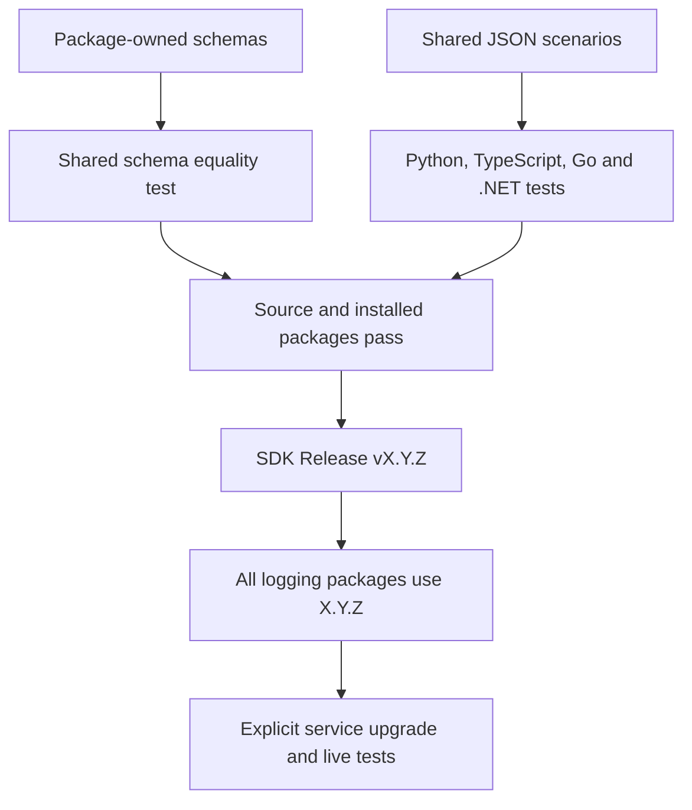
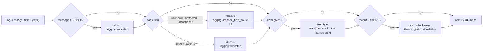
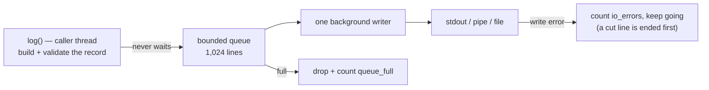
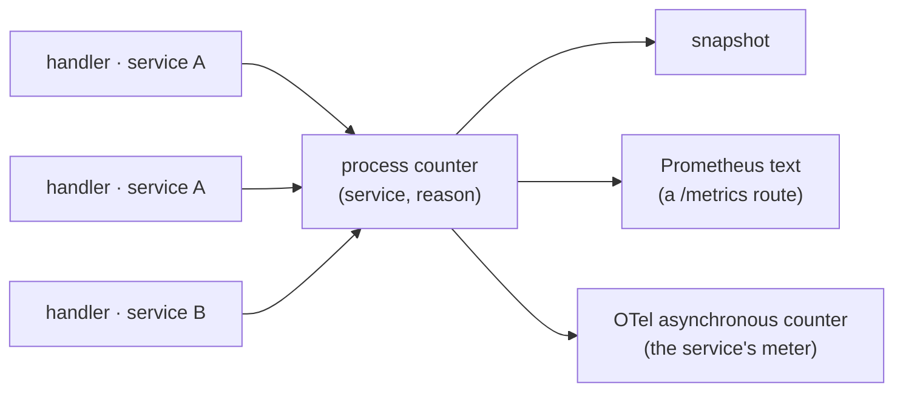

# Shared logging: one SDK release

See [shared HTTP request logging](request-logging.md) for the request profile,
verified identity attribution, response-status semantics and service adoption steps.



| Language | Package / usage | Distribution |
|---|---|---|
| Python | [onenexus-observability-python](../python/packages/observability/README.md) | SDK Release wheel |
| TypeScript | [@onenexus-team/observability](../ts/packages/observability/README.md) | GitHub npm registry |
| Go | [go/packages/observability](../go/packages/observability/README.md) | Go module tag |
| .NET | [OneNexus.Observability](../dotnet/packages/observability/README.md) | GitHub NuGet registry |

- Each logger includes its runtime rules and context helpers; no separate OneNexus contract package.
- Each language package owns its `schema.json`. Update all four schemas, `tests/logging/scenarios.json` and any affected language helpers together.
- [`test_language_rules_remain_equivalent`](../tests/logging/test_shared_tests.py) compares the four schemas as parsed JSON. CI runs this test for every pull request and main-branch push; any schema mismatch fails the check. Shared scenarios also check behavior through each language's real APIs.
- Each published package embeds its own schema, including Go through `go:embed`. Consumers need no repository path, network schema lookup or separate contract package.

## Keep the line: shorten, strip, count (contract 0.4.0)

Before 0.4.0, one broken rule dropped the **whole** record: a long error message, one unknown field, a Go `error` value. Exceptions lost their type and stack. The lines that explain an incident were the ones that never arrived.



### Rules — identical in four languages

| Input | Before | Now |
|---|---|---|
| `message` > 1,024 UTF-8 bytes | Record dropped | Cut at a character boundary, ends `…`; `logging.truncated: true` |
| String field > 1,024 bytes (`exception.stacktrace`: 2,048) | Go: dropped · TS: dropped > 4,096 chars · Python, .NET: kept | Cut the same way; `logging.truncated: true` |
| Unknown or protected field | Python, TS, Go: dropped · .NET: ignored silently | Removed; `logging.dropped_field_count` counts it |
| Unsupported value (Go struct/map/`Duration`/`Time`, TS object, NaN, invalid Unicode, a caller `error.type` with spaces) | Record dropped | Field removed and counted |
| Go `logger.With(...)` with one bad field | **Every** later record of that logger dropped | That field removed and counted on each record |
| Exception / error | Python, .NET: type + stack lost · Go: record dropped · TS: no API | `error.type` + `exception.stacktrace` |
| Record > 4,096 bytes | Dropped | Outer stack frames removed, then custom fields, largest first (counted) |
| Unserialisable, empty message, event without outcome | Dropped | Dropped and counted (unchanged) |

### New fields

| Field | Type | Set by | Notes |
|---|---|---|---|
| `logging.truncated` | `true` | SDK only (protected) | Message, a string field or the stack was cut |
| `logging.dropped_field_count` | integer 1–64 | SDK only (protected) | Fields removed from this record |
| `error.type` | string ≤ 128, no spaces | SDK, or the caller | Type name only |
| `exception.stacktrace` | string ≤ 2,048 bytes | SDK, or the caller | `at <function> (<file>:<line>)` per frame, innermost first |

- A caller value for `error.type` / `exception.stacktrace` wins (MLOps already sets its own).
- Never logged: the error message, argument values, source lines, directories.

### Error input per language

| Language | How to pass the error | `error.type` | Stack source |
|---|---|---|---|
| Python | `logger.exception(...)` or `exc_info=True` | `ValueError`, `pkg.mod.Error` | The traceback |
| TypeScript | `logger.log(msg, { error })` | `error.name` | `error.stack` frames |
| Go | any attr whose value is an `error` | `%T`, e.g. `*fs.PathError` | Call site (`runtime.Callers`); inside `recover()` it includes the panicking frames |
| .NET | `logger.LogError(exception, ...)` | `GetType().FullName` | `StackTrace(exception)` |

### Example

```text
Before   (nothing — dropped, counted in memory)
After    {"level":"ERROR","message":"Failure (Status 422): {\"kind\":\"Status\",…","logging.truncated":true,
          "error.type":"ApiException","exception.stacktrace":"at reconcile (tracker.py:88)\nat run (worker.py:41)", …}
```

### Lifecycle and readiness review

```mermaid
sequenceDiagram
    autonumber
    participant SDK as SDK release 0.6.0
    participant Svc as Service (pin bump)
    participant Out as stdout → Alloy → Loki
    participant Q as Queries / alerts
    SDK->>Svc: new package version (old versions stay installable)
    Svc->>Out: same base fields + optional new fields
    Out->>Q: lines that were dropped now arrive
    Note over Svc,Q: Rollback = previous pin/image; no data migration
```

| Area | Result |
|---|---|
| Dependencies | None added. stdout, Alloy and Loki unchanged; lines stay ≤ 4,096 bytes |
| Compatibility | Additive: base fields, profiles and limits unchanged. New fields are optional; old validators accept them (`additionalProperties`) |
| Behaviour change | Records that were dropped now arrive, flagged. Utility (TS) string fields over 1,024 bytes are now cut, not kept up to 4,096 chars |
| Security | No error text, argument values or directories. Protected `logging.*` fields cannot be forged by callers |
| Failure tolerance | Shortening runs before encoding; any exception inside still drops and counts — logging never breaks the caller |
| Performance | One extra size check per record (Python and TypeScript encode once more; Go and .NET reuse the encoded line); the fitting loop runs only above 4,096 bytes |
| Concurrency | Per-record state only; Go clones carry their removed-field count |
| Rollout | SDK release → one service pin at a time → live raw test → promotion |
| Rollback | Previous pin or image; no stored state, no migration |
| Proof | `tests/logging/scenarios.json` → `degradation_cases`, run through the real logger in all four languages; live: the consuming repo's raw test |
| Contract identity | `x-contract-version` 0.4.0; `CONTRACT_DIGEST` = sha256 of the bundled `schema.json`, equal in every language (shared test) |

## The caller never waits on the output (one write model, SDK 0.7.0)

A slow or broken stdout used to behave differently in every language: Python and .NET blocked the request, Go dropped after 100 ms and stopped for good after a partial write, TypeScript stopped for good after one error. Now all four share one model (`tests/logging/scenarios.json` → `write_model`).



| Behaviour | Before | Now |
|---|---|---|
| stdout blocked | Python, .NET: the caller blocks · Go: waits 100 ms, drops · TS: drops | The caller returns at once; lines queue (1,024), the overflow is dropped and counted |
| One write error | Go (partial write), TS: every later line dropped until restart | Counted; the next line is written. A line cut short is ended with a newline first |
| Shutdown | Whatever the caller flushed | `close` drains for up to 2 s, then reports what is still pending |
| Hard exit right after an error (`os._exit`, Go `os.Exit` / `log.Fatal`) | Written synchronously | Python, Go: an ERROR/FATAL line waits up to 50 ms for the writer, so it is on the output. TypeScript, .NET: call `close` before exiting (NestJS shutdown hooks and the .NET host do) |

### Counters

| Shared name | Python `stats()` | TypeScript counts | Go `Stats()` | .NET `Stats` |
|---|---|---|---|---|
| written | `written` | `written` | `Written` | `Written` |
| invalid (record rejected) | `invalid` | `invalid` | `Invalid` | `Invalid` |
| queue_full | `queue_full` | `backpressure` | `Busy` | `QueueFull` |
| io_errors | `io_errors` | `io` | `IOErrors` | `IoErrors` |
| closed (logged after close) | `closed` | `closed` | `Closed` | `Closed` |
| pending (accepted, not yet written) | `pending` | `pending` | `Pending` | `Pending` |

- Totals for compatibility: Python `dropped_records`, .NET `DroppedRecords` = invalid + queue_full + io_errors + closed.
- Close with a deadline: Python `close_within(timeout)`, Go `CloseWithin(d)`, .NET `CloseWithin(t)`, TypeScript `close(timeoutMs)`; each returns true when nothing was lost. The plain `close()` / `Close()` / `Dispose()` uses 2 s.
- Go `Config.MaxWait` is deprecated and ignored (still accepted).

### Lifecycle and readiness review

```mermaid
sequenceDiagram
    autonumber
    participant App as Caller
    participant Q as Queue (1,024)
    participant W as Writer
    participant Out as stdout
    App->>Q: line (never waits)
    W->>Out: write
    Out--xW: blocked
    App->>Q: lines … queue full → drop + count
    Out-->>W: unblocked
    W->>Out: queued lines
    App->>Q: close (deadline 2 s)
    W->>Out: drain
    Note over App,Out: still blocked at the deadline → close returns false; the lines stay counted as pending
```

| Area | Result |
|---|---|
| Lifecycle | The writer starts with the logger; `close` stops new lines (counted `closed`), drains to a deadline and stops the writer. A second close is harmless |
| Fork (Python) | After `os.fork` the child gets a new lock, queue and writer, and its own counters; the parent's may be held by a thread that does not exist in the child |
| Exit (Python) | Every writer is drained (2 s) and stopped at interpreter exit, even when its handler was already collected. A stream with a file descriptor is written with `os.write`, so a writer still blocked at exit cannot abort the process: the exit code is kept |
| Partial writes | Python (fd) and Go finish or end a cut line, so every later line stays one valid JSON line |
| Concurrency | One writer per logger owns the stream; callers only enqueue. Go clones share it; Go tests run with `-race` |
| Memory | At most 1,024 lines (≤ 4 KiB each) per logger |
| Failure tolerance | Nothing in the write path raises to the caller; every lost line is counted under one of the counters |
| Compatibility | Public APIs kept; additions only (`stats`, `close_within` / `CloseWithin`, `Pending`). Output can now trail the `log` call: tests read after a close or flush |
| Rollout | SDK release → one fleet bump (`logging-fleet.json` + pins) → live raw test → promotion |
| Rollback | Previous pin or image; no stored state |
| Proof | `write_model` cases run in all four languages; live: the consuming repo's raw test (blocked stdout probe) |

### Known limits

| Limit | Effect | What to do |
|---|---|---|
| Close is required | A logger that has logged keeps its writer thread (Python, .NET) or goroutine (Go) until closed. One that never logged owns none (Python, Go) | Close loggers you create; DI hosts and the SDK's exit hook (Python) do it for the defaults |
| TypeScript on Linux | Node writes to pipes, TTYs and files synchronously: a stalled stdout reader still blocks the event loop inside `log()` (as before) | None in the SDK; Kubernetes reads container stdout continuously |
| TypeScript burst | More than 1,152 lines (128 in flight + 1,024 queued) in one tick to a fast synchronous sink drop the overflow, counted as `backpressure` | Expected; the cap bounds memory |
| Python and `print` | Lines from `print` and from the handler can interleave out of order (the handler writes the file descriptor directly) | Log through the handler |
| Python exit hooks | Lines logged from an `atexit` hook registered *before* the SDK was imported come after the SDK's own exit drain: counted as `closed` | Register such hooks after importing the SDK |
| Snapshots | Counters are read one at a time: a snapshot taken mid-write can be off by one | Read after `close` for exact totals |


## One drop metric (design review R1)

Every line the SDK does not write is counted once, process-wide, per `(service, reason)` (`tests/logging/scenarios.json` → `drop_metric`).



| | Value |
|---|---|
| OTel instrument | `onenexus.log.records.dropped`, unit `{record}`, asynchronous monotonic counter |
| Prometheus series | `onenexus_log_records_dropped_total{service, reason}` |
| `service` | The handler's `LogConfig.service` |
| `reason` | `closed` · `invalid` · `io_errors` · `queue_full` — the write-model counters that mean "not written" |

| Rule | Why |
|---|---|
| All four reasons appear, at 0, as soon as a handler exists | "No drops" is distinguishable from "not exported" |
| Handlers of one service are summed; services stay separate | One series per service, however many loggers it builds |
| Counts never decrease, also after `close` | A Prometheus counter; a restart resets it, and `rate()` handles that |

| Language | Snapshot | Prometheus text | OpenTelemetry |
|---|---|---|---|
| Python | `log_drop_counts()` | `drop_metrics_text()` | `register_drop_metric(meter)` |
| TypeScript | `logDropCounts()` | `dropMetricsText()` | `registerDropMetric(meter)` |
| Go | `DropCounts()` | `DropMetricsText()` | `RegisterDropMetric(meter)` |
| .NET | `LogDropMetrics.Snapshot()` | `LogDropMetrics.PrometheusText()` | `Meter` `OneNexus.Observability` (add it to the host's OTel metrics) |

Query for every service: `sum by (service, reason) (rate(onenexus_log_records_dropped_total[5m]))`.

## Release

| Step | Required result |
|---|---|
| Merge the SDK change | PR checks pass |
| Publish a GitHub Release with an unused stable `vX.Y.Z` tag on main | Starts `sdk-release.yml`; pushing a tag alone does not |
| Build all languages | Source tests, shared scenarios, installed-package tests and artifact checks pass before any publisher starts |
| Publish tested artifacts | Wheels attached, npm/NuGet uploaded, Go tag created |
| Verify remote installs | Clean consumers can install each adopted package by version |

- Go consumers upgrading from the previous `go/observability` module must update imports and the `go.mod` requirement to `github.com/onenexus-team/onenexus-sdks/go/packages/observability`. Existing published versions remain available at their original path.
- Go requires `go/packages/observability/vX.Y.Z` for its subdirectory. The workflow creates it at the same SDK commit and version.
- Publication across registries is not atomic. After failure, inspect accepted versions before retrying; keep service upgrades blocked until all destinations are verified.
- Never overwrite/delete published versions. Use a new SDK version if safe completion is impossible. If only a Release attachment failed, attach the exact tested artifact after verifying its tag and source commit.

## Validation

| Scope | Command from repository root |
|---|---|
| Shared rules and checker | `python3 -m unittest discover -s tests/logging -p 'test_*.py'` |
| Release guards | `python3 scripts/test-sdk-release.py` and `python3 scripts/test-go-module-release.py` |
| Python source + installed wheel | `bash scripts/check-python-observability.sh` |
| TypeScript source + installed npm | `bash scripts/check-typescript-observability.sh` |
| Go source + installed module + race detector | `bash scripts/check-go-observability.sh` |
| .NET source + installed NuGet | `bash scripts/check-dotnet-observability.sh` |
| Full SDK build | `bash scripts/build-sdk-artifacts.sh <language> [version]` |

- Full builds use `python`, `typescript`, `go` or `dotnet` and require a fresh `.artifacts/sdk/<language>` directory. Local version defaults to root `VERSION`; specifying another version does not publish it.
- Integration probes live under each package's `tests/integration/` (`test/integration/` for TypeScript). The check scripts run them automatically against installed artifacts and verify emitted JSON plus deliberate failures.
- SDK checks use synthetic data without cluster credentials. Real gateway → service → worker → monitoring `raw_tests` belong to consuming repositories; package success does not prove service adoption or log delivery.

## Service upgrade

- Publish and verify the SDK release, update the service pin/lockfile, then run service tests and live raw tests before promotion. Validate log completeness, drop counters, latency and rollback.
- Existing logger APIs and base fields remain; 0.4.0 adds optional fields and keeps lines that 0.3.2 dropped (see [Keep the line](#keep-the-line-shorten-strip-count-contract-040)). Keep old packages/tags available for pinned consumers; roll back a service through its previous pin/image.
- Direct users of standalone contract packages must move validation calls to their logger. .NET validation is under `OneNexus.Observability.Rules`.
- Legacy exported format constants remain for compatibility; they are not package versions or release controls.
- Shared edge-policy cases generate IDs explicitly. Business services retain their trusted-ingress policy; Envoy owns new business-request IDs. Python's existing `incoming_context` API is edge-style and must not replace service ingress checks.
- Consumer upgrade deadlines, collectors and service deployments remain separate work.
