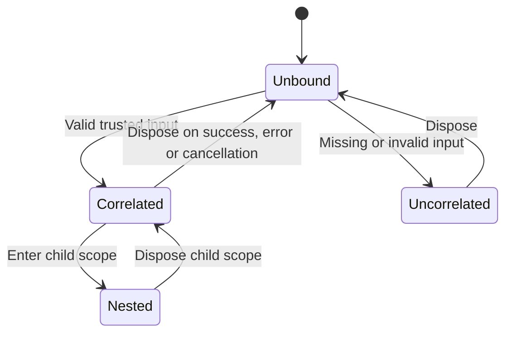
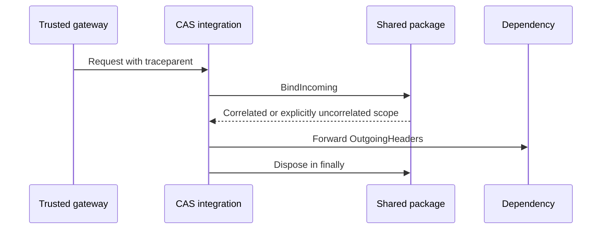
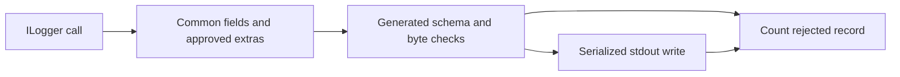
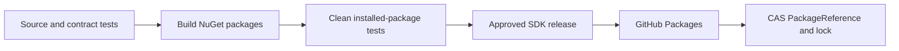

# Shared .NET logging — design and validation

## 1. Verdict

- Mode: **Implement**. Scope: contract artifact, execution context, `ILogger` provider and package delivery.
- **Package gate: local PASS; hosted CI pending. CAS adoption/live gate: PENDING #798.**
- No business resource, database schema, collector, deployed service or authorization behavior changes.
- Prior MLOps validation remains separate; this PR does not close its untested worker/fault scenarios.

### Seven-discipline readiness scorecard

| Discipline | Status | Evidence |
|---|---|---|
| 1 · Technical design | ✅ | Schema-generated validators and standard ILogger/Activity integration |
| 2 · Distributed systems | ✅ | No distributed writes or coordinator; explicit scope ownership |
| 3 · Test coverage | ⚠️ | QA1: source/installed-package tests pass; CAS live tests await adoption |
| 4 · Monitoring and alerts | ⚠️ | QA1: drop count available; CAS must export and alert on it |
| 5 · CI/CD | ⚠️ | OPS1: package CI/release pipeline added; first publication pending |
| 6 · Security | ✅ | Explicit trust, no baggage, allowlisted fields, safe rejection |
| 7 · Operations | ⚠️ | PERF1: synchronous stdout latency/loss budget remains a service gate |

### What is already right

| Strength | Evidence |
|---|---|
| One contract source | Generated.cs targets canonical schema fragments; embedded hashes checked at initialization |
| Familiar CAS tools | .NET 10, Corvus schema generation, MSTest and ILogger |
| Real dependency consumption | Clean consumer uses PackageReference and isolated NuGet cache; no source reference |
| No invented service trace | BindIncoming preserves trusted context or suppresses correlation |

## 2. System and lifecycle


| System profile | Decision |
|---|---|
| Datastore / isolation | No DB; AsyncLocal context and one provider write lock |
| Execution | Synchronous validation/write; caller-owned context scopes |
| Deployment | No new process/replicas; package installed into each consuming service |
| Tenancy / authority | Trace ID is diagnostic only; authentication determines tenant access |
| Integrity | Canonical manifest hashes, locked dependencies, package checksums |
| Retention | SDK releases retained; application log retention belongs to existing pipeline |

| Resource | Identity / owner | Dependencies and lifetime |
|---|---|---|
| Contract package | SDK package version + contract version/digest; SDK maintainers | Immutable package; generated validators and embedded JSON |
| Context scope | Execution-local frame; creating execution | Trusted input / explicit uncorrelated policy; nested scope to disposal |
| Logger provider | DI registration + immutable config; application host | Valid contract and caller-owned writer; startup to disposal |
| Record | Timestamp + optional canonical trace; current execution | Validate then write/drop once; no durable delivery promise |



| From | Operation / guard | Atomic change / side effect | To | Recovery |
|---|---|---|---|---|
| Unbound | BindIncoming; explicit trusted policy | AsyncLocal frame; no network | Correlated or uncorrelated | Dispose restores prior frame |
| Bound | Nested scope | New frame linked to previous frame | Nested | Reverse-order disposal; invalid order rejected |
| No provider | Register validated config in startup DI | One registration; conflicting config rejected | Active | Same settings reuse registration |
| Active | Validate record, then acquire write lock | One JSON line written; errors counted without echo | Active | No retry or growing queue |
| Active | Dispose; serialize with writes | Mark disposed; caller stream stays open | Disposed | Later emissions counted as drops |

| Dependency | Authority / policy | Creation / removal | Failure behavior |
|---|---|---|---|
| Logger → contract | NuGet version and lock file; contract digest | Build/install; package rollback | Invalid artifact blocks startup, no runtime fetch |
| Context → incoming header | Gateway/service boundary owns trust | Scope entry/exit | Missing/invalid input remains uncorrelated |
| Provider → writer | Host owns writer; provider serializes writes | Registration/disposal | Write exceptions counted; slow writer PERF1 |
| Consumer → package registry | SDK release owner; read:packages for consumers | Approved release/install | Existing running processes unaffected by registry outage |

| Contention | Serialization / loser behavior | Deterministic test |
|---|---|---|
| Interleaved requests and cancellation | AsyncLocal frame per execution; finally restores | ConcurrentRequestsCancellationAndParallelWrites |
| Nested scope exits | Current frame must match scope owner | ScopeExitOrderAndIndependentUncorrelatedEvents |
| Concurrent log lines | Provider lock around one WriteLine | ConcurrentRequestsCancellationAndParallelWrites |
| Write versus Dispose | Same provider lock; later write is counted/dropped | DisposeWaitsForInFlightWriteAndRejectsLaterWrites |
| Repeated startup registration | DI configuration is single-threaded; identical config reused | BadConfigurationAndDuplicateInstallation |

| Interrupted phase | Durable evidence / safe next step | Bound |
|---|---|---|
| Scope raises/cancels | No durable state; finally disposes | Scope exit, no retries |
| Formatter/validation/write throws | DroppedRecords; no recursive logging | One attempt |
| Process dies during stdout write | Log may be lost/partial; no replay claim | QA1/PERF1 collection/loss-budget gate |
| Writer blocks | No delivery completion or hard deadline promised | PERF1: service must measure/accept stdout blocking |
| Build interrupted | No accepted release; rerun clean build | CI timeout 15 minutes; test timeout 2 minutes |

- Detached tasks inherit context at creation. They must bind their own job context or `BindUncorrelated`; parent disposal does not erase a child's copy.
- Client action parity: **N/A**, this library adds no API/console actions.
- Decision: use canonical schema generation and versioned dependencies; no hand-coded field schema or request-time download.
- Decision: retain existing Activity context for the same trace; no new recording spans/exporters.

## 3. Core flows

### Flow 1 · Restore and propagate context



| Dimension | Status | Evidence / limit |
|---|---|---|
| Extendability | ✅ | W3C and Activity compatibility support later spans |
| Availability | ✅ | No exporter or remote coordinator |
| Scalability | ✅ | Execution-local frames; no global request lock |
| Reliability | ✅ | Restore, nested cleanup and retry metadata roundtrip |
| Performance | ✅ | traceparent exactly 55 chars; no payload propagation |
| Maintainability | ✅ | One helper; explicit service versus edge policy |
| Security | ✅ | Explicit trust; duplicate rejection; no baggage/tracestate |
| Concurrency | ✅ | Controlled overlap, cancellation and cleanup assertions |
| Failure tolerance | ✅ | Missing context does not block requests or invent IDs |

### Flow 2 · Emit a log



| Dimension | Status | Evidence / limit |
|---|---|---|
| Extendability | ✅ | Allowlisted custom fields; standard/source-generated ILogger tested |
| Availability | ⚠️ | PERF1: synchronous writer can block caller |
| Scalability | ✅ | No growing background queue or retry storm |
| Reliability | ✅ | Common identity protected; invalid records rejected |
| Performance | ⚠️ | PERF1: measure schema/serialization and sink costs in CAS |
| Maintainability | ✅ | Schema-generated rules plus explicit semantic byte limits |
| Security | ✅ | No implicit exception serialization; safe template arguments remain caller responsibility |
| Concurrency | ✅ | One write/dispose lock; AsyncLocal context and ILogger scopes |
| Failure tolerance | ⚠️ | QA1: exceptions counted; consuming service must expose/alert on drops |

### Flow 3 · Build, release and consume



| Dimension | Status | Evidence / limit |
|---|---|---|
| Extendability | ✅ | New language shares canonical vectors and schema |
| Availability | ✅ | No runtime registry dependency |
| Scalability | ✅ | CI runs per change; no application traffic |
| Reliability | ✅ | Clean install plus independent checker and negative control |
| Performance | ✅ | Schema generated at build; metadata verified once at initialization |
| Maintainability | ✅ | Existing SDK release version pattern; no copied source imports |
| Security | ⚠️ | OPS1: first authorized registry publication/consumer access needs verification |
| Concurrency | ✅ | Independent CI workspaces; release concurrency grouped by tag |
| Failure tolerance | ✅ | Failed build/tests block publish; previous versions remain available |

## 4. Dependencies and data layer

| Dependency | Direction | HA / failure behavior | Access |
|---|---|---|---|
| Corvus 5.7.5 | Runtime/build | Local library; schema generator private to build | NuGet restore, locked hashes |
| Microsoft.Extensions.Logging 10.0.13 | Runtime | Local ILogger/DI APIs; no server | NuGet restore, locked hashes |
| MSTest 4.4.1 | Test only | Tests fail before publish | NuGet restore, locked hashes |
| GitHub Packages | Build/release | Registry outage blocks install; installed processes keep running | Release GITHUB_TOKEN, consumer read:packages; OPS1 |
| stdout / collector | Output | Provider catches writer exceptions; delivery/retention not guaranteed | Service-owned writer; QA1/PERF1 |

Data layer — not applicable: no datastore, indexes, SQL, foreign keys, migrations, business cache or transaction pool. Contract data is immutable local package content; trace IDs confer no write authority.

## 5. Findings catalog

| ID | Priority / problem | Recommended solution / owner | Status |
|---|---|---|---|
| QA1 | P2 adoption gate: package tests cannot prove CAS middleware, HTTP/gRPC propagation, authorization, projection or Loki ingestion | CAS #798 integrates package, tests positive/denial/concurrent paths, exposes drop count and runs real raw tests | Not started |
| OPS1 | P2 release gate: new NuGet packages are not published or proven restorable from organization registry | SDK release owner publishes an approved new vX.Y.Z, verifies immutable artifacts/checksums and a real consumer restore | Not started |
| PERF1 | P2 production adoption gate: synchronous validation/stdout can block and logs can be lost on crash | CAS owner measures p95/p99 logging cost, sink stalls, volume and drop/loss budget; accepts or fixes before production | Not started |

## 6. Validation

| Check | Concrete result |
|---|---|
| Source and clean installed packages | 13 tests pass in each lane; no skips |
| Shared contract | All 56 record and 10 context cases pass through real C# APIs |
| Negative contract observation | Deliberately accepting an invalid record is rejected by independent checker |
| Standard and source-generated ILogger | Common fields, scope fields, level mapping, protected identity |
| Service boundary | Missing/invalid/untrusted/duplicate input has no invented trace ID, even with framework Activity |
| Context lifecycle | Nested exception, cancellation, retry metadata, concurrent requests, reverse-order disposal |
| Provider lifecycle | Concurrent lines remain separate; in-flight write versus Dispose; writer ownership preserved |
| Failure behavior | Bad message/size/NaN/formatter/sink counted; safe output; no implicit exception text |
| Raw checker | Package probe passes; wrong trace and missing required service fail |
| Actual CAS deployment | **NOT RUN — QA1**; package not consumed by CAS yet |

```bash
bash scripts/check-dotnet-observability.sh
bash scripts/check-log-contracts.sh
shellcheck scripts/check-dotnet-observability.sh
```

- Local artifact evidence: `.artifacts/dotnet/<SDK-version>/` contains packages, checksums, actual adapter observations and negative-control results.
- Raw instructions: [raw_tests/README.md](raw_tests/README.md); use actual service log bodies after #798 adoption.
- Hosted CI must pass for the reviewed commit. Package publication and CAS rollout are later gates, not claimed here.

### Distributed-systems protocol

Distributed-systems protocol — not applicable: no durable jobs, leases, distributed writes or external resource mutations. Saving/restoring job metadata is an integration responsibility; helpers do not alter business ownership or retry rules.

### Checked and not found

| Suspected failure | Evidence |
|---|---|
| Framework invents an ID when trusted input is missing | MissingInvalidAndUntrustedContextsStayUncorrelatedEvenWithFrameworkActivity |
| One request leaks its ID into another | ConcurrentRequestsCancellationAndParallelWrites |
| Common identity overwritten by scope | CommonFieldsAndSafeCustomFields |
| Existing healthy instrumentation loses sampling | ExistingActivityChildRetainsTraceAndSampling |
| Logging failure changes application result | InvalidRecordsAndSinkFailuresAreCountedWithoutEcho |
| Source-only tests hide missing NuGet dependency | Installed consumer uses PackageReference in a separate directory/cache |

## 7. Recommended sequence

### Phase 1 — package delivery

- [ ] OPS1 — Merge after CI; publish an approved new SDK version; verify registry restore.

### Phase 2 — CAS adoption

- [ ] QA1 — Integrate HTTP/gRPC boundaries, provider replacement and drop metric; validate real CP/DP flows in development.

### Phase 3 — production budget

- [ ] PERF1 — Measure/accept overhead and failure budget before production enablement.

## 8. Decision and approval gates

| Rollout phase | Existing code | New code | Validation / rollback |
|---|---|---|---|
| Package merge | CAS unchanged | Library available in source | CI; revert package PR if needed |
| Approved release | Existing package pins unchanged | New immutable packages in registry | Restore/hash gate; retain previous versions |
| CAS adoption PR | Existing console/context path | Explicit provider and trusted boundary helpers | Real development tests; revert image/package pin |
| Production | Existing approved image | Only after QA1/PERF1 | Controlled image rollout; no database migration |

| Gate | Required evidence | Finding |
|---|---|---|
| Package review | Local tests, all shared cases, installed consumer, hosted CI | None in package runtime scope |
| Published dependency | First registry publication, downloaded checksums and consumer restore | OPS1 |
| CAS development adoption | Real gateway → CAS → dependencies; safe denial logs, isolation, Loki query | QA1 |
| Production adoption | Accepted latency/drop/retention budget and operational alerts | PERF1, QA1 |

## 9. Lifecycle coverage

| Contract area | Assessment |
|---|---|
| C1 dependency graph | ✓ Contract, context, provider, stream and registry edges mapped |
| C2 state machine | ✓ Bound/uncorrelated/nested/disposed transitions above |
| C3 ownership | ✓ Creator owns scope; host owns provider; caller owns stream |
| C4 concurrency | ✓ AsyncLocal scopes and write/dispose lock with controlled tests |
| C5 durable async | N/A: no job persistence or asynchronous external transition |
| C6 external effects | ✓ stdout failure behavior; OPS1 publication gate |
| C7 recovery | ✓ Scope cleanup and counted drops; PERF1 blocked-writer limitation |
| C8 retries | ✓ Same stored header restores trace per attempt; no library delivery retries |
| C9 tenancy / client parity | N/A: no tenant authorization or UI; trace never grants access |
| C10 observability | QA1: drop counter exists; actual CAS metrics/collection pending |
| C11 evolution | ✓ Same contract tests, versioned artifacts and Activity compatibility |

| Race row | Assessment / reason |
|---|---|
| R1 | N/A: no dependency claim/delete |
| R2 | N/A: no delete fence |
| R3 | N/A: no delete requests |
| R4 | N/A: no job claim |
| R5 | N/A: no DB/broker commit |
| R6 | N/A: no external teardown |
| R7 | N/A: no teardown finalization |
| R8 | N/A: no usage claims |
| R9 | N/A: no shared resource claims |
| R10 | N/A: no worker leases |
| R11 | N/A: no resource acquisition |
| R12 | N/A: no reconciler mutation |
| R13 | N/A: no parent cascade |
| R14 | N/A: no runtime/business state projection |
| R15 | N/A: no deletion retry |
| R16 | N/A: no lease renewal |
| R17 | N/A: no business natural-key reuse |
| R18 | N/A: no cascade ownership |
| R19 | N/A: no upload/production lifecycle |
| R20 | N/A: no business state transition |
| R21 | N/A: no generation-targeted deletion |
| R22 | N/A: no remote destructive authority |
| R23 | N/A: no versioned durable jobs or claimers |
| R24 | N/A: no paginated cascade |
| R25 | N/A: no external deletion |
| R26 | N/A: no tenant offboarding |
| R27 | N/A: no credentials or presigned resource access |
| R28 | N/A: no asynchronous snapshot/copy; package hashes and clean install separately tested |
