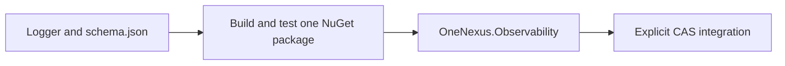

# Shared .NET logging

`OneNexus.Observability` includes the `ILogger` provider, trace-context helpers and validation rules.
It uses the same `X.Y.Z` version as SDK release `vX.Y.Z`.



- Target: .NET 10, matching CAS. Schema validators are generated inside the logging assembly.
- No separate schema package, release tag, dependency pin or request-time download.
- Source and installed-package tests run against shared repository scenarios.
- No service adoption, cluster rollout or span exporter is included here.

## Consume after release

Configure the organization's authenticated NuGet source in the consuming repository:
`https://nuget.pkg.github.com/onenexus-team/index.json`. Keep credentials in the build secret store; use package-source mapping for `OneNexus.*` and a committed restore lock file.

```xml
<!-- Replace X.Y.Z with the approved SDK release. -->
<PackageReference Include="OneNexus.Observability" Version="[X.Y.Z]" />
```

Install only `OneNexus.Observability`; its rules are included in the same assembly.
For a local build, use `.artifacts/dotnet/<version>` as a NuGet source.

## Register at service startup

```csharp
using OneNexus.Observability;

builder.Logging.AddOneNexus(new LogConfiguration(
    service: "cas-control",
    environment: "development",
    region: "global",
    allowedFields: ["operation_id", "attempt"]));
```

- Existing `ILogger<T>` and source-generated logger methods keep working.
- Registration is idempotent for identical settings; conflicting settings fail startup.
- Registration runs during single-threaded DI setup, as with other `IServiceCollection` changes.
- The package does not remove existing providers. CAS integration must explicitly replace its plain console provider to avoid duplicate output; keep healthy telemetry providers.
- Service, environment and region come from deployment configuration and cannot be overwritten by log scopes.
- Template/scope properties are included only when allowlisted. `event` and `outcome` are reserved, optional fields and must be supplied together.
- Formatting still renders template arguments into `message`: callers must use safe messages. Tokens, claims, bodies, prompts and arbitrary exception text must not be message arguments.
- Exceptions are not automatically serialized. Invalid/oversized records and write failures increment `JsonLogProvider.DroppedRecords` without throwing into application logic.

## Restore context at each trusted boundary

```csharp
// The integration determines trust from its gateway/service authentication boundary.
// Pass each header value separately so duplicate traceparent values can be rejected.
using (CorrelationContext.BindIncoming(headers, trusted: true))
{
    logger.LogInformation("Authorization checked");
    var outgoing = CorrelationContext.OutgoingHeaders();
    // The integration forwards outgoing to the next approved HTTP/gRPC dependency.
}
```

| Input / action | Behavior |
|---|---|
| One valid, trusted `traceparent` | Preserve trace ID; sampling preserved by default |
| Missing, malformed, duplicate or untrusted input | Allow execution with no `trace_id`; emit common-schema logs |
| Nested scope / exception / cancellation | Restore the previous context on `Dispose` |
| Independent scheduled work | Use `BindUncorrelated()` to suppress inherited request context |
| Related durable work | Persist only `OutgoingHeaders()` with the job; restore on each attempt; log attempt separately |
| Existing .NET `Activity` within the same trace | Use its current context, preserving future span support |
| No explicit package scope | Use an existing W3C `Activity`, if present |

- **Services must call `BindIncoming` at the request boundary.** ASP.NET may create an Activity itself; the explicit scope prevents an unrelated framework ID from replacing the gateway ID.
- Scopes belong to the creating execution and must be disposed in reverse order. Child tasks inherit context; detached work must explicitly restore its own metadata or bind uncorrelated context.
- `BindAtEdge` is an explicit identity-creation policy for shared contract cases/edge implementations. **CAS must not use it. Envoy owns new business-request trace IDs.**
- Only `traceparent` is propagated. No baggage or `tracestate`; trace identity grants no authorization.

## Validation and limits

```bash
bash scripts/check-dotnet-observability.sh
```

- Source tests and the same tests against installed `.nupkg` files in a separate consumer/cache.
- All 66 shared cases through actual C# APIs; the independent Python checker rejects a deliberately wrong result.
- Context isolation, cancellation, retry metadata, existing Activity compatibility, log fields and failure behavior.
- Manual log checks: [raw_tests/README.md](raw_tests/README.md).
- Lifecycle, readiness findings and rollout gates: [SDK readiness](../../../docs/logging-readiness.md).
- Output is bounded to 4 KiB per record and 1 KiB per message. The provider writes synchronously and owns no growing queue; a blocked stdout writer can block the caller. CAS must measure its logging budget and expose the drop counter before production adoption.
- Logs go to existing stdout collection. This package adds no OpenTelemetry exporter, collector, Loki client or new recording spans.

- [SDK release and upgrade guide](../../../docs/logging.md).
