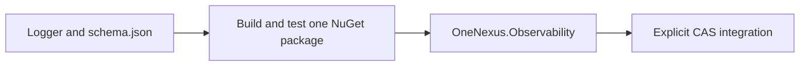

# Shared .NET logging

`OneNexus.Observability` includes the `ILogger` provider, trace-context helpers and validation rules.
It uses the same `X.Y.Z` version as SDK release `vX.Y.Z`.



- Target: .NET 10, matching CAS. Schema validators are generated inside the logging assembly.
- No separate schema package, release tag, dependency pin or request-time download.
- Source and installed-package tests run against shared repository scenarios.
- No service adoption, cluster rollout or span exporter is included here.

## Consume after release

Configure the organization's authenticated NuGet source in the consuming repository:
`https://nuget.pkg.github.com/onenexus-team/index.json`. Keep credentials in the build secret store; use package-source mapping for `OneNexus.*` and a committed restore lock file.

```xml
<!-- Replace X.Y.Z with the approved SDK release. -->
<PackageReference Include="OneNexus.Observability" Version="[X.Y.Z]" />
```

Install only `OneNexus.Observability`; its rules are included in the same assembly.
For a local build, use `.artifacts/dotnet/<version>` as a NuGet source.

## Register at service startup

```csharp
using OneNexus.Observability;

builder.Logging.AddOneNexus(new LogConfiguration(
    service: "cas-control",
    environment: "development",
    region: "global",
    allowedFields: ["resource.id", "job.attempt"]));
```

- Existing `ILogger<T>` and source-generated logger methods keep working.
- Registration is idempotent for identical settings; conflicting settings fail startup.
- Registration runs during single-threaded DI setup, as with other `IServiceCollection` changes.
- The package does not remove existing providers. CAS integration must explicitly replace its plain console provider to avoid duplicate output; keep healthy telemetry providers.
- Service, environment and region come from deployment configuration and cannot be overwritten by log scopes.
- Every allowed field name must pass the field registry (`x-field-registry` in `schema.json`, design review E1), checked in this order: not protected; format (lowercase, `.` between namespaces, `_` between words, at most 5 segments and 128 characters); not banned; a registered field is accepted; not in a reserved namespace (`logging.*`, `k8s.*`); 2+ segments with a registered first segment. At most 256 names. A failure throws `ArgumentException("invalid_allowed_fields: <rule>: <detail>")`; a banned name's detail names its replacement, e.g. `invalid_allowed_fields: banned: status_code -> http.response.status_code`. `Contract.CheckAllowedFields(names)` runs the same check.
- A custom field value must be a flat scalar: string, finite number, boolean or null. An object or array, or a registered field's value of another type (`integer` is a whole number), is removed and counted in `logging.dropped_field_count`; the line is kept.
- Template/scope properties are included only when allowlisted. Others (including protected fields such as `environment`) are removed and counted in `logging.dropped_field_count`; the `{OriginalFormat}` template entry is not counted. `event` and `outcome` are reserved, optional fields and must be supplied together.
- Formatting still renders template arguments into `message`: callers must use safe messages. Tokens, claims, bodies, prompts and arbitrary exception text must not be message arguments.
- An `exception` argument adds `error.type` (type full name) and `exception.stacktrace` (one `at <Type>.<Method> (<file>:<line>)` per frame, innermost first, at most 2 KiB), never its message or `ToString()`. A caller-supplied allowlisted value for either field wins.
- The line still arrives: a message or string field over 1 KiB (stack 2 KiB) is cut at a character boundary with a trailing `…` and `logging.truncated: true`. A record over 4 KiB loses outermost stack frames, then the largest custom fields (counted). Only a record that still does not fit, cannot be serialized or breaks a base-field rule, a full queue, a write failure and a write after dispose increment `JsonLogProvider.DroppedRecords` without throwing into application logic; `JsonLogProvider.Stats` splits them (`Written`, `Invalid`, `QueueFull`, `IoErrors`, `Closed`, `Pending`).

## Drop metric

Every line not written is counted once per process, per `(service, reason)` (spec: `tests/logging/scenarios.json` `drop_metric`).

| Read it as | API |
|---|---|
| Snapshot | `LogDropMetrics.Snapshot()` → `LogDropCount(Service, Reason, Count)` rows, sorted |
| Prometheus text | `LogDropMetrics.PrometheusText()` → `onenexus_log_records_dropped_total{service, reason}` |
| OpenTelemetry | Meter `OneNexus.Observability` (`LogDropMetrics.MeterName`): asynchronous counter `onenexus.log.records.dropped`, unit `{record}` |

```csharp
builder.Services.AddOpenTelemetry().WithMetrics(metrics => metrics.AddMeter(LogDropMetrics.MeterName));
```

- `reason` is `closed`, `invalid`, `io_errors` or `queue_full`; `service` is `LogConfiguration.Service`.
- All four reasons appear at 0 once a provider for the service exists.
- Providers of one service are summed; each row equals the sum of their `Stats` counters.
- Counts never decrease, also after `Dispose`.
- The package adds no OpenTelemetry dependency: the meter is in-box `System.Diagnostics.Metrics`.

## Restore context at each trusted boundary

```csharp
// The integration determines trust from its gateway/service authentication boundary.
// Pass each header value separately so duplicate traceparent values can be rejected.
using (CorrelationContext.BindIncoming(headers, trusted: true))
{
    logger.LogInformation("Authorization checked");
    var outgoing = CorrelationContext.OutgoingHeaders();
    // The integration forwards outgoing to the next approved HTTP/gRPC dependency.
}
```

| Input / action | Behavior |
|---|---|
| One valid, trusted `traceparent` | Preserve trace ID; sampling preserved by default |
| Missing, malformed, duplicate or untrusted input | Allow execution with no `trace_id`; emit common-schema logs |
| Nested scope / exception / cancellation | Restore the previous context on `Dispose` |
| Independent scheduled work | Use `BindUncorrelated()` to suppress inherited request context |
| Related durable work | Persist only `OutgoingHeaders()` with the job; restore on each attempt; log attempt separately |
| Existing .NET `Activity` within the same trace | Use its current context, preserving future span support |
| No explicit package scope | Use an existing W3C `Activity`, if present |

- **Services must call `BindIncoming` at the request boundary.** ASP.NET may create an Activity itself; the explicit scope prevents an unrelated framework ID from replacing the gateway ID.
- Scopes belong to the creating execution and must be disposed in reverse order. Child tasks inherit context; detached work must explicitly restore its own metadata or bind uncorrelated context.
- `BindAtEdge` is an explicit identity-creation policy for shared contract cases/edge implementations. **CAS must not use it. Envoy owns new business-request trace IDs.**
- Only `traceparent` is propagated. No baggage or `tracestate`; trace identity grants no authorization.

## Validation and limits

```bash
bash scripts/check-dotnet-observability.sh
```

- Source tests and the same tests against installed `.nupkg` files in a separate consumer/cache.
- All 66 shared cases through actual C# APIs; the independent Python checker rejects a deliberately wrong result.
- Context isolation, cancellation, retry metadata, existing Activity compatibility, log fields and failure behavior.
- [Validation and releases](../../../docs/logging.md). Live service checks belong in the consuming repository.
- Output is bounded to 4 KiB per record (as written, including JSON escapes) and 1 KiB per message or string field. The caller never waits on the output: records are built and validated on the caller's thread, then queued (bounded, 1,024 lines) for one background writer that owns every write. A blocked stdout fills the queue and later lines are dropped and counted; a failed write is counted and the writer goes on. `Dispose` stops accepting lines and drains for up to 2 s; `CloseWithin(timeout)` returns `false` when queued lines were not written in time (shared spec: `tests/logging/scenarios.json` `write_model`). Each provider owns one background writer thread that ends only on `Dispose`: the provider must be disposed (the host does it for `AddOneNexus`, which registers it as a DI singleton), and `Dispose` blocks for up to 2 s while queued lines drain. `Stats` reads each counter separately, so a snapshot taken while lines are written can be briefly off by one between counters. CAS must expose the drop metric (see [Drop metric](#drop-metric)) before production adoption.
- Logs go to existing stdout collection. This package adds no OpenTelemetry exporter, collector, Loki client or new recording spans.

- [SDK release and upgrade guide](../../../docs/logging.md).
