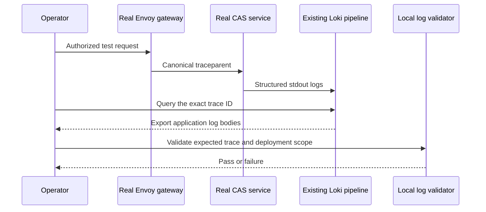

# Manual .NET log validation

| Lane | What it proves | Current status |
|---|---|---|
| Installed-package probe | Built NuGet packages emit valid records and clear context | Run by `scripts/check-dotnet-observability.sh` |
| Real CAS logs | Deployed CAS emits common fields and preserves the gateway trace | **Pending CAS adoption #798** |
| CAS authorization, projection, retries | Business flow and failure behavior | Separate #798 integration tests; this checker does not prove them |

## Build the validator

```bash
bash scripts/check-dotnet-observability.sh
version="$(cat VERSION)"
dotnet restore dotnet/packages/observability/raw_tests/LogProbe -p:PackageUnderTest="$version" \
  --source "$PWD/.artifacts/dotnet/$version" --source https://api.nuget.org/v3/index.json
dotnet build dotnet/packages/observability/raw_tests/LogProbe --no-restore -c Release -p:PackageUnderTest="$version"
```

The validator consumes the actual `.nupkg` through `PackageReference`. It does not import SDK source or deploy a test service.

## Real development-cluster procedure after CAS adoption



| Step | Action | Required evidence |
|---|---|---|
| 1 | Confirm `development-region-1`; verify CAS package/image and gateway deployment | Image digest, SDK package version and UTC test window |
| 2 | Perform a real authorized CP request and a real regional DP request from #798 | HTTP/gRPC outcomes unchanged; record returned/canonical trace IDs |
| 3 | Query Grafana using exact trace ID and actual permitted stream selector | Related CAS logs present; each hop uses the same ID |
| 4 | Export log **bodies** as NDJSON, one record per line | No Grafana wrapper, timestamp prefix or silently filtered invalid rows |
| 5 | Run the command below for each deployment scope | Required services present, every selected row matches schema, trace, environment and region |
| 6 | Repeat with a deliberately wrong ID and a missing required service | Both exit nonzero |
| 7 | Inspect missing-context and concurrent-request scenarios | Missing input has no invented ID; concurrent requests do not share unrelated IDs |
| 8 | Inspect Loki stream labels and secret handling | Trace/operation IDs are not indexed labels; no tokens, claims, cookies or bodies |

```bash
# Replace placeholders with observed deployment values; these service names are examples.
dotnet dotnet/packages/observability/raw_tests/LogProbe/bin/Release/net10.0/LogProbe.dll \
  verify cas-control.ndjson '<trace_id>' development global cas-control
dotnet dotnet/packages/observability/raw_tests/LogProbe/bin/Release/net10.0/LogProbe.dll \
  verify cas-regional.ndjson '<same_trace_id>' development region-1 cas-regional
```

- Use the actual CP/DP region values; separate scopes into separate inputs.
- A request need not visit both CP and DP. Select real #798 scenarios with known expected hops; do not invent an end-to-end path.
- `emit` is a **local package probe**, with a fixed test trace ID. Never present its output as real service evidence.
- The verifier rejects empty input, wrong IDs/scope, missing services, malformed records, records over 4 KiB and input over 16 MiB/10,000 records.
- This checks captured records, not completeness of every expected event or authorization correctness. #798 owns expected-event sets, denial tests, projection/replay assessment, live ingestion and cleanup.
- No credentials are needed by the local validator. Do not include credentials in exports or reports.
