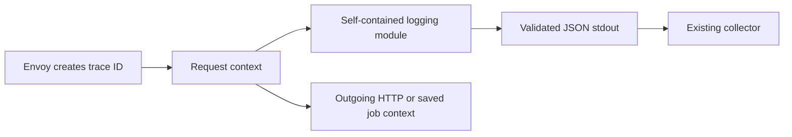

# Shared Go logging

One module contains the `slog` handler, validation rules and trace-context helpers.
SDK release `vX.Y.Z` automatically creates Go module tag `go/observability/vX.Y.Z` at the same commit.



- Runtime rules are embedded from this module's `schema.json`.
- Shared test data stays in `tests/logging/`; no separate Go contract module.
- No runtime package downloads, global logger replacement, span exporter or cluster changes.

## Install after publication

```bash
export GOPRIVATE=github.com/onenexus-team/onenexus-sdks
# Configure authenticated Git access using your normal protected credential method.
go get github.com/onenexus-team/onenexus-sdks/go/observability@v<released-sdk-version>
```

- Commit the application's `go.mod` and `go.sum`; do not add local `replace` entries.
- Go uses versioned source modules from the private Git repository, not the npm/NuGet registry.

## Use in a service

```go
handler, err := observability.NewHandler(observability.Config{
    Service: "monitoring",
    Environment: "development", // development, staging, prod
    Region: "ric1",
    AllowedFields: []string{"operation.id", "attempt"},
}, os.Stdout)
if err != nil { return err } // Invalid configuration fails before serving work.
defer handler.Close()
logger := slog.New(handler)

// true only when the application has verified that this hop is trusted.
ctx := observability.IncomingContext(request.Context(), request.Header, trustedGateway)
logger.InfoContext(ctx, "Request completed",
    slog.String("event", "request.completed"),
    slog.String("outcome", "success"),
)

// Preserve only approved propagation fields; keep other request headers separate.
for key, values := range observability.OutgoingHeaders(ctx) {
    outgoingRequest.Header[key] = values
}
```

| Work | Context rule |
|---|---|
| API request | Call `IncomingContext` at the trusted gateway boundary |
| Outgoing HTTP | Add `OutgoingHeaders(ctx)` to the dependency request |
| Durable job | Persist those headers with work in the application's transaction; restore with `IncomingContext` in the worker |
| Retry or restart | Restore the same saved context; add the current attempt as an approved field |
| Independent system work / legacy job | `UncorrelatedContext(parent)`; no invented request trace |
| Future OpenTelemetry spans | Start a child from this context; the logger keeps its trace and forwards the active child's span ID |

- **Envoy remains the ID creator.** Missing, invalid, duplicate or untrusted context runs uncorrelated.
- `EdgeContext` exists for explicitly designated edges and shared edge-policy tests. Do not use it as a service fallback.
- Use `InfoContext` / `LogAttrs` with the operation's context. `logger.Info(...)` has no request context.
- `event` and `outcome` must appear together. Common identity fields cannot be replaced by attributes.
- Extensions are approved scalar values only. No automatic body, header, exception or arbitrary-object serialization.
- Callers still own message privacy. An allowlist does not remove secrets placed inside a message.

## Output failure behavior

| Situation | Behavior |
|---|---|
| Normal concurrent calls | Serialize complete lines through a shared writer gate, including logger clones |
| Slow output | At most 128 active/waiting calls; default wait 100ms, configurable up to 1 second |
| Queue full / wait expires | Drop and increment `Busy`; no retry or background queue |
| Already-entered `Write` blocks | Caller can block: `io.Writer` has no cancellation contract. Use prompt local stdout; measure this during service rollout |
| Invalid record | Drop; increment `Invalid`; stable error without input content |
| Zero-byte output error | Count `IOErrors`; a later call may try again |
| Partial write | Disable further writes on this handler; recreate only after sink recovery |
| Close | Stop new/waiting writes; in-flight write may finish; never close caller-owned stdout |
| Process crash | Best-effort logs may be lost; no durability claim |

Export `handler.Stats()` as service metrics. `slog` ignores handler return errors; counters must be monitored.

## Validate

```bash
bash scripts/check-go-observability.sh
python3 scripts/test-go-module-release.py
```

| Check | What it proves |
|---|---|
| Source + `go test -race` | Shared cases, goroutine isolation, cancellation, retry, real recorded child, concurrent output and failure handling |
| Separate installed consumer | Versioned module ZIP install without source replacements; same tests pass |
| Shared behavior checker | Actual results agree with all 56 record and 10 edge-context cases |
| Integration probe | Four emitted SDK JSON lines; three share the same trace ID |
| Negative controls | Wrong trace/service, missing field, plain-text output and falsified case result fail |

Artifacts: `.artifacts/go-observability/` (results, module archives, captured logs, benchmark).

Local installed-module probes live in [tests/integration/](tests/integration/README.md). End-to-end `raw_tests` belong to consuming service repositories.

See [design and validation](../../docs/logging-readiness.md) and the [SDK release guide](../../docs/logging.md).
