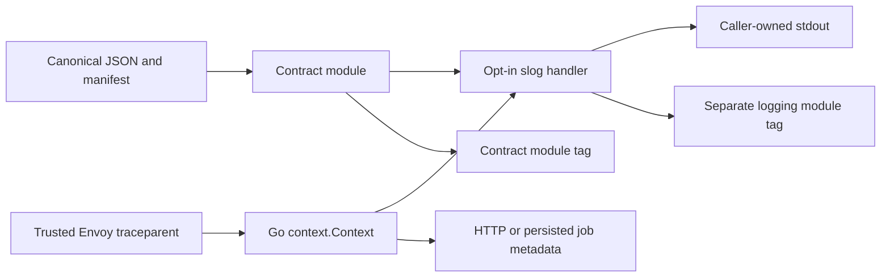
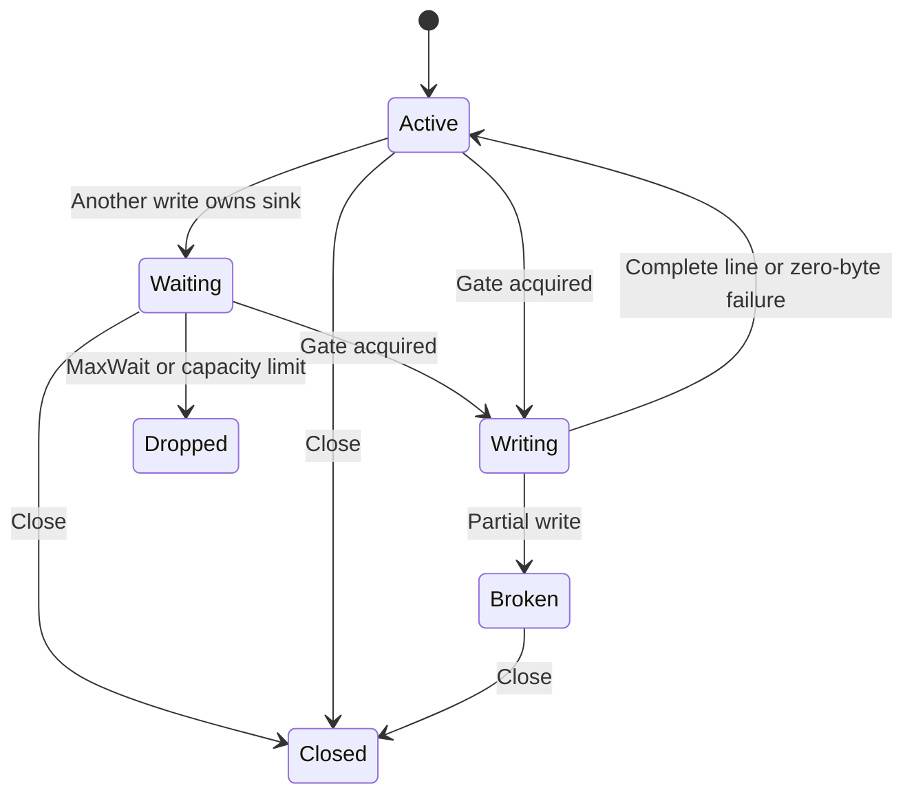

# Shared Go logging — design and validation

## 1. Scope and verdict

- **Implement mode:** contract module, trace context, logger/output lifecycle and module publication.
- **Local package validation passes.** Publication and deployed Go service validation remain gated by REL1, SVC1 and PERF1.
- Changes are opt-in. No service configuration, database migration, collector or live cluster changes.

### Seven-discipline readiness scorecard

| Discipline | Status | Evidence / remaining gate |
|---|---|---|
| 1 · Technical design + security | ✅ | Canonical schema; explicit trusted boundaries; protected common fields |
| 2 · Distributed-systems principles | ✅ | No business state; immutable module tags; release crash states documented |
| 3 · Test coverage | ⚠️ | SVC1: package/race/installed/raw tests pass; no deployed consumer yet |
| 4 · Monitoring + alerts | ⚠️ | SVC1: counters provided; service must export and alert on drops/errors |
| 5 · CI/CD | ⚠️ | REL1: source and artifact gates pass; first remote module publication pending |
| 6 · Security | ✅ | No runtime registry/schema requests; no arbitrary object serialization |
| 7 · Operations | ⚠️ | PERF1: service stdout latency, overload and loss budget require measurement |

## 2. System context and lifecycle



| System profile | Decision |
|---|---|
| Datastore / isolation | No business datastore; immutable contexts, channel writer gate, atomic counters |
| Work execution | Synchronous local validation/write; no new worker or exporter |
| Replicas / regions | One handler per output sink per process; no cross-replica state |
| Integrity | Embedded canonical bytes; manifest SHA-256; Go sums; source/archive parity |
| Tenant authority | Application authentication remains authoritative; trace ID grants no access |
| Retention | Caller owns log retention; published module versions are retained |

| Resource | Identity / owner | Dependency and lifetime |
|---|---|---|
| Contract | Version + digest; SDK maintainer | Embedded canonical JSON; immutable after module publication |
| Context | Explicit `context.Context`; caller | Inherits cancellation/values; boundary replaces only trace state |
| Handler | Sink + immutable config; application | Contract validator and writer; clones share writer fence |
| Record | One log call | Snapshot of scalar attributes and context; written or counted as dropped |
| Module release | Module path/version + commit; release workflow | Source commit, artifact ZIP, registry/module tag |



| From | Action / guard | Serialization point | Result / recovery |
|---|---|---|---|
| Any context | Trusted valid v00 header | New immutable context value | Same trace; compatible recorded child retained |
| Any context | Missing/invalid/untrusted input | Explicit empty boundary | Uncorrelated; no fallback trace generation |
| No handler | Valid config / contract | Constructor | Invalid config fails startup before serving |
| Active | Valid bounded record | Acquire one of 128 slots, then writer gate | One complete JSON-line write |
| Active/waiting | Invalid/full/timeout | Counter increment | Drop; no retry or unbounded retained queue |
| Writing | Zero-byte error | Writer gate | Count error; later call may recover |
| Writing | Partial write | Broken flag while holding gate | Later writes rejected; caller replaces sink/handler after recovery |
| Active/waiting | Close | Atomic closed flag + close notification | New/waiting writes stop; entered write may finish |
| Tagged release | Build/test | Version/hash/source checks | Verified archives; no publication on failure |
| Verified release | Publish | Registry uniqueness / GitHub atomic ref creation | Retain partial state; no overwrite/delete/retry loop |

| Dependency edge | Authority / removal policy | Failure behavior |
|---|---|---|
| Logger → contract | Reviewed Go dependency pin; retain releases | Restore fails if unavailable; running process has embedded data |
| Context → saved metadata | Application persists with its durable work | Legacy/missing metadata is uncorrelated; retry identity remains application-owned |
| Handler → writer | Caller owns writer; Close retains it | Count output failure; no automatic destination change |
| Contract tag → Go module tag | Same reviewed Git commit | Existing/newer tag or dirty source rejects publication |

| Contention / interruption | Mechanism | Proof / recovery |
|---|---|---|
| Overlapping requests | Separate context values | Barrier-controlled goroutines; `TestConcurrentCancellationPanicAndReusedWorker` |
| Concurrent output / clones | One channel gate per sink | Complete lines from 64 simultaneous calls; race detector |
| Close versus blocked write | Atomic flag, waiter notification | Entered write finishes; later writes stop; writer remains caller-owned |
| Retry / restart | Serialize headers, restore into fresh context | Same trace, distinct real recorded child IDs across attempts |
| Competing tag publishers | Create-only GitHub refs API | Race error stops after one attempt; no delete or force update |

| Busy state | Driver / budget | Deadline / terminal outcome |
|---|---|---|
| Waiting for sink | One attempt; max 128 active/waiting calls | 100ms default, max 1s; counted drop or closed |
| Inside writer.Write | Caller-owned I/O | PERF1: interface has no cancellation; service must ensure prompt writes / bounded sink behavior |
| CI validation | One job, bounded child commands | 15–25 minute job limit; failed run is terminal |
| Partial publication | No automatic retries | Failed run + draft remain visible; operator verifies and rolls forward |

- Front-end action parity: **N/A** — no product API/UI resource or actions introduced.
- No business migrations, transaction changes, job leases or delete fences apply.

## 3. Flows

### Flow 1 — receive and forward a trace

```mermaid
sequenceDiagram
    participant G as Trusted gateway
    participant A as Application
    participant P as Go context helpers
    participant W as Dependency or worker
    G->>A: traceparent
    A->>P: IncomingContext(parent, headers, trusted)
    P-->>A: Correlated or explicitly uncorrelated context
    A->>P: OutgoingHeaders(ctx)
    A->>W: HTTP headers or durable metadata
    W->>P: Restore into fresh context for each attempt
    Note over A,W: Envoy owns new request IDs; no service fallback
```

**Already right:** same W3C shape as other languages; no mutable global request state.

| Dimension | Verdict | Evidence |
|---|---|---|
| Extendability | ✅ | Real OpenTelemetry recorded-child test; no exporter required |
| Availability | ✅ | No network or shared coordinator on runtime path |
| Scalability | ✅ | Explicit per-operation contexts; no global request lock |
| Reliability | ✅ | Roundtrip/retry checks; missing metadata cannot inherit previous job |
| Performance | ✅ | Fixed 55-character header; only traceparent propagated |
| Maintainability | ✅ | One incoming helper, one outgoing helper; caller owns trust decision |
| Security | ✅ | Reject duplicates/invalid/untrusted context; strip baggage and tracestate |
| Concurrency | ✅ | Barrier overlap, panic, cancellation and worker reuse checks |
| Failure tolerance | ✅ | Invalid input continues uncorrelated; parent remains unchanged |

### Flow 2 — write a record

```mermaid
sequenceDiagram
    participant A as Application
    participant H as slog handler
    participant C as Contract
    participant O as Output writer
    A->>H: Context, safe message, allowed fields
    H->>C: Validate schema and UTF-8 limits
    alt Invalid or waiting limit reached
        H-->>A: Count rejection; no write
    else Admitted
        H->>O: One JSON line under writer gate
        O-->>H: Full, partial or failed write
        H-->>A: Count outcome; disable after partial write
    end
```

**Already right:** no header/body dumps; common identity cannot be replaced by application attributes.

| Dimension | Verdict | Evidence |
|---|---|---|
| Extendability | ✅ | Up to 32 approved scalar fields; dotted slog groups supported |
| Availability | ⚠️ | PERF1: an entered caller-owned Write may block |
| Scalability | ✅ | Fixed 128 waiter/active cap; wait timeout; no retry queue |
| Reliability | ✅ | Exact int64 timestamps; schema validation; complete-line writer gate |
| Performance | ⚠️ | PERF1: local benchmark recorded; service throughput/loss budget unmeasured |
| Maintainability | ✅ | Canonical fields loaded once; no copied schema constants |
| Security | ✅ | UTF-8 validation; no user LogValuer/JSON hooks; safe error codes |
| Concurrency | ✅ | Shared clone fence and atomics; race tests for output and close |
| Failure tolerance | ⚠️ | SVC1: service must monitor counters and verify collection; stdout success is not Loki delivery |

### Flow 3 — publish and consume modules

```mermaid
sequenceDiagram
    participant C as Contract release
    participant G as GitHub
    participant S as SDK release
    participant A as Go consumer
    C->>C: Verify all languages and source ZIP
    C->>G: Create contract module tag at reviewed commit
    Note over C,G: Existing tag or API failure stops; no overwrite
    S->>G: Restore published contract pin
    S->>S: Test installed logging module
    S->>G: Create logging module tag
    A->>G: go get logging module at version
    G-->>A: Module source, embedded contract and dependencies
```

**Already right:** Go installs module source from tags; release ZIPs are independently tested evidence, not a substitute for module tags.

| Dimension | Verdict | Evidence |
|---|---|---|
| Extendability | ✅ | Same canonical contract and shared cases across languages |
| Availability | ✅ | Registry outage blocks new install/release; existing processes continue |
| Scalability | ✅ | No request-time package access; standard Go module cache |
| Reliability | ✅ | Archive/source parity; independent consumer with no source replacement |
| Performance | ✅ | Schema compiled once per process; source embedded by Go compiler |
| Maintainability | ✅ | Contract/SDK versions independent; native go.mod/go.sum |
| Security | ⚠️ | REL1: local publication guards pass; real private restore still pending |
| Concurrency | ✅ | Global release groups; create-only tag API rejects races |
| Failure tolerance | ✅ | Failed writes stop; partial versions retained; no automatic destructive retry |

## 4. Dependencies and data layer

| Dependency | HA / outage behavior | Authentication | Evidence |
|---|---|---|---|
| JSON Schema validator v6.0.3 | Local immutable compiled schema; no external loader | None at runtime | Shared cases and strict JSON tests |
| x/text v0.41.0 | Patched transitive validator dependency; local only | None at runtime | Reachability scan; patched version pinned |
| OpenTelemetry trace API v1.47.0 | Local context only; no global provider required | None at runtime | Actual SDK recorded-child test; SDK is test use only |
| stdout / supplied io.Writer | Caller-owned; finite waiters, possible blocking entered call | Local application ownership | Failure/close/partial-write tests; PERF1 |
| GitHub tags/Releases/npm/NuGet | Provider-managed; outage stops publication; existing versions retained | Scoped GitHub token; protected Git credentials for restore | Release guard tests; REL1 for live publication |
| Public Go module proxy | Build-only; restore failure stops validation | TLS/public read; private modules restored via authenticated Git | Clean consumer installs and go.sum |

- Dependency decision: no existing Go validator or tracing package existed in this SDK repository. Use a maintained JSON Schema validator rather than hand-copying schema rules; use the standard OTel context API for later spans.
- Cost: no new pods, database, network exporter or persistent queue. Runtime cost is validation + stdout; benchmark in `.artifacts/go-observability/benchmark.txt`.

Data layer — not applicable: no SQL tables, indexes, cache, migrations or business queries. GitHub owns release state; applications own durable trace metadata persistence.

### What is already right

| Guarantee | Evidence |
|---|---|
| One schema source | Go embeds original manifest/schema/vectors; `contract.Load` verifies digests |
| Opt-in adoption | No init logger, global provider or service configuration changes |
| Service does not invent IDs | Incoming-context rejection tests; EdgeContext explicitly separate |
| No copied source dependency for apps | Fresh proxy ZIP consumer; no `Replace` in resolved modules |

### Checked and not found

| Suspected defect | Evidence |
|---|---|
| Trace leaks after cancellation / reuse | Immutable parent and barrier tests |
| Future child span changes trace | Real recorded child keeps trace and changes outgoing span ID |
| Invalid JSON coerces to valid data | Duplicate keys, nonfinite values, malformed UTF-8/surrogates rejected |
| Integer timestamp rounded | int64 boundary/overflow cases pass |
| Arbitrary application object executes | LogValuer/object attributes rejected without executing hooks |
| Close closes stdout | Caller-owned output remains writable |
| Two writers interleave JSON | Gate shared by clones; 64 concurrent records remain complete |
| Release overwrites an existing module | Atomic ref creation; no force/update/delete path |

## 5. Findings catalog

| ID | Priority / problem | Solution / owner | Status |
|---|---|---|---|
| REL1 | P2: first Go modules are not published; private Git restore is unverified | SDK release owner publishes approved new contract, then logging module; verifies fresh private consumer | Not started |
| SVC1 | P2: no Go service adopted the handler/context yet; no deployed collector proof | Service owner integrates every ingress/outbound/job path, exposes counters and runs real cluster raw checks | Not started |
| PERF1 | P2: io.Writer can block after entry; service output latency/loss budgets unmeasured | Service owner uses prompt local stdout, tests stalled output and approves latency/drop budgets before production | Not started |

## 6. Validation and protocol

| Check | Result / scope |
|---|---|
| Source + installed Go modules | PASS: `go vet`, `go test -race`, shared cases and runtime behavior |
| Shared cross-language cases | PASS: 56 record + 10 context observations; independent checker |
| Raw logs | PASS: four SDK records, three correlated; wrong trace/service/missing field/plain output rejected |
| Release guards | PASS: source identity, invalid versions, duplicate/newer tags, auth failure, race rejection and partial state |
| All-language build | PASS: Python installed wheel; TS and .NET installed tests/raw probes; Go installed tests/raw probe |
| Vulnerability scan | PASS: official govulncheck reports no vulnerabilities after patched x/text pin; repeated in Go CI |
| Published Go packages / real service | NOT RUN: REL1 / SVC1 |

```bash
bash scripts/check-go-observability.sh
python3 scripts/test-go-module-release.py
python3 scripts/test-log-contract-release.py
```

### Distributed-systems protocol

| # | Invariant | Assessment and evidence |
|---|---|---|
| 1 | Single current authority | Registry uniqueness and atomic Git ref creation; preflight alone is not authority |
| 2 | One durable intent | Tag + draft Release identify the release attempt |
| 3 | Lease ownership | GitHub owns job execution; no application lease introduced |
| 4 | State is monotonic | Verified → draft → published versions/tags → finalized; never replace accepted versions |
| 5 | Recovery converges | Failed run is terminal; inspect partial registries/tags and roll forward |
| 6 | External resources are owned | Exact module path/version, commit and archive contents verified |

```mermaid
sequenceDiagram
    participant W as Release worker
    participant N as Package registries
    participant G as GitHub module tag
    participant O as Operator
    W->>N: Publish verified contract packages
    N-->>W: Accepted
    W->>G: Create immutable module tag
    G--xW: Failure or unknown result
    W->>W: Stop; keep draft and failed run
    O->>N: Inspect accepted versions
    O->>G: Verify tag target
    Note over O,G: Never delete/reuse a published version; roll forward or finish a fully verified draft
```

| Interrupted boundary | Durable evidence | Safe next action |
|---|---|---|
| Before publication | Failed run and validation artifacts | Fix and rerun; no package writes yet |
| Registry accepted, Go tag absent/unknown | Draft, checksums, registry versions and remote refs | Inspect all destinations; corrected new version if incomplete |
| Tag created, Release finalization failed | Immutable ref + verified ZIP/draft | Verify exact target/content, then complete existing draft |
| SDK Go tag created, asset attachment failed | Immutable logging ref and failed SDK job | Verify tag; attach exact validated archive manually; no re-tag |
| Process dies during logging | No durability guarantee | Possible log loss; service collection/retention gate SVC1 |

### Lifecycle coverage

| Contract | Result |
|---|---|
| C1 | ✓ Explicit context/contract/writer/release dependencies |
| C2 | ✓ Handler, context boundary and release transitions documented |
| C3 | N/A: no usage leases/deletion; caller owns writer |
| C4 | ✓ Context isolation, shared writer gate, atomic tag create |
| C5 | N/A: SDK creates no durable business jobs/outbox |
| C6 | ✓ Append-only publication; writer ownership retained |
| C7 | ✓ Bounded waiters/jobs; explicit sink recovery; PERF1 bounds caller-owned I/O gate |
| C8 | ✓ No log retries; module duplicates rejected; partial release inspection |
| C9 | ✓ No tenant authorization changes; trusted boundary is caller policy |
| C10 | ✓ Error/drop counters, raw checks, release metadata; SVC1 service alerts pending |
| C11 | ✓ Independent version pins, opt-in adoption; REL1 release gate |

| Race rows | Result / scoped reason |
|---|---|
| R3, R4 | ✓ Adapted: competing module publications reject duplicate ref creation |
| R6, R7, R13, R15, R24 | ✓ Adapted: partial publication is retained; crash recovery table above |
| R10, R12, R17, R18, R20, R21 | ✓ Adapted: no published-version replacement or deletion; no stale lease writer |
| R22 | ✓ Auth/network failure blocks publication; never infer absence from failure |
| R23 | ✓ Existing packages/services stay pinned; no service rollout introduced |
| R28 | ✓ Archive/source parity + clean reviewed commit guard at publication |
| R1, R2, R5, R8, R9, R11, R14, R16, R19, R25, R26, R27 | N/A: no business deletion, producer lease, broker, tenant cascade or external write capability |

## 7. Recommended sequence

### Phase 1 — publish packages

- [ ] REL1 — Merge after CI. Prepare canonical contract 0.3.4; publish its approved contract tag; verify normal Go restore. Publish logging SDK afterward.

### Phase 2 — integrate Go services

- [ ] SVC1 — Adopt in Monitoring / inference-policy / other Go consumers in separate PRs; run real ingress → dependency/job → logs checks and expose counters.

### Phase 3 — approve production operation

- [ ] PERF1 — Measure stdout stalls, expected peak throughput and loss/latency budgets in each service.

## 8. Decision and approval gates

| Gate | Required evidence |
|---|---|
| Merge | Source + installed Go/race/raw tests; all-language artifact build; workflow/release guard checks; report checker |
| Package publication | REL1: explicit release authorization, unused version, main commit; real private Go restore; no source overrides |
| Service rollout | SVC1: actual service APIs/jobs emit common schema and expected trace in test cluster and Loki |
| Production | PERF1: measured sink behavior, agreed loss/latency budget, counters/alerts verified |

| Rollout stage | Old behavior | New behavior | Rollback |
|---|---|---|---|
| Merge SDK code | Existing applications retain old pins | No runtime change | Revert source before publication |
| Publish contract then logging module | Existing pins remain usable | New version available | Retain tags; fix forward with new version |
| Separate service adoption | Existing logger still available until changed | Explicit handler/context integration | Revert service dependency/config; preserve released modules |
