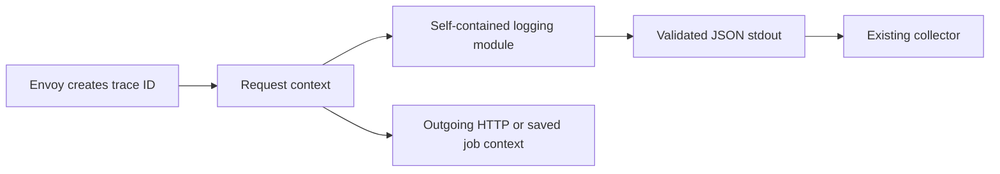

# Shared Go logging

One module contains the `slog` handler, validation rules and trace-context helpers.
SDK release `vX.Y.Z` automatically creates Go module tag `go/packages/observability/vX.Y.Z` at the same commit.



- Runtime rules are embedded from this module's own [`schema.json`](schema.json). Shared tests require it to match the Python, TypeScript and .NET schemas.
- Shared test data stays in `tests/logging/`; no separate Go contract module.
- No runtime package downloads, global logger replacement, span exporter or cluster changes.

## Install after publication

```bash
export GOPRIVATE=github.com/onenexus-team/onenexus-sdks
# Configure authenticated Git access using your normal protected credential method.
go get github.com/onenexus-team/onenexus-sdks/go/packages/observability@v<released-sdk-version>
```

- Upgrading from `github.com/onenexus-team/onenexus-sdks/go/observability` requires changing imports and the `go.mod` requirement to `github.com/onenexus-team/onenexus-sdks/go/packages/observability`. Earlier releases and their existing module tags remain valid.
- Commit the application's `go.mod` and `go.sum`; do not add local `replace` entries.
- Go uses versioned source modules from the private Git repository, not the npm/NuGet registry.

## Use in a service

```go
handler, err := observability.NewHandler(observability.Config{
    Service: "monitoring",
    Environment: "development", // development, staging, prod
    Region: "ric1",
    AllowedFields: []string{"mlops.operation.id", "job.attempt"},
}, os.Stdout)
if err != nil { return err } // Invalid configuration fails before serving work.
defer handler.Close()
logger := slog.New(handler)

// true only when the application has verified that this hop is trusted.
ctx := observability.IncomingContext(request.Context(), request.Header, trustedGateway)
logger.InfoContext(ctx, "Request completed",
    slog.String("event", "request.completed"),
    slog.String("outcome", "success"),
)

// Preserve only approved propagation fields; keep other request headers separate.
for key, values := range observability.OutgoingHeaders(ctx) {
    outgoingRequest.Header[key] = values
}
```

| Work | Context rule |
|---|---|
| API request | Call `IncomingContext` at the trusted gateway boundary |
| Outgoing HTTP | Add `OutgoingHeaders(ctx)` to the dependency request |
| Durable job | Persist those headers with work in the application's transaction; restore with `IncomingContext` in the worker |
| Retry or restart | Restore the same saved context; add the current attempt as an approved field |
| Independent system work / legacy job | `UncorrelatedContext(parent)`; no invented request trace |
| Future OpenTelemetry spans | Start a child from this context; the logger keeps its trace and forwards the active child's span ID |

- **Envoy remains the ID creator.** Missing, invalid, duplicate or untrusted context runs uncorrelated.
- `EdgeContext` exists for explicitly designated edges and shared edge-policy tests. Do not use it as a service fallback.
- Use `InfoContext` / `LogAttrs` with the operation's context. `logger.Info(...)` has no request context.
- `event` and `outcome` must appear together. Common identity fields cannot be replaced by attributes.
- Extensions are approved scalar values only. No automatic body, header, exception or arbitrary-object serialization.
- **Field registry (E1).** `NewHandler` checks every `AllowedFields` name with `CheckAllowedFields`, against the
  schema's `x-field-registry`, in this order. The first failure is an `*AllowedFieldError` wrapping
  `ErrInvalidAllowedFields`, e.g. `invalid_allowed_fields: banned: status_code -> http.response.status_code`.

| Rule | Rejects |
|---|---|
| `too_many` | More than 256 names (`max_custom_fields`) |
| `protected` | A base field, e.g. `message` |
| `format` | Not lowercase `a.b_c` with at most 5 segments, or over 128 characters |
| `banned` | A known alias; the error names the replacement |
| (registered) | Accepted: a field in `fields`, even under `logging.*` |
| `reserved` | Other `logging.*` and `k8s.*` names |
| `namespace` | A single segment, or an unregistered first segment |
| `duplicate` | A name listed twice (Go only) |

- **Keep the line.** A bad attribute never drops the record or disables a `With`/`WithGroup` logger:

| Input | Result |
|---|---|
| Message or string attribute over 1,024 UTF-8 bytes (`exception.stacktrace`: 2,048) | Cut at a rune boundary, ending in `…`; `logging.truncated=true` |
| Unapproved, protected, duplicate or 35th+ attribute; invalid UTF-8; NaN/Inf; struct, map, slice, named `slog.Group`, `Duration`, `Time`, `LogValuer`; registered field of another type (`job.attempt` takes a whole number); invalid group name | Attribute removed; counted in `logging.dropped_field_count` (max 64) |
| Attribute whose value is an `error` (any key) | Not emitted; `error.type` = `%T`, `exception.stacktrace` = call-site frames `at <func> (<file>:<line>)`, innermost first, within 2,048 bytes. Never the error text. Approved caller values win |
| Record over 4,096 bytes | Drop outermost stack frames, then the largest caller attributes (ties: key descending), each counted |

- Callers still own message privacy. An allowlist does not remove secrets placed inside a message.

## Output failure behavior

| Situation | Behavior |
|---|---|
| Normal concurrent calls | The line is built and validated on the caller goroutine, then queued; one background goroutine per handler (shared by clones) writes complete lines |
| Slow or blocked output | The caller never waits: up to `QueueCapacity` (1,024) lines wait in the queue |
| Queue full | Drop and increment `Busy` (the shared `queue_full` counter); no retry |
| Invalid record (invalid UTF-8 or empty message, `event` without `outcome`, bad timestamp, still over 4,096 bytes) | Drop; increment `Invalid`; stable error without input content |
| Write error, short write or panicking writer | Count `IOErrors`; the writer goes on with the next line |
| Partial write | Counted as a write error; the next line is preceded by `\n`, so it starts on its own line and stays valid JSON |
| `Close()` / `CloseWithin(d)` | Stop accepting (later calls count `Closed`); write queued lines until `CloseTimeout` (2 s) or `d`; `CloseWithin` returns `true` when nothing queued was lost, otherwise the rest stays in `Pending`. A `Write` blocked inside the caller's writer cannot be interrupted. Never closes caller-owned stdout |
| `ERROR` or higher, then `os.Exit` / `log.Fatal` | The call waits up to `ErrorWait` (50 ms) for its own line, so it is on the output before a hard exit (never on the writer goroutine itself) |
| Handler lifetime | The writer goroutine and its queue start with the first accepted line; a handler that never logs owns none. After first use a handler keeps its writer until closed: call `Close()` at shutdown (it can block up to 2 s) |
| `Config.MaxWait` | Deprecated and ignored; 0 to 1 s is still accepted |
| Process crash | Best-effort logs may be lost; no durability claim |

Export `handler.Stats()` (`Written`, `Invalid`, `Busy`, `IOErrors`, `Closed`, `Pending`) as service metrics. `slog` ignores handler return errors; counters must be monitored.

## Drop metric

Every line a handler does not write is counted once per process, per `(service, reason)`. `service` is `Config.Service`; handlers of one service are summed.

| API | Returns |
|---|---|
| `DropCounts()` | `[]DropCount{Service, Reason, Count}`, sorted by service then reason |
| `DropMetricsText()` / `FormatDropMetrics(counts)` | Prometheus text for `onenexus_log_records_dropped_total` (live counts / the given rows) |
| `RegisterDropMetric(meter)` | OTel asynchronous counter `onenexus.log.records.dropped`, unit `{record}` |

- Reasons (`DropReason`): `closed`, `invalid`, `io_errors`, `queue_full` (= `Stats.Busy`). All four appear at 0 once a handler exists.
- Counts never decrease, also after `Close`. Each equals the sum of the service's `handler.Stats()` counters.
- Counting is lock-free: a handler holds its service's counters.

```go
// OTel metrics:
_, err := observability.RegisterDropMetric(otel.Meter("my-service"))
// or serve observability.DropMetricsText() on /metrics
```

## Validate

```bash
bash scripts/check-go-observability.sh
python3 scripts/test-go-module-release.py
```

| Check | What it proves |
|---|---|
| Source + `go test -race` | Shared cases, goroutine isolation, cancellation, retry, real recorded child, concurrent output and failure handling |
| Separate installed consumer | Versioned module ZIP install without source replacements; same tests pass |
| Shared behavior checker | Actual results agree with shared record, edge-context and request-emission cases |
| Integration probe | Four emitted SDK JSON lines; three share the same trace ID |
| Negative controls | Wrong trace/service, missing field, plain-text output and falsified case result fail |

Artifacts: `.artifacts/go-observability/` (results, module archives, captured logs, benchmark).

See [validation and releases](../../../docs/logging.md). Live service checks belong in the consuming repository.
