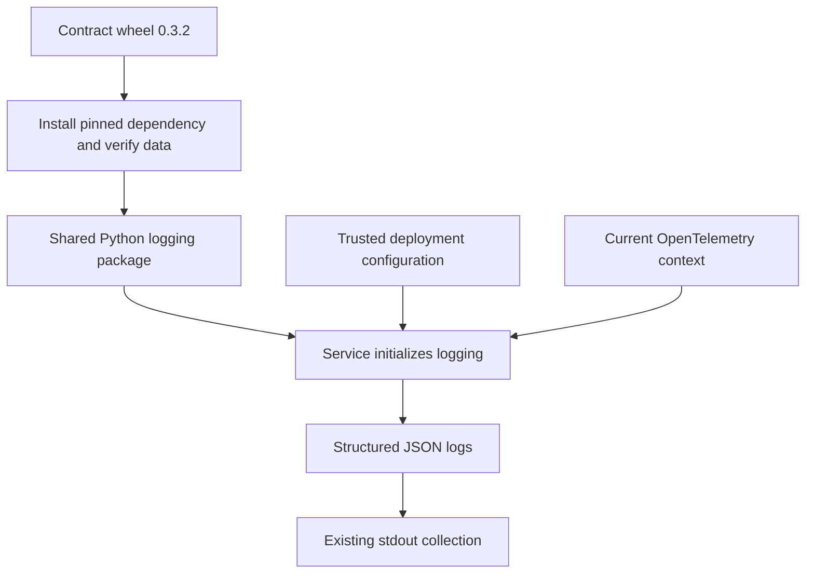
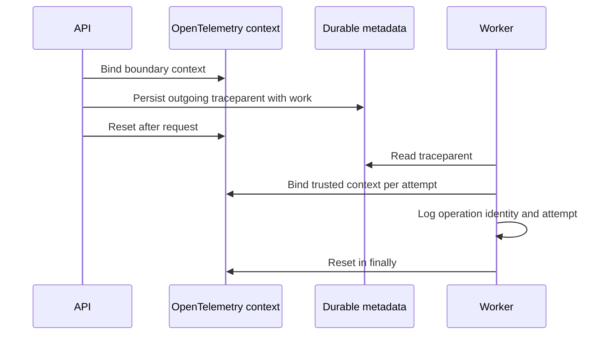
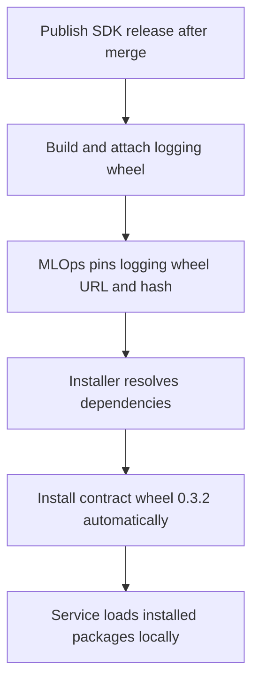

# Shared Python logging

**One package adds common fields and carries trace context. Services keep their logging calls.**



| Component | Responsibility |
|---|---|
| Released JSON contract | Field rules, limits and shared cases |
| `LogConfig` | Required service/environment/region; custom-field allowlist |
| `JsonLogHandler` | Populate and validate records; write compact JSON |
| Context helpers | Create/restore W3C context; reset after work |
| Service middleware | Decide trust, bind context and propagate headers |
| Existing collector | Deliver emitted logs to Loki |

## Usage

```python
import logging
from onenexus_observability import (
    LogConfig, bound_context, incoming_context, install_handler, outgoing_headers,
)

logger = logging.getLogger("my-service")
logger.setLevel(logging.INFO)
handler = install_handler(logger, LogConfig(
    service="mlops-api", environment="development", region="region-1",
    allowed_fields=frozenset({"operation_id", "attempt"}),
))
# request_headers and operation_id come from the application.
with bound_context(incoming_context(request_headers, trusted=False)):
    logger.info("Request accepted", extra={
        "event": "request.accepted", "outcome": "success",
        "fields": {"operation_id": operation_id},
    })
    dependency_headers = outgoing_headers()
    # Pass dependency_headers to the HTTP client or durable work metadata.
logger.info("Background maintenance ready")
```

- Initialize once. Identical repeated installation returns the same handler; conflicting config fails at startup.
- Logger levels, propagation and other handlers are unchanged. Install at one logger hierarchy level to avoid duplicates. Owner removes/closes the handler on shutdown; shared stdout is not closed.
- Deployment supplies `environment`: `development`, `staging` or `prod`. There is no silent default.
- Ordinary logs need no call-site edits. Lifecycle logs supply `event` and `outcome`.
- Approved custom fields cannot override common fields. Applications must supply safe messages/values; this is not a general secret detector.
- Exception messages, stack traces, arbitrary `LogRecord` extras and baggage are not automatically copied.
- `build_record` supports exporter adapters. Installing this stdout handler does not reformat existing OTLP handlers; final field mapping is a service-integration gate.

## Context and existing tracing



- Uses the existing OpenTelemetry API; registers no provider, exporter or recording spans.
- Active recording spans automatically supply trace ID and outgoing parent ID. Sampling flags are preserved by default.
- `preserve_sampling=False` selects the contract's unsampled test profile; it is not a production-wide sampling change.
- Bind boundary context before instrumentation creates a request span. Never replace a healthy active request span with a new boundary.
- Only `traceparent` is propagated; arbitrary baggage/tracestate are excluded.
- Async tasks inherit their creator's context. Detached/unrelated work must enter a fresh boundary or an empty OpenTelemetry context. Parent exit cannot clear an already-created child task.
- Threads require explicit metadata restoration. Middleware adapters and business job persistence remain service work.

## Failure behavior

| Condition | Behavior |
|---|---|
| Invalid config or installed contract | Startup fails with fixed error |
| Invalid log, formatting or stream exception | Drop emission; increment `handler.dropped_records`; never echo rejected payload |
| Valid log | At most 4,096 UTF-8 bytes excluding newline; message at most 1,024 bytes |
| Slow/full stdout | Synchronous write may block; no queue or retry |
| Crash / collector outage | Existing collection loss limits apply; no delivery guarantee |

- Expose `dropped_records` through service monitoring during adoption.
- No package network calls. Schema loads once; `jsonschema` enforces it without handwritten field-rule copies.
- Input objects can already be large before logging. Do not pass arbitrary request bodies.
- OpenTelemetry API already exists in this workspace. Its SDK is test-only for this package.

## Release and consumption

The logging package follows the **existing Python SDK release process**: publish a GitHub release tagged `v<VERSION>` and the SDK workflow builds and attaches its Python wheel alongside the other SDK wheels.



| Item | Release / consumption rule |
|---|---|
| Logging package | Uses the SDK release version; artifact is `onenexus_observability_python-<VERSION>-py3-none-any.whl` |
| Contract package | Independently pinned to `log-correlation-v0.3.2` in the logging package dependency metadata |
| MLOps dependency | Declare the logging wheel URL and SHA-256 in its requirements |
| Contract installation | Resolved automatically by pip/uv; MLOps does not need a separate contract entry |
| Future logging upgrade | Update the logging wheel URL/version/hash and run service validation |

Consumer requirements template—replace `<VERSION>` and `<WHEEL_SHA256>` with the values from the published SDK release:

```text
onenexus-observability-python @ https://github.com/onenexus-team/onenexus-sdks/releases/download/v<VERSION>/onenexus_observability_python-<VERSION>-py3-none-any.whl#sha256=<WHEEL_SHA256>
```

- Use normal dependency installation; `--no-deps` would skip the required contract dependency.
- The existing `v0.3.0` release predates this package. Consume a new SDK release containing the merged change.
- Merge alone does not publish. The existing SDK workflow runs when a GitHub release is published.
- Publication uses GitHub Release assets; no private Python registry setup is required.

## Version and validation

| Identity | Source |
|---|---|
| Distribution / import | `onenexus-observability-python` / `onenexus_observability` |
| Contract version | `0.3.2` |
| Contract provenance | `pyproject.toml` pins release-wheel URL/hash; `uv.lock` records the resolved dependency |
| Package version | Existing SDK `VERSION`/release-tag mechanism; separate from contract version |

- `onenexus-log-contract` supplies the schema, cases, checker and version/digest constants. The logging wheel contains no copied contract folder.
- To upgrade: change the contract wheel URL/version/hash in `pyproject.toml`, run `uv lock`, then run the package gate. Review and commit both files. `uv sync --frozen` installs the selected contract automatically.
- The contract is downloaded during installation, never while handling a request. The repository/release is public; this dependency uses GitHub Release assets.
- CI installs the logging wheel in a fresh environment, resolves its declared contract dependency, and runs all shared cases. An archive download script is no longer needed.
- Source merge does not publish a wheel. The SDK release build includes this package; publish an approved SDK release before MLOps consumes it.
- MLOps must install a pinned wheel, not import SDK source paths.

```bash
# Repository root: source tests, wheel build, installed-wheel tests and probe.
bash scripts/check-python-observability.sh
```

| Gate | Evidence |
|---|---|
| Contract | 66 cases through real APIs; deliberately wrong observation fails |
| Lifecycle | Nested scopes, threads, concurrent requests, cancellation, retries and exception cleanup |
| Compatibility | Real recording child preserves IDs and sampling |
| Packaging | Installed logging wheel resolves the released contract dependency; both import from site-packages |
| Raw probe | [Test-cluster procedure](raw_tests/README.md) |
| Service acceptance | MLOps middleware, OTLP/stdout mapping and Loki lookup: separate #796 gate |

[Design and readiness](design-and-validation.md).
