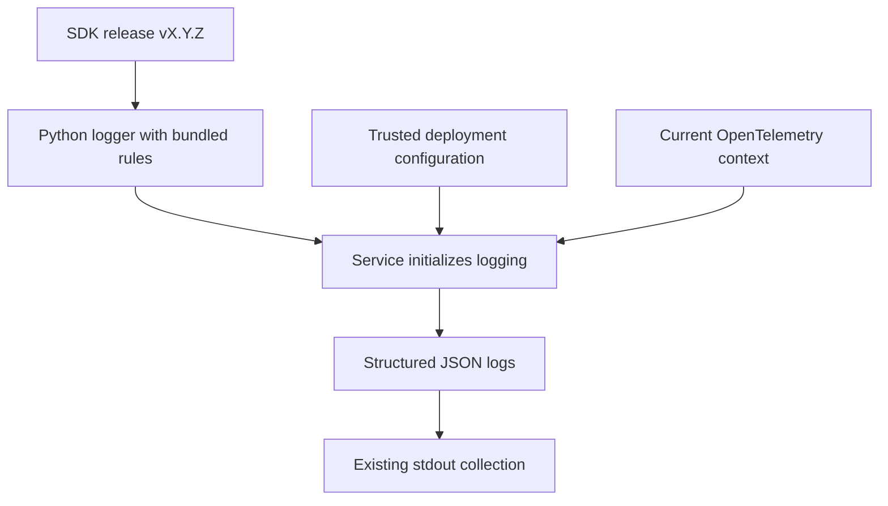
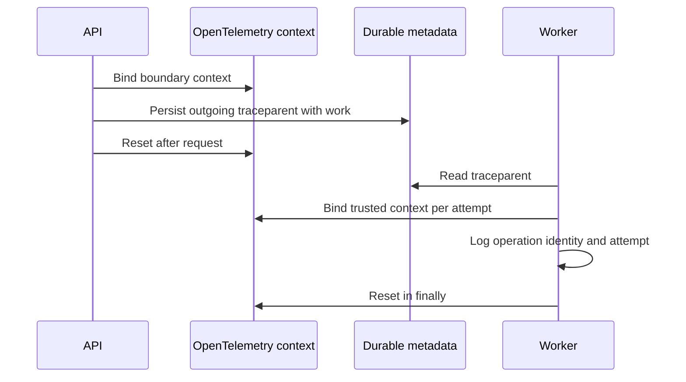

# Shared Python logging

**One package adds common fields and carries trace context. Services keep their logging calls.**



| Component | Responsibility |
|---|---|
| Bundled rules | Validate common fields and size limits locally |
| Shared repository tests | Keep language implementations consistent |
| `LogConfig` | Required service/environment/region; custom-field allowlist |
| `JsonLogHandler` | Populate and validate records; write compact JSON |
| Context helpers | Create/restore W3C context; reset after work |
| Service middleware | Decide trust, bind context and propagate headers |
| Existing collector | Deliver emitted logs to Loki |

## Usage

```python
import logging
from onenexus_observability import (
    LogConfig, bound_context, incoming_context, install_handler, outgoing_headers,
)

logger = logging.getLogger("my-service")
logger.setLevel(logging.INFO)
handler = install_handler(logger, LogConfig(
    service="mlops-api", environment="development", region="region-1",
    allowed_fields=frozenset({"operation_id", "attempt"}),
))
# request_headers and operation_id come from the application.
with bound_context(incoming_context(request_headers, trusted=False)):
    logger.info("Request accepted", extra={
        "event": "request.accepted", "outcome": "success",
        "fields": {"operation_id": operation_id},
    })
    dependency_headers = outgoing_headers()
    # Pass dependency_headers to the HTTP client or durable work metadata.
logger.info("Background maintenance ready")
```

- Initialize once. Identical repeated installation returns the same handler; conflicting config fails at startup.
- Logger levels, propagation and other handlers are unchanged. Install at one logger hierarchy level to avoid duplicates. Owner removes/closes the handler on shutdown; shared stdout is not closed.
- Deployment supplies `environment`: `development`, `staging` or `prod`. There is no silent default.
- Ordinary logs need no call-site edits. Lifecycle logs supply `event` and `outcome`.
- Approved custom fields cannot override common fields. Applications must supply safe messages/values; this is not a general secret detector.
- Exception messages, stack traces, arbitrary `LogRecord` extras and baggage are not automatically copied.
- `build_record` supports exporter adapters. Installing this stdout handler does not reformat existing OTLP handlers; final field mapping is a service-integration gate.

## Context and existing tracing



- Uses the existing OpenTelemetry API; registers no provider, exporter or recording spans.
- Active recording spans automatically supply trace ID and outgoing parent ID. Sampling flags are preserved by default.
- `preserve_sampling=False` selects the shared unsampled test profile; it is not a production-wide sampling change.
- Bind boundary context before instrumentation creates a request span. Never replace a healthy active request span with a new boundary.
- Only `traceparent` is propagated; arbitrary baggage/tracestate are excluded.
- Async tasks inherit their creator's context. Detached/unrelated work must enter a fresh boundary or an empty OpenTelemetry context. Parent exit cannot clear an already-created child task.
- Threads require explicit metadata restoration. Middleware adapters and business job persistence remain service work.

## Failure behavior

| Condition | Behavior |
|---|---|
| Invalid config or bundled rules | Startup fails with fixed error |
| Invalid log, formatting or stream exception | Drop emission; increment `handler.dropped_records`; never echo rejected payload |
| Valid log | At most 4,096 UTF-8 bytes excluding newline; message at most 1,024 bytes |
| Slow/full stdout | Synchronous write may block; no queue or retry |
| Crash / collector outage | Existing collection loss limits apply; no delivery guarantee |

- Expose `dropped_records` through service monitoring during adoption.
- No package network calls. Schema loads once; `jsonschema` enforces it without handwritten field-rule copies.
- Input objects can already be large before logging. Do not pass arbitrary request bodies.
- OpenTelemetry API already exists in this workspace. Its SDK is test-only for this package.

## Release and consumption

Install this package at the SDK release version. It includes the logger, context helpers and validation rules; there is no separate contract dependency.

```text
onenexus-observability-python @ https://github.com/onenexus-team/onenexus-sdks/releases/download/v<VERSION>/onenexus_observability_python-<VERSION>-py3-none-any.whl#sha256=<WHEEL_SHA256>
```

- Replace the version and SHA-256 with values for the approved SDK release.
- Normal pip/uv installation resolves public dependencies. No contract wheel is downloaded.
- `CONTRACT_VERSION` and `CONTRACT_DIGEST` remain legacy log-format identifiers for compatibility. They are not package-release versions.
- Update the application's dependency lock and image, then run its real request/job and monitoring checks.

## Validation

```bash
bash scripts/check-python-observability.sh
```

| Gate | Evidence |
|---|---|
| Shared behavior | JSON record, context and emitted-log cases through real APIs |
| Context lifecycle | Nested scopes, threads, concurrent requests, cancellation, retries and cleanup |
| Packaging | Source and installed wheel tested; no standalone contract distribution installed |
| Validation / releases | [SDK guide](../../../docs/logging.md) |

## Output: the caller never waits

`JsonLogHandler` builds and validates each record on the caller's thread, then queues the line (1,024) for one background writer. A blocked or broken output never blocks the caller: overflow and write errors are counted (`handler.stats()`), and the writer keeps going.

- `handler.flush()` waits up to 2 s for queued lines; `handler.close_within(timeout)` stops, drains and returns True when nothing was lost. `close()` (used by `logging.shutdown`) is `close_within(2.0)`.
- An ERROR/FATAL record waits up to 50 ms for the writer, so the line logged just before a hard exit is not lost.
- Output can trail the logging call: tests read it after `flush()` or `close_within()`.
- After `os.fork` the child gets its own writer. At exit every writer is drained within one 2 s deadline, and the process keeps its exit code even if stdout is blocked.

See `docs/logging.md` → "The caller never waits on the output" for the counters in every language and the known limits.

## Drop metric

Every line a handler does not write is counted once per process, per `(service, reason)`. `service` is `LogConfig.service`; handlers of one service are summed.

| API | Returns |
|---|---|
| `log_drop_counts()` | `list[DropCount(service, reason, count)]`, sorted by service then reason |
| `drop_metrics_text(counts=None)` | Prometheus text for `onenexus_log_records_dropped_total` (default: the live counts) |
| `register_drop_metric(meter)` | OTel asynchronous counter `onenexus.log.records.dropped`, unit `{record}` |

- Reasons (`DropReason`): `closed`, `invalid`, `io_errors`, `queue_full`. All four appear at 0 once a handler exists.
- Counts never decrease, also after `close`. Each equals the sum of the service's `handler.stats()` counters.
- A child created by `os.fork` is a new process: its counts start at 0, its rows stay.

```python
from opentelemetry import metrics
from onenexus_observability import drop_metrics_text, register_drop_metric

register_drop_metric(metrics.get_meter("my-service"))  # or serve drop_metrics_text() on /metrics
```

