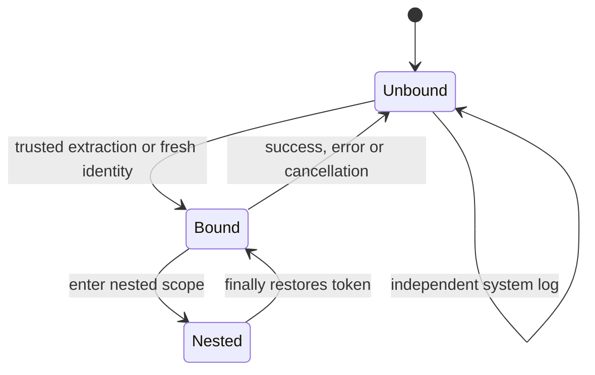
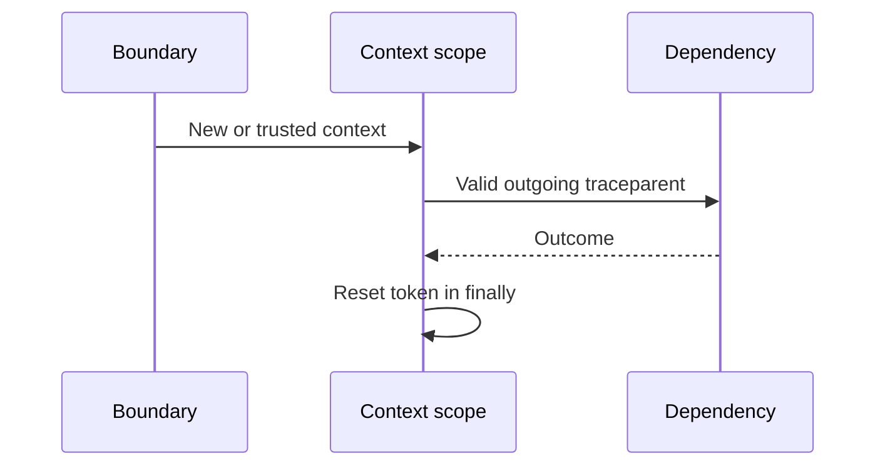
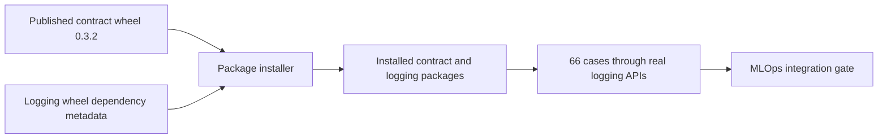

# Python logging package — design and validation

## 1. Verdict

- Mode: **Implement**. Scope: contract dependency, context scopes, log handler and wheel.
- Package validation precedes MLOps integration #796; jobs/retries #797 waits for that service gate.
- No deployed service, collector, provider, exporter or business protocol is changed.

### Seven-discipline readiness scorecard

| Discipline | Status | Evidence |
|---|---|---|
| 1 · Technical design | ✅ | Pinned schema, OpenTelemetry context and standard logging |
| 2 · Distributed systems | ✅ | No distributed coordinator; metadata helpers do not persist business work |
| 3 · Test coverage | ⚠️ | QA1: package tests pass; live service adoption remains unverified |
| 4 · Monitoring and alerts | ⚠️ | QA1: service must expose dropped-record counter and validate Loki fields |
| 5 · CI/CD | ⚠️ | OPS1: wheel publication follows review/merge |
| 6 · Security | ✅ | Explicit trust, no baggage, approved custom fields, no rejected-payload echo |
| 7 · Operations | ⚠️ | PERF1: service-specific stdout latency and loss budget remains an adoption gate |

### What is already right

| Strength | Evidence |
|---|---|
| Same contract across languages | Release-pinned schema/vectors; actual API observations checked by released checker |
| Future span compatibility | Existing recording child retains IDs and sampling in test |
| No hidden global setup | Explicit handler installation; no provider/exporter registration |

## 2. System and lifecycle



| Resource | Identity / owner | Lifetime / dependency |
|---|---|---|
| Contract dependency | Version + digest; contract maintainers | Installed package lifetime; schema/vector/checker from approved wheel |
| Context scope | OTel token; current execution | Enter to finally; no business authority |
| Log handler | Logger + immutable config; service startup | Install to owner removal/close; shared stream not closed |
| Record | Timestamp + active trace if present | Build, validate, write or discard |

| System profile | Decision |
|---|---|
| Datastore / isolation | No DB; context-local OTel state, logger/handler locks |
| Work execution | Synchronous formatting/write; async context cleanup in caller scope |
| Regions / tenancy | Deployment config supplies region/environment; trace ID grants no access |
| Retention | Release archives retained; emitted logs use existing collector retention |
| Integrity | Pinned dependency URL/hash; package validates contract digest at import |

| From | Action / guard | Serialization / write | To | Recovery |
|---|---|---|---|---|
| Unbound | Boundary chooses trusted flag | OTel context attach token | Bound | Finally detaches |
| Bound | Nested work | New token | Nested | Restore prior scope, including exceptions |
| Bound | Queue work | Caller persists outgoing header | Unbound after completion | Worker explicitly restores metadata; persistence is service work |
| No handler | Install validated config | Package install lock and logger addHandler | Installed | Same config returns existing handler; conflict fails |
| Record created | Schema and byte validation | Handler lock protects write/drop count | Written or dropped | No retry; fixed counter, no input echo |

| Dependency | Authority / policy | Outage or failure |
|---|---|---|
| Contract → release | Approved wheel pin; install automatically | Bad hashes block build/startup; no runtime network |
| Context → OTel API | Existing active context | No provider required; missing context means system log |
| Handler → stdout | Service-owned stream | Exceptions counted; blocking writes inherit stream behavior |
| Service → library | Pinned wheel | Roll back package pin/image; do not import SDK source |

| Contention | Winner / loser | Deterministic evidence |
|---|---|---|
| Two installs on same logger | One handler; identical call reuses | Barrier-controlled install test |
| Interleaved async requests | Each retains its active ID | Events force overlap; cancelled task resets |
| Reused worker threads | Explicit scope restored per attempt | Thread pool with metadata roundtrip |
| Existing recorded child | Existing child supplies context | Real local SDK tracer test, no exporter |

| Interrupted phase | Evidence / recovery | Bound |
|---|---|---|
| Context scope raises/cancels | finally resets token | Scope exit; no retry loop |
| Invalid log/failed stream write | dropped_records increments | One emission; no retry |
| Stream blocks | Caller remains blocked | PERF1: service owns stream budget; no false zero-latency claim |
| Build interrupted | No accepted published wheel | CI job timeout 10 minutes; rebuild |

- Child tasks inherit context at creation. Parent exit cannot erase their copy; detached work must enter a fresh/empty context.
- Handler shutdown is owner-managed. Installation does not change other handlers or logger propagation.
- Client action parity: **N/A**, no tenant API or console is introduced.

## 3. Core flows

### Flow 1 · Correlation context



| Principle | Status | Evidence / limit |
|---|---|---|
| Extendability | ✅ | W3C context supports future spans without a parallel trace-ID store |
| Availability | ✅ | No backend/exporter needed |
| Scalability | ✅ | Context-local state, no global request lock |
| Reliability | ✅ | Scope cleanup, retries and malformed input tests |
| Performance | ✅ | Header length capped at 512; bounded identity creation |
| Maintainability | ✅ | Uses OTel API rather than custom propagation protocol |
| Security | ✅ | Boundary decides trust; public input resets; no baggage |
| Concurrency | ✅ | Async cancellation/interleaving and thread tests |
| Failure tolerance | ✅ | Finally restores prior context, including nested scopes |

### Flow 2 · Log emission

| Principle | Status | Evidence / limit |
|---|---|---|
| Extendability | ✅ | Approved custom fields; common builder for exporter adapters |
| Availability | ⚠️ | PERF1: synchronous stdout can block |
| Scalability | ✅ | No background queue growth; handlers use normal logging locks |
| Reliability | ✅ | Strict invalid-record rejection; failed sink does not raise to caller |
| Performance | ⚠️ | PERF1: two validation passes favor safety; measure in service workload |
| Maintainability | ✅ | JSON Schema drives field validation; no service-specific rule copies |
| Security | ✅ | No automatic exception payload or arbitrary-extra logging; messages remain caller responsibility |
| Concurrency | ✅ | Standard handler lock; startup lock tested with barrier |
| Failure tolerance | ✅ | Dropped-record count; no recursive error logging or silent retry |

### Flow 3 · Build and adoption

| Principle | Status | Evidence / limit |
|---|---|---|
| Extendability | ✅ | Independent package and contract identities |
| Availability | ✅ | Vendored pinned release; no runtime fetch |
| Scalability | ✅ | Small reusable wheel; no application traffic in CI |
| Reliability | ✅ | Source tests plus installed-wheel tests and installed contract integrity check |
| Performance | ✅ | Contract loaded once; no per-call schema download |
| Maintainability | ✅ | Existing uv/Hatch tooling and SDK release path |
| Security | ⚠️ | OPS1: publication and repository protections remain release-owner work |
| Concurrency | ✅ | Independent CI matrix workspaces; no release in PR CI |
| Failure tolerance | ✅ | Invalid pin/build/test blocks promotion; existing services unchanged |

## 4. Dependencies

| Dependency | Purpose | HA / failure / access |
|---|---|---|
| jsonschema | Execute released Draft 2020-12 rules | New runtime dependency; exact version locked for testing |
| OpenTelemetry API | Context propagation | Existing workspace technology; SDK test-only |
| GitHub release | Contract acquisition and later wheel publication | Authorized build-time access; no runtime credentials |
| Python standard logging | Record transport | Stream failures counted; slow stream PERF1 |

### Data layer

| Concern | Assessment |
|---|---|
| Indexes, query shapes, connections, migrations | Not applicable: no database or migration |
| Locking | Context-local tokens and tested handler install lock |
| Caching | Local pinned schema; no remote cache |

- Database indexes, foreign keys, SQL, Redis and durable coordinators: **N/A**.
- HTTP client/framework instrumentation is not installed by this package.
- Do not change business resource lifecycles, auth checks or tenant scoping for correlation.

## 5. Findings catalog

| ID | Priority / remaining work | Owner / solution | Status |
|---|---|---|---|
| QA1 | P2 adoption gate: no deployed MLOps proof | MLOps #796 integrates middleware/export mapping, exposes drop counter and runs authorized Loki raw tests | Not started; blocks service-compliance claims, not package review |
| OPS1 | P2 release gate: package wheel not published | SDK owner approves release after merge; verify downloaded wheel and retained artifacts | Not started; blocks released-package consumption |
| PERF1 | P2 adoption gate: stdout can block and delivery can lose logs | Service owner measures latency/volume/drop budget with real collection | Not started; blocks production adoption without an accepted budget |

## 6. Validation

| Check | Assertion |
|---|---|
| 66 shared cases | Actual package API observations; rejected-case mutation must fail checker |
| Logger output | Required fields, canonical context, custom fields, system logs without trace ID |
| Failure paths | Invalid config fails early; bad logs/sink failures do not leak or raise |
| Context | Nested exception, cancellation, concurrency, worker reuse and retry identity |
| Future tracing | Real recording child and sampled parent preserved |
| Wheel | Installed artifact resolves the pinned contract dependency and runs shared tests |
| Raw probe | Four records; two attempts share ID; unrelated record has none |

```bash
bash scripts/check-python-observability.sh
# Existing workspace regression suite after uv sync --all-extras --group dev --frozen:
python/.venv/bin/python -m pytest python/packages -q
```

- Source and clean installed-wheel suites: 16 tests pass on Python 3.11 and 3.14. The wheel automatically installs contract 0.3.2.
- Full SDK regression: 221 tests and 38 subtests pass with the updated dependency.
- All 66 shared cases passed; this is package behavior evidence, not just manifest integrity.
- Local raw probe and missing-trace negative control passed. Live test-cluster/Loki lane **NOT RUN**; see raw_tests/README.md and QA1.

### Distributed-systems protocol

Distributed-systems protocol — not applicable: no durable jobs, database leases or distributed writes in this package; metadata persistence belongs to service integration.

## 7. Recommended sequence

### Phase 1 — package release

- [ ] OPS1 — Merge reviewed package; publish and verify a versioned wheel.

### Phase 2 — MLOps API adoption

- [ ] QA1 — Pin wheel in #796; validate propagation, final log mapping and authorized live lookup.
- [ ] PERF1 — Measure and accept stdout latency, record volume and drop/retention budget before production adoption.

Only after #796 service gate passes may #797 jobs/retries proceed.

| Rollout | Current behavior | New behavior | Validation / rollback |
|---|---|---|---|
| Package PR | MLOps unchanged | Reusable library exists | Package tests; no deployed rollback |
| Package release | No new wheel consumed | Installable pinned artifact | Wheel checks; retain previous releases |
| MLOps follow-up | Existing logging | Common enrichment and boundary integration | QA1/PERF1; roll back image/package pin |

## 8. Decision and approval gates

| Gate | Evidence | Findings |
|---|---|---|
| Package merge | Shared cases, behavioral tests, installed-wheel checks and hosted CI | None |
| Wheel consumption | Approved release and verified downloaded artifact | OPS1 |
| MLOps production adoption | Real field mapping, authorized Loki lookup and accepted performance budget | QA1, PERF1 |

### Checked and not found

| Suspected failure | Evidence |
|---|---|
| Public caller controls trace identity | Shared context cases reset untrusted input |
| Custom field overrides deployment environment | Actual logger and rejected-field tests |
| Cancellation leaks context | Interleaved task test checks finally cleanup |
| Logging error exposes exception payload | Failed sink and formatting tests check empty stderr |
| Library disables existing spans | Recorded-child test preserves parent ID and sampling |

## 9. Lifecycle coverage


| Contract area | Assessment |
|---|---|
| C1 dependencies | ✓ Pinned contract, OTel context, service-owned stream |
| C2 state machine | ✓ Context and handler transitions above |
| C3 usage ownership | ✓ Scope token and handler owner explicit |
| C4 concurrency | ✓ Context-local storage, install lock and handler lock tests |
| C5 durable async | N/A: no job persistence; metadata helper only |
| C6 external effects | OPS1: publication later; stdout effect documented |
| C7 repair | ✓ Context cleanup and failed-log counting; no hidden retry |
| C8 retries | ✓ Metadata preserves trace identity; attempt remains separate |
| C9 tenancy / client parity | N/A: no authorization or console; trace never grants access |
| C10 observability | QA1: service exposes drop counter; raw probe supplied |
| C11 evolution | ✓ Approved artifact pin; existing recording spans preserved |

| Race row | Assessment / reason |
|---|---|
| R1 | N/A: no resource delete/claim/lease or distributed worker mutation in this library |
| R2 | N/A: no resource delete/claim/lease or distributed worker mutation in this library |
| R3 | N/A: no resource delete/claim/lease or distributed worker mutation in this library |
| R4 | N/A: no resource delete/claim/lease or distributed worker mutation in this library |
| R5 | N/A: no resource delete/claim/lease or distributed worker mutation in this library |
| R6 | N/A: no resource delete/claim/lease or distributed worker mutation in this library |
| R7 | N/A: no resource delete/claim/lease or distributed worker mutation in this library |
| R8 | N/A: no resource delete/claim/lease or distributed worker mutation in this library |
| R9 | N/A: no resource delete/claim/lease or distributed worker mutation in this library |
| R10 | N/A: no resource delete/claim/lease or distributed worker mutation in this library |
| R11 | N/A: no resource delete/claim/lease or distributed worker mutation in this library |
| R12 | N/A: no resource delete/claim/lease or distributed worker mutation in this library |
| R13 | N/A: no resource delete/claim/lease or distributed worker mutation in this library |
| R14 | N/A: no resource delete/claim/lease or distributed worker mutation in this library |
| R15 | N/A: no resource delete/claim/lease or distributed worker mutation in this library |
| R16 | N/A: no resource delete/claim/lease or distributed worker mutation in this library |
| R17 | N/A: no resource delete/claim/lease or distributed worker mutation in this library |
| R18 | N/A: no resource delete/claim/lease or distributed worker mutation in this library |
| R19 | N/A: no resource delete/claim/lease or distributed worker mutation in this library |
| R20 | N/A: no resource delete/claim/lease or distributed worker mutation in this library |
| R21 | N/A: no resource delete/claim/lease or distributed worker mutation in this library |
| R22 | N/A: no resource delete/claim/lease or distributed worker mutation in this library |
| R23 | N/A: no resource delete/claim/lease or distributed worker mutation in this library |
| R24 | N/A: no resource delete/claim/lease or distributed worker mutation in this library |
| R25 | N/A: no resource delete/claim/lease or distributed worker mutation in this library |
| R26 | N/A: no resource delete/claim/lease or distributed worker mutation in this library |
| R27 | N/A: no resource delete/claim/lease or distributed worker mutation in this library |
| R28 | ✓ Bundle hashes and installed-wheel tests prevent accidental contract-generation drift |

## Contract dependency migration



| Concern | Before | After |
|---|---|---|
| Schema ownership | Copied `_contract` folder inside logging package | Generated `onenexus-log-contract` dependency |
| Upgrade | Download archive and run custom vendor script | Change dependency URL/version/hash; run `uv lock` |
| Contract constants | Repeated in logger source | Read from verified contract manifest |
| Tests | Read copied cases | Read installed dependency cases and checker |
| Integrity failure | Logger rejects copied-data corruption | Logger import fails when installed dependency data is corrupted |
| Runtime | Local files | Local installed files; no request-time download |

- Contract release `log-correlation-v0.3.2` is published and verified. This closes only the contract-distribution prerequisite; OPS1 still covers publication of the logging wheel.
- The clean installation test resolves dependencies from the logging wheel's metadata. It cannot succeed by relying on a source-tree `_contract` copy.
- Existing context/lifecycle and service-adoption gates above still apply.
