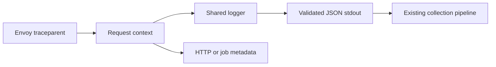

# OneNexus TypeScript logging

**Opt-in structured logging for Node.js services.** Runs the same behavior scenarios as Python, Go and .NET.



| Package | Responsibility |
|---|---|
| `@onenexus-team/observability` | Context isolation, safe fields, JSON output and bounded pending writes |

After an approved SDK release, install `@onenexus-team/observability@<released-sdk-version>` from the existing private GitHub npm registry. Validation rules are included in this package. Commit the consuming service's lockfile.

## Use in a service

```ts
import { createLogger, withIncomingContext, outgoingHeaders } from '@onenexus-team/observability';

const logger = createLogger({
    service: 'utility',
    environment: 'development', // development | staging | prod
    region: 'region-1',
    allowedFields: ['operation_id', 'attempt'],
});

// Decide trust from deployment/authenticated-peer policy, never a client header.
await withIncomingContext(Object.entries(request.headers), { trusted: isTrustedGateway }, async () => {
    logger.log('Request accepted', { event: 'request.accepted', outcome: 'success' });
    await callDependency({ headers: outgoingHeaders() });
});

// During application shutdown, after stopping new work:
const drained = await logger.close(1000);
// Export logger.stats() via the service's metrics; do not recursively log drops.
```

| Rule | Behavior |
|---|---|
| Common fields | `timestamp`, `level`, `service`, `environment`, `region`, `message` |
| Valid trusted context | Adds the canonical `trace_id`; forwards W3C `traceparent` |
| Missing / invalid / duplicate / untrusted context | Allows work, emits uncorrelated logs; no replacement trace generated |
| Timestamp | Unix nanosecond units, millisecond clock resolution; exact JSON integer |
| Custom fields | Up to 32 configured names, scalar JSON values; cannot replace common fields |
| Context cleanup | `AsyncLocalStorage.run`; nested, async, exception and cancellation paths restore the caller's context |
| Independent work | Start with `withUncorrelatedContext`; detached tasks otherwise inherit their creator's context |
| Durable work | Save `outgoingHeaders()` with the job; restore with `withIncomingContext` for each attempt |
| Retries | Retain job context; log operation ID and attempt separately; SDK does not own retries |
| Edge-only generation | `withEdgeContext` implements the shared edge contract; business services must not use it as fallback |
| Later spans | Existing matching OTel active child is honored; application owns its context manager/provider/exporter |

## Operational limits

- Importing this package does not replace `console`, NestJS logging, existing handlers, or OTel providers.
- Create one logger per service/sink during startup. Utility's NestJS adapter is a separate integration.
- `log()` returning `true` means submitted to the stream, **not received by Loki**.
- Honors Node stream backpressure; caps pending callbacks at 128 records, each at most 4,096 bytes plus newline. No SDK queue or retries.
- Invalid records, overload, I/O failure and calls after close return `false` and increment separate counters. No rejected payload is printed.
- `flush()` waits for stream callbacks, with a 1-second default and 30-second maximum deadline. Concurrent flushes share the first caller's deadline.
- `close()` stops acceptance and flushes once. It does not close the application's stream. On timeout, pending callbacks remain bounded; their listener is removed after completion/stream close.
- Process death can lose pending logs. `stdout` may block synchronously on some destinations; measure application latency/drop budgets before production.
- Messages and approved field values must be safe. The SDK does not recognize or redact secrets embedded in caller-supplied text. No automatic exception/body/header serialization.
- W3C version `00` supported; baggage and tracestate are intentionally not forwarded.
- Node.js >24.17; ESM and CommonJS consumers share one runtime entry point and context store. Avoid installing multiple SDK versions in the same process.

## Validation

```bash
pnpm --dir ts install --frozen-lockfile
bash scripts/check-typescript-observability.sh
```

See [raw tests](raw_tests/README.md) and [design and validation](../../../docs/logging-readiness.md). These package checks do not prove Utility adoption or live collection.
