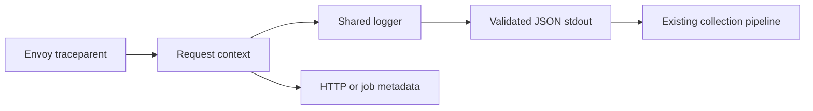

# OneNexus TypeScript logging

**Opt-in structured logging for Node.js services.** Runs the same behavior scenarios as Python, Go and .NET.



| Package | Responsibility |
|---|---|
| `@onenexus-team/observability` | Context isolation, safe fields, JSON output and bounded pending writes |

After an approved SDK release, install `@onenexus-team/observability@<released-sdk-version>` from the existing private GitHub npm registry. Validation rules are included in this package. Commit the consuming service's lockfile.

## Use in a service

```ts
import { createLogger, withIncomingContext, outgoingHeaders } from '@onenexus-team/observability';

const logger = createLogger({
    service: 'utility',
    environment: 'development', // development | staging | prod
    region: 'region-1',
    allowedFields: ['operation_id', 'attempt'],
});

// Decide trust from deployment/authenticated-peer policy, never a client header.
await withIncomingContext(Object.entries(request.headers), { trusted: isTrustedGateway }, async () => {
    logger.log('Request accepted', { event: 'request.accepted', outcome: 'success' });
    await callDependency({ headers: outgoingHeaders() });
});

// An Error adds its type and frames, never its message.
logger.log('Operation failed', { level: 'ERROR', error });

// During application shutdown, after stopping new work:
const drained = await logger.close(1000);
// Export logger.stats() via the service's metrics; do not recursively log drops.
```

| Rule | Behavior |
|---|---|
| Common fields | `timestamp`, `level`, `service`, `environment`, `region`, `message` |
| Valid trusted context | Adds the canonical `trace_id`; forwards W3C `traceparent` |
| Missing / invalid / duplicate / untrusted context | Allows work, emits uncorrelated logs; no replacement trace generated |
| Timestamp | Unix nanosecond units, millisecond clock resolution; exact JSON integer |
| Custom fields | Up to 32 configured names, scalar JSON values; cannot replace common fields |
| Too long | Message or string field over 1,024 UTF-8 bytes (`exception.stacktrace`: 2,048) is cut at a character boundary plus `…`; sets `logging.truncated: true` |
| Unknown / unsupported field | Removed, the line is kept; `logging.dropped_field_count` counts it (also non-scalar, accessor, beyond 32) |
| Record over 4,096 bytes | Stack shortened by whole frames, then largest custom fields removed and counted, until it fits |
| `error` option | `error.type` (error name) and `exception.stacktrace` (`at <function> (<file>:<line>)`, innermost first); caller-supplied values win; non-errors ignored; adds `logging.error_fingerprint` (`errorFingerprint`) |
| Context cleanup | `AsyncLocalStorage.run`; nested, async, exception and cancellation paths restore the caller's context |
| Independent work | Start with `withUncorrelatedContext`; detached tasks otherwise inherit their creator's context |
| Durable work | Save `outgoingHeaders()` with the job; restore with `withIncomingContext` for each attempt |
| Retries | Retain job context; log operation ID and attempt separately; SDK does not own retries |
| Edge-only generation | `withEdgeContext` implements the shared edge contract; business services must not use it as fallback |
| Later spans | Existing matching OTel active child is honored; application owns its context manager/provider/exporter |

## Operational limits

- Importing this package does not replace `console`, NestJS logging, existing handlers, or OTel providers.
- Create one logger per service/sink during startup. Utility's NestJS adapter is a separate integration.
- `log()` returning `true` means accepted into the write queue, **not received by Loki**. `log()` never waits on the output and never throws.
- Shared write model (`tests/logging/scenarios.json` `write_model`): a bounded queue of `QUEUE_CAPACITY` (1,024) lines feeds the stream; while the stream reports back-pressure lines stay queued and are written on `drain`. A full queue drops the line and counts `backpressure`. At most 128 lines are in flight to the stream; each line is at most 4,096 bytes plus newline. No retries.
- A failed write counts `io` and later lines are still written. A destroyed stream (Node's default on error), or a Node `Writable` that errored (it stays errored even with `autoDestroy: false`), cannot take more lines: queued and later lines count `io`.
- Counters: `written`, `invalid`, `backpressure` (queue full), `io`, `closed`, `pending` (accepted, not yet written or failed).
- Only a record that cannot be encoded, has an invalid message/event/outcome, or still exceeds 4,096 bytes is invalid. Invalid records, overload, I/O failure and calls after close return `false` and increment separate counters. No rejected payload is printed.
- `flush()` waits until nothing is pending, with a 1-second default and 30-second maximum deadline.
- `close(timeoutMs = CLOSE_TIMEOUT_MS)` (2 seconds) stops acceptance (later calls count `closed`) and drains until the deadline; it resolves `true` when nothing is pending and no line was given up during the wait (earlier losses do not count), otherwise `false`. A second close returns the same result. It does not close the application's stream. Lines still pending at the deadline stay counted and are written if the stream recovers.
- Known limits: on Linux, Node writes to pipes, TTYs and files synchronously, so a stalled stdout reader still blocks the event loop inside `log()`; the queue cannot help there (true before the queue too). A burst of more than 1,152 lines (128 in flight + 1,024 queued) in one tick to a fast synchronous sink drops the overflow, counted as `backpressure`.
- A stream that emitted `close` is treated as dead even if it still reports `writable` (stdout after EPIPE): later lines count `io` at once.
- Process death can lose pending logs. `stdout` may block synchronously on some destinations; measure application latency/drop budgets before production.
- Messages and approved field values must be safe. The SDK does not recognize or redact secrets embedded in caller-supplied text. No error message, body or header serialization.
- W3C version `00` supported; baggage and tracestate are intentionally not forwarded.
- Node.js >24.17; ESM and CommonJS consumers share one runtime entry point and context store. Avoid installing multiple SDK versions in the same process.

## Drop metric

Every line a logger does not write is counted once, process-wide, per `(service, reason)` (`tests/logging/scenarios.json` `drop_metric`, design review R1).

| API | Returns |
|---|---|
| `logDropCounts()` | `readonly DropCount[]` — `{ service, reason, count }`, sorted by service then reason |
| `dropMetricsText(counts?)` | Prometheus text for `onenexus_log_records_dropped_total{service, reason}` (default: the live snapshot), for a `/metrics` route |
| `registerDropMetric(meter)` | The `onenexus.log.records.dropped` asynchronous counter (unit `{record}`) on your `@opentelemetry/api` `Meter` |

| `reason` | Logger counter |
|---|---|
| `closed` | `closed` |
| `invalid` | `invalid` |
| `io_errors` | `io` |
| `queue_full` | `backpressure` |

- `service` is `LogConfig.service`. Creating a logger reports all four reasons for its service at 0.
- Loggers of one service are summed; the metric equals the sum of their `stats()` counters.
- Counts never decrease, also after `close()`; a process restart resets them.

## Validation

```bash
pnpm --dir ts install --frozen-lockfile
bash scripts/check-typescript-observability.sh
```

See [validation and releases](../../../docs/logging.md). Live service checks belong in the consuming repository.
