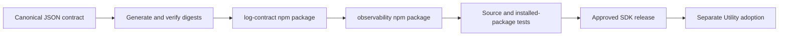
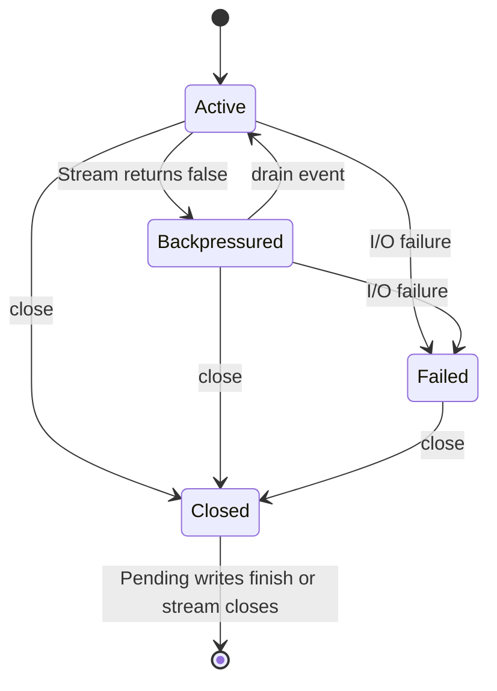
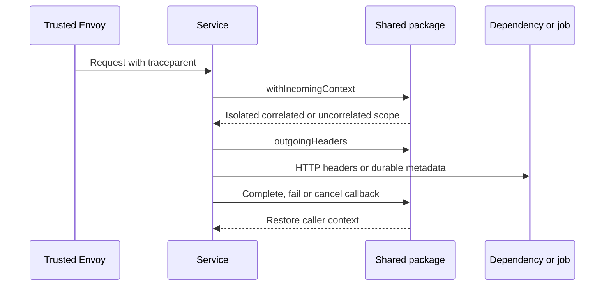
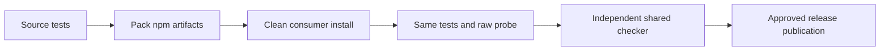

# Shared TypeScript logging — design and validation

## 1. Scope and verdict

- Mode: **Implement**. Resources: versioned contract, request context, logger and pending log records.
- **Local package gate: PASS. Hosted CI and publication are separate gates.** Utility rollout is a separate task: [platform #799](https://github.com/onenexus-team/one-nexus-ai-platform/issues/799).
- No service, database, collector, billing logic or authorization changes. No new span export.



### Seven-discipline readiness scorecard

| Discipline | State | Evidence / limit |
|---|---|---|
| 1 · Technical design + security | ✅ | Explicit boundary policy; canonical schema; field allowlist |
| 2 · Distributed systems | ✅ | No durable business state or remote coordinator |
| 3 · Tests | ⚠️ | QA1: package tests cover SDK behavior; live Utility remains separate |
| 4 · Monitoring + alerts | ⚠️ | QA1: consuming service must export drop counters and alert |
| 5 · CI/CD | ⚠️ | OPS1: source/artifact gates added; first registry release pending |
| 6 · Security | ✅ | No body/exception serialization or baggage; identity fields protected |
| 7 · Operations | ⚠️ | PERF1: production latency, drop and loss budgets need service measurements |

## 2. Lifecycle and dependencies

| System profile | Decision |
|---|---|
| Datastore / isolation | None; process-local ALS context and Node stream callbacks |
| Work execution | Synchronous validation and stream submission; bounded callbacks |
| Replicas / regions | Each consumer owns a local logger; no cross-replica state |
| Tenancy | Authenticated application owns tenant selection; trace ID grants no authority |
| Retention | SDK versioned releases; application log retention belongs to collection infrastructure |
| Integrity | Manifest SHA-256 checks at generation, locked packages, artifact tests |

| Resource | Identity / owner | Dependencies / lifetime |
|---|---|---|
| Contract artifact | SDK version + contract version/digest; SDK release owner | Canonical schema; immutable after publication |
| Context | Async execution; caller | Trusted `traceparent` or explicit uncorrelated scope |
| Logger | One per process/sink; application | Immutable identity, contract package, caller-owned stream |
| Record | One log call; logger | Context captured before submission; written/dropped once |



| From | Operation / guard | Atomic change | Side effect / recovery |
|---|---|---|---|
| Unbound context | Valid trusted v00 header | New ALS frame | Related calls/logs use same trace |
| Any context | Missing/invalid/untrusted boundary | Explicit empty frame | Never fall back to unrelated active span |
| Bound context | Callback returns/throws/rejects | ALS restores caller | Detached work owns its inherited context; reset explicitly |
| No logger | Validate config | Immutable config and stream listeners | Invalid config fails startup |
| Active logger | Valid record; capacity available | Pending token registered | Submit one line; callback removes token |
| Active logger | Invalid record or backpressure | Counter increment | Drop; no recursive log, retry or queue |
| Active logger | Stream error/close | Failed flag; settle pending count | Later writes rejected; app recreates logger after sink recovery |
| Active/failed logger | Close | Reject new writes | Bounded flush; never end caller stream |
| Closed logger | Late callback after timeout | Remove bounded pending token | Listeners detach after completion/stream close |

| Dependency edge | Authority / removal policy | Failure behavior |
|---|---|---|
| Logger → contract | Exact SDK package version; retained artifact | No runtime registry access; bad config fails startup |
| Scope → parent context | ALS owner; restore on callback exit | Errors/cancellation restore caller; child tasks must reset themselves |
| Logger → stream | Application owns stream; detach listeners, retain stream | Drop/count errors; at most 128 outstanding records |
| Application → registry | Release owner; immutable versions | Build/install fails when unavailable; running process unaffected |

| Contention / interruption | Mechanism and bound | Test / recovery |
|---|---|---|
| Two async requests | Separate ALS stores; barrier-controlled overlap | `concurrent_context_isolation` |
| Nested work or cancellation | ALS scope nesting; explicit empty frame | Exception/cancellation restore caller |
| Writes versus close | Synchronous state check before write; closed is terminal | Later calls counted as closed |
| Stream callbacks versus error | Pending token deleted at most once | No double counting; late errors caught |
| Missing stream callback | Flush deadline, default 1 second, max 30 seconds | False result; up to 128 callbacks retained until stream closes |
| Process death | No durability promise | Pending/partial logs may be lost; no automatic replay |
| Build/release interrupted | No application state | Rerun CI; never silently overwrite a published package |

- Decision: reuse existing AJV for JSON Schema; add OTel API for later active-child compatibility. Test SDK/context manager are dev-only.
- Decision: no NestJS/Pino dependency or global logger installation; framework adoption remains in Utility.
- Client action parity: N/A — SDK adds no API or UI actions.

## 3. Flows

### Flow 1 · Restore and forward context



| Dimension | State | Evidence / limit |
|---|---|---|
| Extendability | ✅ | W3C v00 plus compatible OTel child context |
| Availability | ✅ | No runtime network/exporter requirement |
| Scalability | ✅ | Per-execution state; no global request lock |
| Reliability | ✅ | Durable metadata roundtrip and explicit legacy empty context |
| Performance | ✅ | Header length 55; no propagated payload/baggage |
| Maintainability | ✅ | One boundary helper and outgoing API |
| Security | ✅ | Trust from application policy; reject duplicates/untrusted IDs |
| Concurrency | ✅ | Deterministic interleaving and nested exception/cancellation tests |
| Failure tolerance | ✅ | Missing context does not reject business work or invent IDs |

### Flow 2 · Validate and emit

```mermaid
sequenceDiagram
    participant A as Application
    participant L as Logger
    participant C as Contract
    participant O as Output stream
    A->>L: Safe message and approved fields
    L->>C: Validate schema and byte limits
    alt Invalid or backpressured
        L-->>A: false; increment counter
    else Accepted
        L->>O: One JSON line
        L-->>A: true; delivery still pending
        O-->>L: Callback success or failure
    end
    A->>L: close with deadline
    L-->>A: Drained or timed out
```

| Dimension | State | Evidence / limit |
|---|---|---|
| Extendability | ✅ | Approved scalar custom fields; common fields protected |
| Availability | ⚠️ | PERF1: Node stdout can block synchronously on some destinations |
| Scalability | ✅ | Honors drain; cap 128 records × 4,097 bytes; no private queue |
| Reliability | ✅ | Exact timestamp; valid schema or counted rejection |
| Performance | ⚠️ | PERF1: measure service throughput and overload loss budget |
| Maintainability | ✅ | Contract data generated; error codes safe and stable |
| Security | ✅ | No arbitrary object hooks, exception/header/body serialization |
| Concurrency | ✅ | Snapshot fields before write; close/write and error/callback tests |
| Failure tolerance | ⚠️ | QA1: service must observe counters; stdout success is not Loki delivery |

### Flow 3 · Release and install



| Dimension | State | Evidence / limit |
|---|---|---|
| Extendability | ✅ | New language uses same schema and shared vectors |
| Availability | ✅ | Installed packages work offline |
| Scalability | ✅ | Build-time generation; no per-request downloads |
| Reliability | ✅ | Source and artifact tests; wrong observations rejected |
| Performance | ✅ | AJV compiles immutable local schema once |
| Maintainability | ✅ | Existing pnpm workspace and SDK release versioning |
| Security | ⚠️ | OPS1: first authorized registry publication/restore still pending |
| Concurrency | ✅ | Isolated CI workspaces; existing release concurrency per tag |
| Failure tolerance | ✅ | Validation fails before new package publication |

## 4. Dependencies

| Dependency | Kind | Failure / access |
|---|---|---|
| AJV 8.20.0 | Existing workspace validator, runtime | Local schema compilation; no remote schema loading |
| OTel API 1.10.0 | Runtime | No global provider installed; ALS works without instrumentation |
| OTel trace SDK/context manager 3.0.0 | Test only | Real recorded child compatibility test; not bundled in runtime dependencies |
| GitHub npm registry | Build/release | Authenticated read/write packages; OPS1 |
| stdout and existing collection | Output | Best effort, finite buffers, possible process-crash loss; QA1/PERF1 |

### Data layer

Data layer — not applicable: no DB, foreign keys, indexes, queries, migrations, transactions, cache invalidation or business leases.

### What is already right

| Strength | Evidence |
|---|---|
| One schema source | Build reads canonical contract and verifies digests |
| No global logger replacement | Explicit createLogger and scoped context APIs |
| Package adoption remains explicit | No service dependency/config change in this PR |

## 5. Findings catalog

| ID | Priority / problem | Solution / owner | Status |
|---|---|---|---|
| OPS1 | P2: packages not yet published; clean local install does not prove registry access | SDK release owner publishes approved version and verifies normal registry install | Not started |
| QA1 | P2: no Utility integration/live collection proof in an SDK PR | Utility #799 wires middleware/logger/jobs, exposes drop counters and validates real test-cluster logs | Not started |
| PERF1 | P2: production stdout latency and acceptable drop/loss budget not measured | Consuming service owner measures latency under normal/stalled output and approves budgets before production | Not started |

## 6. Validation and checked risks

| Gate | Evidence |
|---|---|
| Contract | 56 record + 10 edge-context cases through real APIs; independent checker |
| Local results | 70 tests pass from source and again from installed packages; full TypeScript workspace packaging passes |
| Async lifecycle | Barriers, failure, cancellation, reused worker, retry metadata |
| Phase-2 compatibility | Real OTel recorded child retains trace and changes outgoing parent ID |
| Output | Common fields, exact timestamp, unsafe values, overload/drain/error/close/deadline |
| Artifact | Temporary consumer installs packed packages, runs same tests, ESM/CJS and type checks; mixed imports share one context store |
| Raw probe | Four real SDK outputs; wrong trace/service and false schema observation rejected |
| Real Utility / Loki | NOT RUN; separate adoption gate QA1 |

```bash
pnpm --dir ts install --frozen-lockfile
pnpm --dir ts package
bash scripts/check-typescript-observability.sh
bash scripts/check-log-contracts.sh
```

### Checked and not found

| Suspected bug | Evidence |
|---|---|
| Inventing a service trace | Missing/untrusted/duplicate tests produce no trace |
| Request mixing | Controlled ALS overlap; each request keeps its own ID |
| Old worker context leaks | Metadata roundtrip plus empty legacy scope |
| Timestamp rounding | bigint encoding and int64 boundary tests |
| Unsafe object executes during serialization | Getter/toJSON/cycle rejection tests |
| Logging outage creates unbounded queue | Drain and 128-callback cap tests |
| Closing logger closes stdout | Stream ownership assertion after close |
| Source tests hide bad package exports | Same tests in isolated installed consumer; ESM/CJS resolution |

### Distributed-systems protocol

Distributed-systems protocol — not applicable: the SDK creates no durable business jobs, leases or external resource mutations. Applications own durable metadata persistence and business retry semantics.

## 7. Recommended sequence

### Phase 1 — release

- [ ] OPS1 — Merge after package CI, publish an explicitly approved SDK version, verify registry install.

### Phase 2 — Utility adoption

- [ ] QA1 — Integrate and validate real API/jobs/collection; expose drop counters.

### Phase 3 — production readiness

- [ ] PERF1 — Measure and accept service latency and log loss budgets before production activation.

## 8. Decision and approval gates

| Gate | Required evidence |
|---|---|
| Merge SDK PR | Source, installed artifacts, raw probe, shared cases, lint/types and regression CI pass |
| Publish | Explicit approved new SDK release; OPS1 |
| Enable in development | Published version pinned; service adoption PR and authorized raw tests; QA1 |
| Enable in production | Service latency/loss budget and rollback verified; PERF1 |
| Rollback | Disable service integration or restore its previous package pin; no DB migration |

- Existing services remain unchanged until they consume and enable the package.
- Package PASS is not a claim that every Utility, billing, CAS or monitoring path emits correlated logs.

## 9. Lifecycle coverage

| Contract area | Mark / evidence |
|---|---|
| C1 | ✓ Dependency table: artifacts retained, context restored, stream retained |
| C2 | ✓ Context and logger state/transition tables |
| C3 | ✓ Caller owns scope/logger; Node owns pending write callbacks |
| C4 | ✓ ALS isolation and synchronous acceptance/close state checks |
| C5 | N/A: no durable business transitions; metadata persistence is service-owned |
| C6 | ✓ One stdout submission, no replay; no destructive effects/cascades |
| C7 | ✓ I/O errors fail closed; service recreates sink/logger; no SDK retry |
| C7.1 | ✓ Flush has deadline; pending callbacks bounded; no durability claim |
| C8 | N/A: no business resource retention/purge |
| C9 | ✓ Boolean submission/flush result, stable validation codes; no UI actions |
| C10 | ✓ Counters available; service alert wiring tracked by QA1 |
| C11 | ✓ Versioned package pins; opt-in adoption; rollback has no DB impact |

| Race | Mark / scope reason |
|---|---|
| R1 | N/A — no usage claims/delete jobs |
| R2 | N/A — no delete fence |
| R3 | N/A — no durable delete intent; close idempotence tested separately |
| R4 | N/A — SDK does not claim/deduplicate business jobs |
| R5 | N/A — no database/broker writes |
| R6 | N/A — no external teardown |
| R7 | N/A — no teardown finalization |
| R8 | N/A — no shared usage claims |
| R9 | N/A — no shared lease/refcount |
| R10 | N/A — no leased writer |
| R11 | N/A — no resource dependents |
| R12 | N/A — no reconciler |
| R13 | N/A — no cascade |
| R14 | N/A — no intent projection |
| R15 | N/A — no destructive retry |
| R16 | N/A — no lease renewal |
| R17 | N/A — no natural-key resource generation |
| R18 | N/A — no parent/child deletion |
| R19 | N/A — no business artifact production |
| R20 | N/A — no archive/restore/purge |
| R21 | N/A — no successor artifacts |
| R22 | N/A — no remote deletion authority |
| R23 | N/A — SDK changes no job type/claim version; service mixed-version proof belongs to QA1 |
| R24 | N/A — no cascade cursor |
| R25 | N/A — no irreversible external deletion; cancellation scope cleanup tested |
| R26 | N/A — no tenant offboarding mutation |
| R27 | N/A — no credentials created or propagated |
| R28 | N/A — no asynchronous business copy; record fields snapshot before stdout submission |
